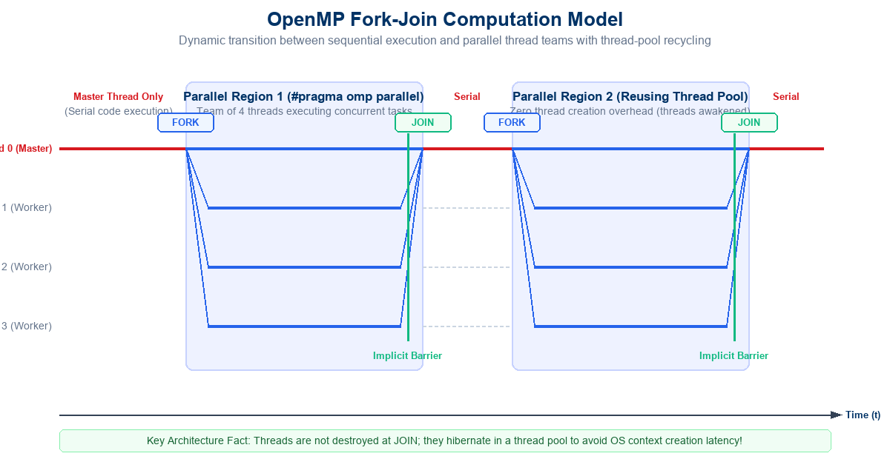
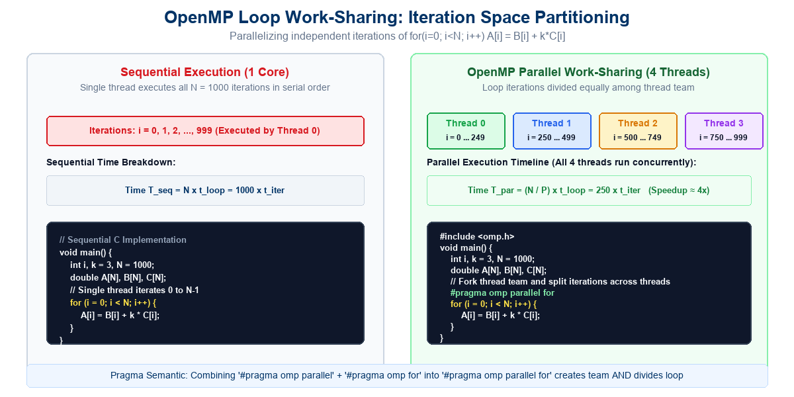
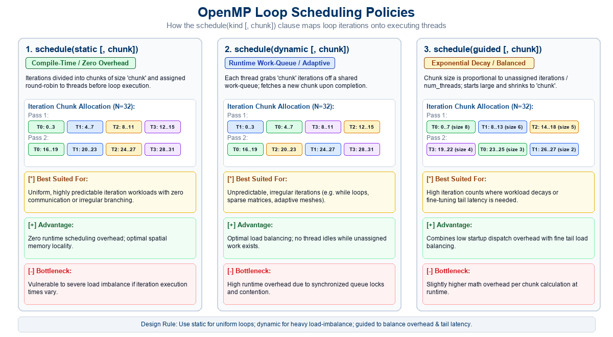
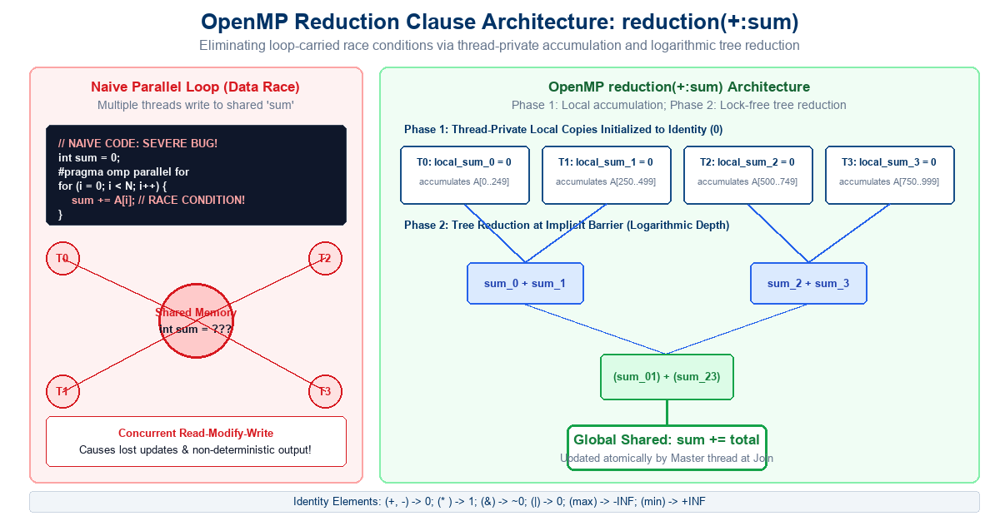
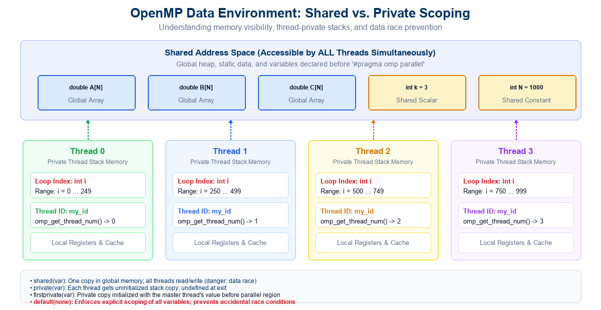

## Lecture Outline

:::: {.columns}

::: {.column width="50%"}
- **Shared-Memory Parallel Architectures**:
  - Symmetric Multiprocessors (SMP) & Multi-Core CPUs.
  - Uniform Memory Access (UMA) vs. Non-Uniform Memory Access (NUMA).
  - Explicit Threading (Pthreads) vs. Directive-Based (OpenMP).
- **The OpenMP Paradigm & Architecture**:
  - Multiplatform standard for C, C++, and Fortran.
  - Pragmas and compiler directives: `#pragma omp ...`.
  - Header file `<omp.h>` and compilation flags (`-fopenmp`).
- **The Fork-Join Computation Model**:
  - Master thread (Thread 0) and Worker thread teams.
  - Structured blocks and implicit synchronization barriers.
  - **Thread-Pool Recycling**: Avoiding OS kernel thread creation cost.
- **Loop Work-Sharing (`#pragma omp parallel for`)**:
  - Identifying computationally intensive loops.
  - Iteration space partitioning across threads.
  - Canonical loop form and parallel execution constraints.
:::

::: {.column width="50%"}
- **Loop Scheduling Policies (`schedule` clause)**:
  - `schedule(static [, chunk])`: Predictable round-robin mapping.
  - `schedule(dynamic [, chunk])`: Work-queue dynamic load balancing.
  - `schedule(guided [, chunk])`: Exponentially decaying chunk sizes.
  - Architectural trade-offs: Synchronization overhead vs. Idle time.
- **Data Scoping & Environment (`shared` vs. `private`)**:
  - Global shared address space vs. Per-thread private stack frames.
  - Unsynchronized writes and data races.
  - Scoping clauses: `shared`, `private`, `firstprivate`, `lastprivate`, `default(none)`.
- **The Reduction Bottleneck & `reduction` Clause**:
  - Loop-carried true data dependencies (`sum += A[i]`).
  - Thread-private accumulation and operator identity elements.
  - Lock-free logarithmic tree reduction at the join barrier.
- **Interactive Review Quizzes**:
  - **Quiz-1 (OpenMP Programming - Lec 15)**: 4 MCQs + Answer Keys.
  - **Quiz-2 (Graph Embedding & Mapping - Lec 14 Review)**: 4 MCQs + Answer Keys.
:::

::::

---

## The Shared-Memory Hardware Landscape

Modern computing systems—from laptops to supercomputer nodes—are fundamentally **shared-memory multiprocessor architectures**:

:::: {.columns}

::: {.column width="50%"}
### Hardware Characteristics
- **Multi-Core Processors**:
  - Multiple independent execution cores on a single silicon die.
  - Private L1/L2 caches per core; unified shared L3 cache.
- **Uniform Memory Access (UMA)**:
  - Symmetric Multiprocessors (SMP).
  - All cores access centralized DRAM with identical latency.
- **Non-Uniform Memory Access (NUMA)**:
  - Multi-socket server configurations.
  - Access to local socket memory is significantly faster than remote socket memory.
:::

::: {.column width="50%"}
### The Programming Challenge
- **Global Physical Address Space**:
  - Every processor core can read from and write to any memory byte in the system.
- **Communication by Shared State**:
  - Threads communicate by modifying memory locations in the shared heap or global segment.
- **The Concurrency Hazards**:
  - Uncoordinated concurrent writes lead to **data races**, lost updates, and corrupted memory states.
  - Hardware cache coherence protocols (MESI/MOESI) can suffer from **false sharing**!
:::

::::

<div style="margin-top: 15px; padding: 10px 18px; background-color: #f1f5f9; border-left: 5px solid #003366; border-radius: 4px; font-size: 0.9em;">
  <strong>Fundamental Question:</strong> How can software developers write parallel programs that exploit multi-core CPUs without getting bogged down in low-level OS thread management, mutual exclusion locks, and race conditions?
</div>

---

## Programming Shared Memory: Pthreads vs. OpenMP

Historically, programmers had to choose between low-level thread APIs and high-level compiler abstractions:

<div style="font-size: 0.88em; margin-top: 10px;">

| Feature / Dimension | POSIX Threads (Pthreads) | OpenMP (Open Multi-Processing) |
|:---|:---|:---|
| **Paradigm** | Explicit library API (`pthread_create`, `pthread_join`) | **Directive-based compiler pragmas** (`#pragma omp ...`) |
| **Level of Abstraction** | Low-level; hardware/OS thread control | **High-level; declarative parallelization** |
| **Portability** | Primarily Unix/Linux systems | **Multiplatform (Linux, Windows, macOS, Unix)** |
| **Incremental Parallelism** | **Impossible**: Requires complete code restructuring | **Seamless**: Parallelize loop-by-loop incrementally |
| **Code Verbosity** | High (dozens of boilerplate setup lines) | **Extremely Low** (often a single pragma line!) |
| **Thread Lifecycle** | Programmer manages thread allocation and destruction | **Runtime engine manages thread-pool automatically** |
| **Work Distribution** | Programmer computes index ranges manually | **Automatic work-sharing constructs (`parallel for`)** |
| **Languages Supported** | C and C++ | **C, C++, and Fortran** |

</div>

<div style="margin-top: 15px; padding: 10px 18px; background: #f0fdf4; border-left: 5px solid #16a34a; border-radius: 4px; font-size: 0.88em; color: #166534;">
  <strong>OpenMP Philosophy:</strong> Start with a correct, verified sequential program. Identify performance bottlenecks (computationally heavy loops), annotate them with compiler directives, and let the compiler and runtime generate high-performance parallel machine code!
</div>

---

## OpenMP: Model of Computation (The Fork-Join Model)

OpenMP programs execute according to the **Fork-Join Model of Concurrency**:

:::: {.columns}

::: {.column width="50%"}
### 1. Serial Execution (Master Thread)
- The application begins execution as a single thread of control called the **Master Thread** (Thread ID = 0).
- The Master Thread executes all sequential portions of the code (I/O, setup, linear control flow) until it encounters an OpenMP parallel directive.

### 2. Fork Event (`#pragma omp parallel`)
- Upon reaching `#pragma omp parallel`, the Master Thread creates or awakens a **team of concurrent threads**.
- The Master Thread becomes the team leader ($T_0$), and $P-1$ worker threads ($T_1, \dots, T_{P-1}$) join the team.
- All threads execute the structured block concurrently across available physical CPU cores.
:::

::: {.column width="50%"}
### 3. Join Event (Implicit Barrier)
- At the closing brace `}` of the parallel region, OpenMP enforces an **implicit synchronization barrier**.
- Faster threads stall until the slowest thread completes its computational slice.
- Once all threads reach the barrier, worker threads yield, and **only the Master Thread resumes** serial execution.

### 4. Thread-Pool Recycling Mechanics
- <span style="color: #d71920; font-weight: bold;">Crucial Architectural Reality:</span> OpenMP does **NOT** destroy threads at the join barrier and create new OS threads at the next fork!
- Creating kernel threads via OS context calls takes hundreds of microseconds.
- Instead, OpenMP maintains a **reusable Thread Pool**: worker threads hibernate (spin-wait or sleep) and are awakened instantly when needed.
:::

::::

---

## Visualizing the OpenMP Fork-Join Execution Model

{width="94%" fig-align="center"}

---

## OpenMP Syntax & Directives Structure

In C and C++, OpenMP directives are written using the standard C preprocessor `#pragma` mechanism:

```c
#pragma omp construct [clause [clause] ...]
```

:::: {.columns}

::: {.column width="50%"}
### Key Syntax Rules
- **Pragma Prefix**:
  - Always begins with `#pragma omp`.
  - Compilers without OpenMP support simply ignore `#pragma omp` directives, ensuring **seamless serial portability**!
- **Constructs**:
  - Specifies the core parallel action: `parallel`, `for`, `sections`, `single`, `barrier`, `atomic`, `critical`.
- **Clauses**:
  - Modifies construct behavior: data scoping (`shared`, `private`), scheduling (`schedule`), reduction (`reduction`), conditional execution (`if`).
- **Structured Block**:
  - A directive applies to the immediately following statement or brace-enclosed `{ ... }` block. Must have **single entry and single exit**.
:::

::: {.column width="50%"}
### Header & Compilation Details
- **Header File**:
  ```c
  #include <omp.h>
  ```
  - Declares OpenMP runtime API functions and data types.
- **Compiler Flags**:
  - **GCC / Clang**: `-fopenmp`
    ```bash
    gcc -O3 -fopenmp my_prog.c -o my_prog
    ```
  - **MS Visual Studio**: `/openmp`
  - **Intel oneAPI**: `-qopenmp`
- **Conditional Compilation**:
  ```c
  #ifdef _OPENMP
      printf("Running OpenMP Version: %d\n", _OPENMP);
  #endif
  ```
:::

::::

---

## Introductory Example: Loop Parallelization

Most scientific and engineering applications spend over 90% of execution time inside tight numerical loops:

:::: {.columns}

::: {.column width="50%"}
### Sequential C Implementation
```c
// Sequential Program (Single Core)
void main()
{
    int i, k = 3, N = 1000;
    double A[N], B[N], C[N];

    // Single thread iterates sequentially
    for (i = 0; i < N; i++) {
        A[i] = B[i] + k * C[i];
    }
}
```
- **Execution**:
  - A single core runs iterations $i = 0, 1, \dots, 999$ one by one.
  - Runtime: $T_1 = N \cdot t_{\text{iter}}$.
:::

::: {.column width="50%"}
### OpenMP Parallel Program
```c
#include <omp.h>
void main()
{
    int i, k = 3, N = 1000;
    double A[N], B[N], C[N];

    // Parallelize loop across thread team
    #pragma omp parallel for
    for (i = 0; i < N; i++) {
        A[i] = B[i] + k * C[i];
    }
}
```
- **Execution**:
  - `#pragma omp parallel for` forks a team of threads.
  - Iteration space $[0, N-1]$ is divided among threads.
  - On 4 cores, each thread computes 250 iterations in parallel: $T_P \approx T_1 / 4$.
:::

::::

<div style="margin-top: 15px; padding: 10px 18px; background: #fff7ed; border-left: 5px solid #ea580c; border-radius: 4px; font-size: 0.88em; color: #7c2d12;">
  <strong>Notice the Elegance:</strong> We converted a sequential program into a high-performance multi-threaded parallel program by adding <strong>exactly one header file</strong> and <strong>one compiler directive</strong>!
</div>

---

## Visualizing Loop Work-Sharing

{width="94%" fig-align="center"}

---

## Parallel Loops: Canonical Form Constraints

To allow OpenMP to partition loop iterations deterministically, loops must adhere to the **Canonical Loop Form**:

```c
for (index = start; index < end; index += step)
```

:::: {.columns}

::: {.column width="50%"}
### Canonical Requirements
1. **Loop Variable (`index`)**:
   - Must be a signed or unsigned integer (or pointer in C++).
   - Automatically treated as **private** to each thread!
2. **Iteration Bounds (`start`, `end`, `step`)**:
   - Must be loop-invariant expressions (cannot change during loop execution).
3. **Trip Count Computability**:
   - The runtime must calculate the total iteration count:
     $$\text{Iterations} = \left\lfloor \frac{\text{end} - \text{start} + \text{step} - 1}{\text{step}} \right\rfloor$$
     **before** parallel execution commences!
:::

::: {.column width="50%"}
### Prohibited Loop Patterns
- **Early Exits (`break`, `return`, `goto`)**:
  ```c
  #pragma omp parallel for
  for (i = 0; i < N; i++) {
      if (A[i] == target) break; // COMPILER ERROR!
  }
  ```
  - Prohibited because threads cannot terminate other threads' iteration spaces arbitrarily.
- **While Loops & Pointer Chasing**:
  - Linked list traversals (`while (curr != NULL)`) cannot be parallelized with standard `omp for` (must use OpenMP tasks).
:::

::::

<div style="margin-top: 12px; padding: 8px 16px; background: #f8fafc; border-left: 4px solid #003366; border-radius: 4px; font-size: 0.88em;">
  <strong>Combined Construct:</strong> `#pragma omp parallel for` is syntactic sugar for a `#pragma omp parallel` construct immediately enclosing a `#pragma omp for` work-sharing construct!
</div>

---

## Classification of OpenMP Constructs

OpenMP constructs are grouped into five primary functional categories:

:::: {.columns}

::: {.column width="50%"}
### 1. Parallel Regions
- `#pragma omp parallel`:
  - The fundamental construct that creates a team of threads.
  - Code inside is duplicated across all threads unless a work-sharing construct is used.

### 2. Work-Sharing Constructs
- `#pragma omp for`:
  - Divides loop iterations among the existing thread team.
- `#pragma omp sections`:
  - Divides distinct structured blocks among threads (Task Parallelism).
- `#pragma omp single`:
  - Designates a block executed by only **one** thread in the team (useful for I/O).
:::

::: {.column width="50%"}
### 3. Data Environment Clauses
- Control variable visibility and memory allocation:
  - `shared(list)`: Shared global access.
  - `private(list)`: Thread-private uninitialized copy.
  - `firstprivate(list)`: Private copy initialized from master.
  - `default(none)`: Enforces explicit variable scoping.

### 4. Synchronization Constructs
- Coordinate thread progress and avoid data races:
  - `#pragma omp barrier`: Explicit team rendezvous.
  - `#pragma omp critical`: Mutual exclusion lock.
  - `#pragma omp atomic`: Hardware-level memory update.
:::

::::

---

## Runtime Functions & Environment Variables

Besides compiler directives, OpenMP provides a rich **Runtime API** and **Environment Variable control**:

:::: {.columns}

::: {.column width="50%"}
### Core Runtime Library Functions
- `#include <omp.h>` required:
  - `omp_get_num_threads()`:
    - Returns the number of threads currently executing the active parallel region.
  - `omp_set_num_threads(int n)`:
    - Dynamically configures the thread count for subsequent parallel regions.
  - `omp_get_thread_num()`:
    - Returns the unique integer ID of the calling thread: $[0, P-1]$.
  - `omp_get_wtime()`:
    - High-resolution wall-clock timer for precise performance benchmarking.
  - `omp_get_num_procs()`:
    - Returns the number of physical processor cores available on the system.
:::

::: {.column width="50%"}
### Key Environment Variables
- Configured in the shell before launching the application:
  - `export OMP_NUM_THREADS=8`
    - Sets default thread count across all parallel regions without recompiling!
  - `export OMP_SCHEDULE="dynamic,4"`
    - Overrides loop scheduling when `schedule(runtime)` is specified.
  - `export OMP_PROC_BIND=true`
    - Binds threads to specific physical CPU cores (prevents OS migration overhead).
  - `export OMP_DYNAMIC=false`
    - Disables dynamic thread adjustment by the runtime system.
:::

::::

<div style="margin-top: 15px; padding: 10px 18px; background: #eff6ff; border-left: 4px solid #2563eb; border-radius: 4px; font-size: 0.88em; color: #1e40af;">
  <strong>Hierarchy of Thread Precedence:</strong> Code with `num_threads(N)` clause overrides `omp_set_num_threads(N)`, which in turn overrides the shell's `OMP_NUM_THREADS` environment variable!
</div>

---

## OpenMP Loops: The `schedule` Clause

When parallelizing a loop with `#pragma omp for`, how are iterations distributed to threads? The `schedule` clause controls this mapping:

```c
#pragma omp for schedule(kind [, chunk_size])
```

:::: {.columns}

::: {.column width="50%"}
### 1. `schedule(static [, chunk])`
- **Allocation Mechanism**:
  - Iterations are divided into blocks of size `chunk`.
  - Blocks are assigned to threads in a **static round-robin fashion** at compile-time/launch.
  - If `chunk` is omitted, the entire loop of size $N$ is divided into $P$ contiguous chunks of size $\approx N/P$.
- **Performance Characteristics**:
  - **Zero runtime overhead**: No locks, no queues, no coordination during loop execution.
  - Optimal cache spatial locality.
  - **Bottleneck**: Severe load imbalance if work per iteration varies!
:::

::: {.column width="50%"}
### 2. `schedule(dynamic [, chunk])`
- **Allocation Mechanism**:
  - Iterations are chunked into blocks of size `chunk`.
  - Blocks are placed in a shared runtime work-queue.
  - When a thread finishes its chunk, it dynamically requests the next available chunk from the queue.
- **Performance Characteristics**:
  - **Excellent load balancing**: Faster threads process more chunks; no thread idles while work remains.
  - **Bottleneck**: High runtime synchronization overhead due to queue locking!
:::

::::

---

## OpenMP Loops: Guided Scheduling & Policy Trade-offs

A third fundamental scheduling policy bridges the gap between static and dynamic overhead:

:::: {.columns}

::: {.column width="50%"}
### 3. `schedule(guided [, chunk])`
- **Allocation Mechanism**:
  - Similar to dynamic scheduling, but the **chunk size decreases exponentially** over time!
  - Chunk size for an available thread is approximately:
    $$\text{Size} = \left\lceil \frac{\text{Remaining Iterations}}{\text{Number of Threads}} \right\rceil$$
  - The chunk size shrinks down until it reaches the minimum specified `chunk` size (default = 1).
- **Performance Characteristics**:
  - Large initial chunks minimize thread synchronization at startup.
  - Small tail chunks provide fine-grained load balancing near the end of the loop!
:::

::: {.column width="50%"}
### 4. `schedule(runtime)` & `schedule(auto)`
- **`schedule(runtime)`**:
  - Defers the scheduling decision to the runtime environment variable `OMP_SCHEDULE`.
  - Allows benchmarking different policies without recompiling!
- **`schedule(auto)`**:
  - Delegates scheduling entirely to the compiler/runtime optimizer.
- **Summary Guideline**:
  - **Static**: For uniform, predictable loop iterations (matrix addition, stencils).
  - **Dynamic**: For highly irregular loops (particle simulations, Mandelbrot fractals).
  - **Guided**: For large loops with moderate variance.
:::

::::

---

## Visualizing OpenMP Loop Scheduling Policies

{width="94%" fig-align="center"}

---

## The Reduction Problem: Loop-Carried Dependencies

Consider the ubiquitous task of computing the sum of array elements:

:::: {.columns}

::: {.column width="50%"}
### Sequential Accumulation
```c
// Sequential Array Accumulation
int sum = 0;
for (i = 0; i < N; i++) {
    sum += A[i];
}
```
- **Loop-Carried True Dependency**:
  - Every iteration $i$ reads the variable `sum` updated by iteration $i-1$, adds $A[i]$, and writes back to `sum`.
  - This is a classical **Read-After-Write (RAW)** and **Write-After-Write (WAW)** dependency along the critical path!
- Cannot be trivially divided without data synchronization.
:::

::: {.column width="50%"}
### The Naive Parallel Bug (Race Condition)
```c
// NAIVE CODE: CATASTROPHIC BUG!
int sum = 0;
#pragma omp parallel for
for (i = 0; i < N; i++) {
    sum += A[i]; // SEVERE DATA RACE!
}
```
- **What Happens at the Hardware Level?**
  - `sum += A[i]` is **not atomic**! It compiles to 3 assembly instructions:
    1. `LOAD R1, [sum]`
    2. `ADD  R1, A[i]`
    3. `STORE R1, [sum]`
  - If two threads interleave these instructions, updates are lost!
  - Output is non-deterministic and mathematically wrong!
:::

::::

---

## The OpenMP `reduction` Clause

To solve loop accumulations efficiently without locking, OpenMP provides the specialized **`reduction` clause**:

```c
#pragma omp parallel for reduction(operator : list)
```

:::: {.columns}

::: {.column width="50%"}
### Parallel Accumulation with Reduction
```c
#include <omp.h>
int sum = 0;

// Correct, high-performance parallel reduction
#pragma omp parallel for reduction(+:sum)
for (i = 0; i < N; i++) {
    sum += A[i];
}
```
- **Zero Lock Contention**:
  - Threads never lock each other during the loop iterations!
  - No atomic instructions inside the loop body.
  - Achieves near-linear scaling on multi-core processors.
:::

::: {.column width="50%"}
### Step-by-Step Execution Mechanics
1. **Private Copy Allocation**:
   - For each thread in the team, OpenMP allocates a **local, private copy** of the reduction variable.
2. **Initialization to Identity Element**:
   - Each local copy is initialized to the mathematical **identity value** of the specified operator (e.g., $0$ for $+$, $1$ for $*$).
3. **Local Parallel Accumulation**:
   - Each thread accumulates its assigned loop iterations into its private variable.
4. **Tree Reduction at Join**:
   - At the barrier, local copies are reduced across threads via a fast logarithmic tree and combined into the original global variable!
:::

::::

---

## Reduction Operators & Mathematical Identity Values

The OpenMP standard mandates specific initialization identity values for each supported reduction operator:

<div style="font-size: 0.88em; margin-top: 10px;">

| Operator | Meaning / Operation | Initial Value (Identity) | C/C++ Example Syntax |
|:---:|:---|:---:|:---|
| `+` | Arithmetic Addition | **`0`** | `reduction(+:sum)` |
| `*` | Arithmetic Multiplication | **`1`** | `reduction(*:product)` |
| `-` | Arithmetic Subtraction | **`0`** | `reduction(-:diff)` |
| `&` | Bitwise AND | **`~0`** (all 1s) | `reduction(&:mask)` |
| `\|` | Bitwise OR | **`0`** | `reduction(\|:flags)` |
| `^` | Bitwise XOR | **`0`** | `reduction(^:checksum)` |
| `&&` | Logical AND | **`1`** (`true`) | `reduction(&&:all_valid)` |
| `\|\|` | Logical OR | **`0`** (`false`) | `reduction(\|\|:any_found)` |
| `max` | Maximum Value | **$-\infty$** (Smallest representable) | `reduction(max:max_val)` |
| `min` | Minimum Value | **$+\infty$** (Largest representable) | `reduction(min:min_val)` |

</div>

<div style="margin-top: 15px; padding: 10px 18px; background: #eff6ff; border-left: 4px solid #2563eb; border-radius: 4px; font-size: 0.88em; color: #1e40af;">
  <strong>Floating-Point Associativity Note:</strong> Floating-point addition is mathematically non-associative due to rounding: $(a + b) + c \neq a + (b + c)$. Parallel tree reduction evaluates sums in a different order than sequential execution, which may produce tiny precision variations in the least significant bits!
</div>

---

## Visualizing OpenMP Reduction Mechanics

{width="94%" fig-align="center"}

---

## Data Scoping: Shared vs. Private Variables

In shared-memory programming, mastering **data scoping** is the single most important skill to prevent concurrency bugs:

:::: {.columns}

::: {.column width="50%"}
### Default Scoping Rules
- **Variables Declared Outside the Parallel Region**:
  - **Shared by Default**: All variables that exist before `#pragma omp parallel` reside in the shared global address space.
  - Every thread reads and writes the exact same physical memory address.
- **The Loop Index Exception**:
  - The loop iteration variable ($i$) in a `#pragma omp for` is **always private by default**!
  - If $i$ were shared, threads would constantly overwrite each other's loop counters, creating infinite loops or crashes!
- **Variables Declared Inside the Parallel Block**:
  - **Private by Default**: Any variable declared inside the parallel `{ ... }` block is allocated on that thread's private stack.
:::

::: {.column width="50%"}
### Dangers of Uncontrolled Shared Access
- **Data Races on Unprotected Shared State**:
  - If multiple threads write to a shared variable without synchronization, data corruption is guaranteed.
- **False Sharing**:
  - Independent variables residing on the same 64-byte CPU cache line bounce between core caches, degrading memory throughput.
- **Best Practice: `default(none)`**:
  - Enforces that the programmer must explicitly declare the scoping of **every single variable**!
  - Compilers reject ambiguous code with a compile-time error.
:::

::::

---

## Data Scoping Clauses: `private`, `firstprivate`, `lastprivate`

OpenMP provides precise clauses to customize how private copies are initialized and finalized:

:::: {.columns}

::: {.column width="50%"}
### 1. `private(list)`
- Creates an uninitialized, independent copy of each variable for every thread.
- **The Value Caveats**:
  - The private copy is **uninitialized** upon entry into the parallel region (does not inherit the outer value).
  - The outer variable's value is **undefined** after the parallel region exits!

### 2. `firstprivate(list)`
- Creates a thread-private copy and **initializes it with the outer variable's value** at the moment the parallel region is entered!
- Ideal for read-only parameters that threads need to modify locally without altering the original master copy.
:::

::: {.column width="50%"}
### 3. `lastprivate(list)`
- Creates a thread-private copy, but **copies back the value from the sequentially last iteration** to the master thread upon loop completion!
- Preserves the sequential semantics of variable updates after the loop terminates.

### Code Example:
```c
int x = 10, y = 20, last_val = 0;
#pragma omp parallel for private(x) \
                         firstprivate(y) \
                         lastprivate(last_val)
for (int i = 0; i < N; i++) {
    x = i * 2;         // x is uninitialized before this
    y += x;            // y started at 20 for all threads
    last_val = x + y;  // preserved from iteration i = N-1
}
// Here: x is undefined, y is 20, last_val has i=(N-1) value
```
:::

::::

---

## Visualizing OpenMP Data Environment: Shared vs. Private

{width="94%" fig-align="center"}

---

## OpenMP Synchronization Constructs

When threads must coordinate access to shared state without a reduction clause, OpenMP provides synchronization directives:

:::: {.columns}

::: {.column width="50%"}
### 1. `#pragma omp barrier`
- Explicit synchronization point.
- No thread can proceed past the barrier until **all threads in the team** have reached it.
- Prevents threads from reading data before producing threads have written it.

### 2. `#pragma omp critical [(name)]`
- Defines a mutual exclusion critical section.
- Only **one thread at a time** can enter the code block.
- Protects arbitrary multi-line updates to shared data structures (e.g., updating a linked list).
- Incurs software lock overhead!
:::

::: {.column width="50%"}
### 3. `#pragma omp atomic`
- Hardware-enforced atomic memory update.
- Restricts synchronization to a **single memory operation** (e.g., `x++`, `x += expr`).
- Translates directly to CPU atomic instructions (`LOCK XADD`, `CMPXCHG`).
- Far faster than `#pragma omp critical` because it avoids OS mutex overhead!

```c
// High-overhead mutex lock
#pragma omp critical
{
    counter++;
}

// Low-overhead hardware atomic
#pragma omp atomic
counter++;
```
:::

::::

---

## Complete Case Study: Numerical Integration ($\pi$ Calculation)

Let us tie together all OpenMP concepts by calculating $\pi$ via numerical Riemann integration: $\int_0^1 \frac{4}{1 + x^2} \, dx = \pi$.

:::: {.columns}

::: {.column width="50%"}
### Sequential Baseline
```c
#include <stdio.h>
static long num_steps = 100000000;
double step;

void main() {
    int i;
    double x, pi, sum = 0.0;
    step = 1.0 / (double)num_steps;

    for (i = 0; i < num_steps; i++) {
        x = (i + 0.5) * step;
        sum += 4.0 / (1.0 + x * x);
    }
    pi = step * sum;
    printf("Pi = %f\n", pi);
}
```
- Runtime on 1 core: $\sim 0.35$ seconds.
:::

::: {.column width="50%"}
### High-Performance OpenMP Version
```c
#include <stdio.h>
#include <omp.h>
static long num_steps = 100000000;
double step;

void main() {
    double pi, sum = 0.0;
    step = 1.0 / (double)num_steps;

    // Parallel loop with private x and reduction sum
    #pragma omp parallel for reduction(+:sum) private(x)
    for (int i = 0; i < num_steps; i++) {
        double x = (i + 0.5) * step;
        sum += 4.0 / (1.0 + x * x);
    }
    pi = step * sum;
    printf("Pi = %f\n", pi);
}
```
- Runtime on 8 cores: $\sim 0.046$ seconds (**$7.6\times$ Speedup**)!
:::

::::

---

## Interactive Review Quiz-1: OpenMP Fundamentals (Lecture 15)

:::: {.columns}

::: {.column width="50%"}
<div style="background: #ffffff; border: 1px solid #cbd5e1; border-left: 4px solid #003366; border-radius: 6px; padding: 8px 12px; margin-bottom: 10px; font-size: 0.78em; line-height: 1.35;">
  <strong style="color: #003366;">Q1 (Fork-Join Thread Lifecycle):</strong> In OpenMP, what actually happens to worker threads when a parallel region terminates at the join barrier?<br>
  <strong>(A)</strong> They are permanently destroyed and deallocated by the operating system kernel.<br>
  <strong>(B)</strong> They enter an infinite busy-wait loop that consumes 100% CPU cycles until program termination.<br>
  <strong>(C)</strong> They are recycled into an internal thread pool and hibernated to avoid OS thread recreation overhead.<br>
  <strong>(D)</strong> They migrate immediately to another program running on the OS.
</div>

<div style="background: #ffffff; border: 1px solid #cbd5e1; border-left: 4px solid #003366; border-radius: 6px; padding: 8px 12px; font-size: 0.78em; line-height: 1.35;">
  <strong style="color: #003366;">Q2 (Loop Scheduling Selection):</strong> You are parallelizing a loop where iteration $i$ takes computation time proportional to $i^2$ (severe load imbalance). Which scheduling clause is most appropriate?<br>
  <strong>(A)</strong> `schedule(static, 1)`<br>
  <strong>(B)</strong> `schedule(dynamic, 4)` or `schedule(guided, 4)`<br>
  <strong>(C)</strong> `schedule(static)` with default chunking<br>
  <strong>(D)</strong> Omitting the schedule clause entirely
</div>
:::

::: {.column width="50%"}
<div style="background: #ffffff; border: 1px solid #cbd5e1; border-left: 4px solid #d71920; border-radius: 6px; padding: 8px 12px; margin-bottom: 10px; font-size: 0.78em; line-height: 1.35;">
  <strong style="color: #d71920;">Q3 (Reduction Mechanism):</strong> When using `#pragma omp parallel for reduction(+:total)`, how are the thread-local accumulators initialized?<br>
  <strong>(A)</strong> To the initial value of `total` prior to entering the loop.<br>
  <strong>(B)</strong> To garbage values left on the thread's stack frame.<br>
  <strong>(C)</strong> To the operator's mathematical identity element ($0$ for addition).<br>
  <strong>(D)</strong> To `total / num_threads`.
</div>

<div style="background: #ffffff; border: 1px solid #cbd5e1; border-left: 4px solid #d71920; border-radius: 6px; padding: 8px 12px; font-size: 0.78em; line-height: 1.35;">
  <strong style="color: #d71920;">Q4 (Variable Scoping Hazards):</strong> In a `#pragma omp parallel for` loop, what happens to the loop iteration variable $i$ if no scoping clause is provided?<br>
  <strong>(A)</strong> It defaults to `shared`, causing threads to overwrite each other's iteration counter.<br>
  <strong>(B)</strong> The compiler automatically makes $i$ private to each thread to ensure correct independent iteration traversal.<br>
  <strong>(C)</strong> The compiler issues a fatal syntax error and halts compilation.<br>
  <strong>(D)</strong> $i$ is made `firstprivate` with value 0.
</div>
:::

::::

<div style="text-align: center; margin-top: 15px; font-size: 0.85em; color: #64748b;">
  <em>Take a moment to record your answers before proceeding to the answer keys on the next slide!</em>
</div>

---

## Review Quiz-1: Answer Keys & Detailed Explanations

:::: {.columns}

::: {.column width="50%"}
<div style="background: #f0fdf4; border: 1px solid #86efac; border-radius: 6px; padding: 8px 12px; margin-bottom: 10px; font-size: 0.78em; line-height: 1.38;">
  <strong style="color: #166534; font-size: 1.05em;">Q1 Key: (C) Thread Pool Recycling</strong><br>
  &bull; <strong>Why (C) is True:</strong> Creating and terminating kernel threads via OS context calls costs significant latency. OpenMP implementations (libgomp, LLVM libomp) maintain a persistent thread pool where threads hibernate between parallel regions.<br>
  &bull; <em>Why others are false:</em> (A) destroys scalability; (B) wastes energy needlessly; (D) violates process memory isolation.
</div>

<div style="background: #f0fdf4; border: 1px solid #86efac; border-radius: 6px; padding: 8px 12px; font-size: 0.78em; line-height: 1.38;">
  <strong style="color: #166534; font-size: 1.05em;">Q2 Key: (B) Dynamic or Guided Scheduling</strong><br>
  &bull; <strong>Why (B) is True:</strong> When iteration times grow as $i^2$, later iterations take vastly longer than early ones. Under static scheduling, the last thread would perform almost all the work while others idle. `dynamic` or `guided` allows threads finishing light iterations to dynamically pull more work.<br>
  &bull; <em>Why others are false:</em> (A) and (C) assign fixed iterations regardless of runtime completion speed.
</div>
:::

::: {.column width="50%"}
<div style="background: #f0fdf4; border: 1px solid #86efac; border-radius: 6px; padding: 8px 12px; margin-bottom: 10px; font-size: 0.78em; line-height: 1.38;">
  <strong style="color: #166534; font-size: 1.05em;">Q3 Key: (C) Mathematical Identity Element</strong><br>
  &bull; <strong>Why (C) is True:</strong> To avoid corrupting intermediate arithmetic, local accumulators are initialized to the operator identity: $0$ for addition, $1$ for multiplication. The original outer value of `total` is added in at the final reduction step.<br>
  &bull; <em>Why others are false:</em> (A) would multiply the initial value by $P$; (B) would produce garbage; (D) is not part of OpenMP semantics.
</div>

<div style="background: #f0fdf4; border: 1px solid #86efac; border-radius: 6px; padding: 8px 12px; font-size: 0.78em; line-height: 1.38;">
  <strong style="color: #166534; font-size: 1.05em;">Q4 Key: (B) Loop Counter is Automatically Private</strong><br>
  &bull; <strong>Why (B) is True:</strong> The OpenMP specification explicitly states that the iteration variable of a work-sharing loop is private to each thread by default. This is an explicit exception to the general rule that outer variables default to shared.<br>
  &bull; <em>Why others are false:</em> (A) would make loop parallelization impossible; (C) is false because explicit declaration of $i$ is not required.
</div>
:::

::::

<div style="background: #f8fafc; border-left: 4px solid #e5a93c; padding: 8px 16px; border-radius: 4px; margin-top: 12px; font-size: 0.85em; color: #475569;">
  <strong>Key Takeaway:</strong> OpenMP abstracts thread management through compiler pragmas, but true performance requires understanding thread-pool persistence, memory scoping, and reduction mechanics!
</div>

---

## Review Quiz-2: Graph Embedding & Mapping (Lecture 14 Review)

:::: {.columns}

::: {.column width="50%"}
<div style="background: #ffffff; border: 1px solid #cbd5e1; border-left: 4px solid #003366; border-radius: 6px; padding: 8px 12px; margin-bottom: 10px; font-size: 0.78em; line-height: 1.35;">
  <strong style="color: #003366;">Q1 (Embedding Metrics):</strong> When embedding a guest communication graph $G(V,E)$ into a host network $G'(V',E')$, what does <strong>Dilation ($D$)</strong> quantify?<br>
  <strong>(A)</strong> The maximum number of guest edges routed over any single physical host link.<br>
  <strong>(B)</strong> The maximum number of physical host edges traversed by any single logical communication edge in $G$.<br>
  <strong>(C)</strong> The ratio of host vertices to guest vertices: $|V'| / |V|$.<br>
  <strong>(D)</strong> The total buffer memory required per router.
</div>

<div style="background: #ffffff; border: 1px solid #cbd5e1; border-left: 4px solid #003366; border-radius: 6px; padding: 8px 12px; font-size: 0.78em; line-height: 1.35;">
  <strong style="color: #003366;">Q2 (Gray Code Hypercube Embedding):</strong> Why does a Binary Reflected Gray Code (RGC) embed a ring of size $2^d$ into a $d$-dimensional hypercube with optimal Dilation $D = 1$ and Congestion $C = 1$?<br>
  <strong>(A)</strong> Gray codes sort vertices by ascending node degree.<br>
  <strong>(B)</strong> Consecutive Gray code codewords differ in exactly 1 bit position, directly matching hypercube physical edges.<br>
  <strong>(C)</strong> Gray codes compress messages into single flits.<br>
  <strong>(D)</strong> Gray codes eliminate store-and-forward latency.
</div>
:::

::: {.column width="50%"}
<div style="background: #ffffff; border: 1px solid #cbd5e1; border-left: 4px solid #d71920; border-radius: 6px; padding: 8px 12px; margin-bottom: 10px; font-size: 0.78em; line-height: 1.35;">
  <strong style="color: #d71920;">Q3 (Leighton's Bisection Theorem):</strong> Leighton's theorem proves that the congestion $C$ when embedding guest graph $G$ into host graph $G'$ is bounded by $C \ge B(G) / B(G')$. What does this imply when embedding a hypercube into a 2D mesh of $p$ processors?<br>
  <strong>(A)</strong> Congestion is optimal with $C = 1$.<br>
  <strong>(B)</strong> Severe link congestion is unavoidable: $C \ge \frac{p/2}{2\sqrt{p}} = \frac{\sqrt{p}}{4}$.<br>
  <strong>(C)</strong> Dilation increases exponentially while congestion remains constant.<br>
  <strong>(D)</strong> The embedding is mathematically impossible.
</div>

<div style="background: #ffffff; border: 1px solid #cbd5e1; border-left: 4px solid #d71920; border-radius: 6px; padding: 8px 12px; font-size: 0.78em; line-height: 1.35;">
  <strong style="color: #d71920;">Q4 (Wormhole Routing vs. Mapping):</strong> In modern supercomputers utilizing Wormhole Routing, why does poor process mapping still degrade performance even though latency is nominally distance-insensitive?<br>
  <strong>(A)</strong> Header flits get permanently lost in intermediate switches.<br>
  <strong>(B)</strong> Stalled flits freeze across physical wires, causing catastrophic link congestion ($C$) and buffer contention.<br>
  <strong>(C)</strong> Wormhole routing only functions when dilation is 1.<br>
  <strong>(D)</strong> Multi-hop packets exceed the maximum transmission unit (MTU).
</div>
:::

::::

<div style="text-align: center; margin-top: 15px; font-size: 0.85em; color: #64748b;">
  <em>Take a moment to record your answers before proceeding to the answer keys on the next slide!</em>
</div>

---

## Review Quiz-2: Answer Keys & Detailed Explanations

:::: {.columns}

::: {.column width="50%"}
<div style="background: #f0fdf4; border: 1px solid #86efac; border-radius: 6px; padding: 8px 12px; margin-bottom: 10px; font-size: 0.78em; line-height: 1.38;">
  <strong style="color: #166534; font-size: 1.05em;">Q1 Key: (B) Maximum Path Length in Host Network</strong><br>
  &bull; <strong>Why (B) is True:</strong> Dilation $D = \max_{(u,v) \in E} |\phi_E(u,v)|$ measures the worst-case physical hop distance between two logically communicating processes. It governs end-to-end message transmission latency.<br>
  &bull; <em>Why others are false:</em> (A) is Congestion ($C$); (C) is Expansion ($X$).
</div>

<div style="background: #f0fdf4; border: 1px solid #86efac; border-radius: 6px; padding: 8px 12px; font-size: 0.78em; line-height: 1.38;">
  <strong style="color: #166534; font-size: 1.05em;">Q2 Key: (B) Hamming Distance of 1 Between Adjacent Codes</strong><br>
  &bull; <strong>Why (B) is True:</strong> By construction, cyclic Gray codes satisfy $H(G(i), G(i+1)) = 1$. In a hypercube, two nodes are connected by a physical edge if and only if their binary addresses differ in exactly one bit. Hence, adjacent ring nodes map to 1-hop physical neighbors.<br>
  &bull; <em>Why others are false:</em> Node degrees are identical in hypercubes; flit size is independent of address encoding.
</div>
:::

::: {.column width="50%"}
<div style="background: #f0fdf4; border: 1px solid #86efac; border-radius: 6px; padding: 8px 12px; margin-bottom: 10px; font-size: 0.78em; line-height: 1.38;">
  <strong style="color: #166534; font-size: 1.05em;">Q3 Key: (B) Bisection Mismatch Forces $C \ge \sqrt{p}/4$</strong><br>
  &bull; <strong>Why (B) is True:</strong> A $p$-node hypercube has bisection width $B(G) = p/2$, while a 2D mesh has bisection width $B(G') \approx 2\sqrt{p}$. Dividing bisections yields $C \ge \sqrt{p}/4$. On a 1024-node system, at least 8 logical channels must squeeze through each bisection link!<br>
  &bull; <em>Why others are false:</em> (A) violates bisection width limits; embeddings are always physically possible (D).
</div>

<div style="background: #f0fdf4; border: 1px solid #86efac; border-radius: 6px; padding: 8px 12px; font-size: 0.78em; line-height: 1.38;">
  <strong style="color: #166534; font-size: 1.05em;">Q4 Key: (B) Flit Freezing & Link Contention</strong><br>
  &bull; <strong>Why (B) is True:</strong> While uncongested wormhole latency is distance-insensitive ($T = t_s + l \cdot t_h + m \cdot t_w$), when multiple worms compete for the same physical links, stalled worms freeze in-place holding physical wires, triggering cascading queue blockages.<br>
  &bull; <em>Why others are false:</em> Flits are not dropped in wormhole flow control; wormhole networks support arbitrary paths.
</div>
:::

::::

<div style="background: #f8fafc; border-left: 4px solid #e5a93c; padding: 8px 16px; border-radius: 4px; margin-top: 12px; font-size: 0.85em; color: #475569;">
  <strong>Synthesis Insight:</strong> High-level programming paradigms like OpenMP abstract processor topologies for shared-memory nodes, while graph embedding metrics govern distributed inter-node message-passing!
</div>

---

## Key Takeaways: Lecture 15 Summary

:::: {.columns}

::: {.column width="50%"}
### 1. OpenMP Architecture & Fork-Join
- **Directive-Based Concurrency**:
  - High-level, incremental parallelization via `#pragma omp`.
  - Seamless fallback to serial execution when compiled without OpenMP flags.
- **Thread-Pool Efficiency**:
  - Threads are awakened and hibernated, not created from scratch at each parallel region!
- **Loop Work-Sharing (`#pragma omp parallel for`)**:
  - Automatically splits canonical loop iteration spaces among executing threads.
:::

::: {.column width="50%"}
### 2. Scheduling & Data Scoping
- **Loop Scheduling Spectrum**:
  - `static`: Zero runtime overhead; best for uniform loop iterations.
  - `dynamic` & `guided`: Adaptive load balancing for irregular workloads at the cost of queue synchronization.
- **Data Scoping Rules**:
  - Outer variables are `shared` by default; loop counters are strictly `private`.
  - Use `default(none)` as a best practice to force explicit scoping!
- **The `reduction` Solution**:
  - Solves loop-carried dependencies via private accumulators and logarithmic tree reduction without lock contention.
:::

::::

<div style="margin-top: 20px; padding: 12px 20px; background: #eff6ff; border: 2px solid #2563eb; border-radius: 6px; text-align: center; font-size: 1.05em; color: #003366;">
  <strong>Next Lecture:</strong> Advanced OpenMP Features: Tasking (`#pragma omp task`), Nested Parallelism, NUMA First-Touch Placement, and SIMD Vectorization!
</div>

---

## References & Further Reading

1. **Grama, A., Gupta, A., Karypis, G., & Kumar, V.** (2003). *Introduction to Parallel Computing* (2nd ed.). Addison-Wesley.
   - **Chapter 7**: "Shared-Memory Parallel Programming with OpenMP" (Sections 7.1–7.5, pp. 297–332).
2. **Quinn, M. J.** (2004). *Parallel Programming in C with MPI and OpenMP*. McGraw-Hill Education.
   - **Chapter 17**: "Shared-Memory Programming with OpenMP" (pp. 415–454).
3. **Chandra, R., Dagum, L., Kohr, D., Maydan, D., McDonald, J., & Menon, R.** (2001). *Parallel Programming in OpenMP*. Morgan Kaufmann Publishers.
   - Comprehensive treatment of loop work-sharing, data environment clauses, and performance tuning.
4. **Pacheco, P. S.** (2018). *An Introduction to Parallel Programming*. Morgan Kaufmann.
   - **Chapter 5**: "Shared-Memory Programming with OpenMP".
5. **OpenMP Architecture Review Board (ARB)** (2021). *OpenMP Application Programming Interface Specification (Version 5.2)*.
   - Official specification available at: [https://www.openmp.org/specifications/](https://www.openmp.org/specifications/)
6. **Chapman, B., Jost, G., & van der Pas, R.** (2008). *Using OpenMP: Portable Shared Memory Parallel Programming*. MIT Press.
