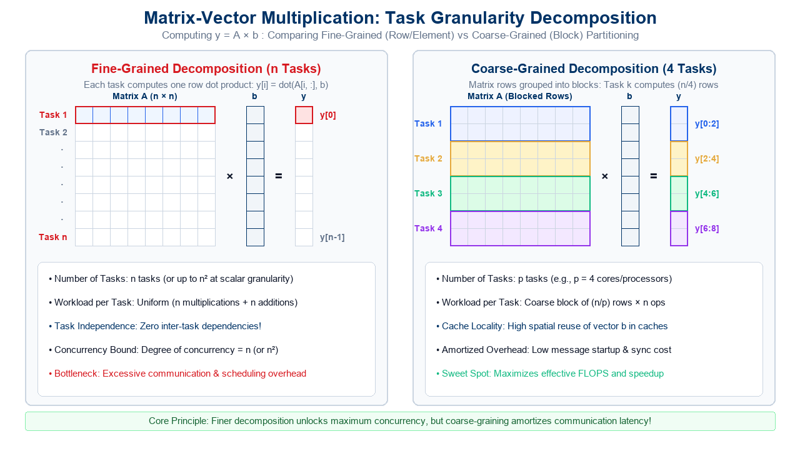
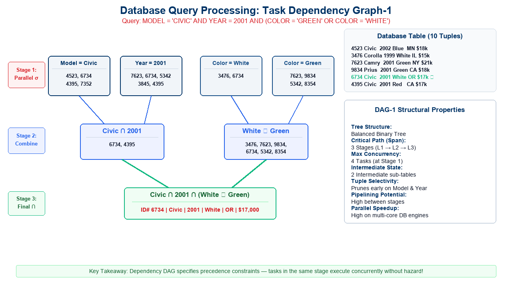
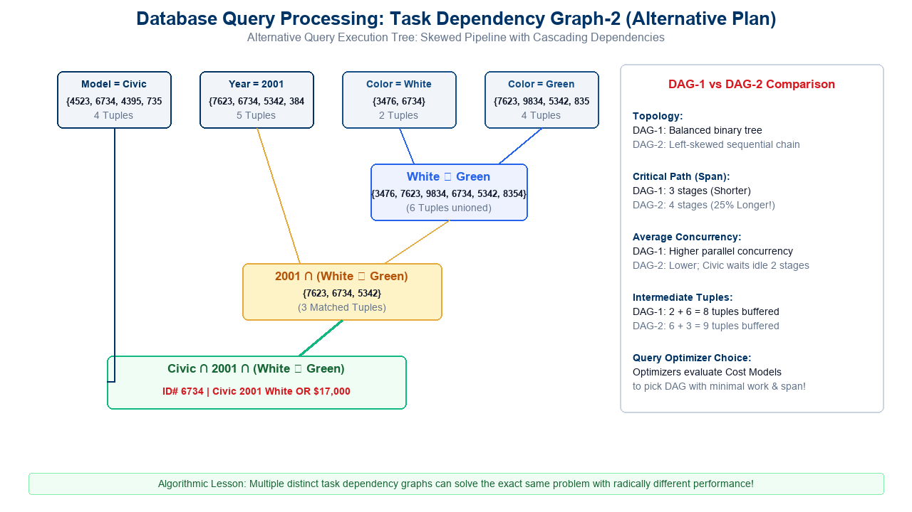
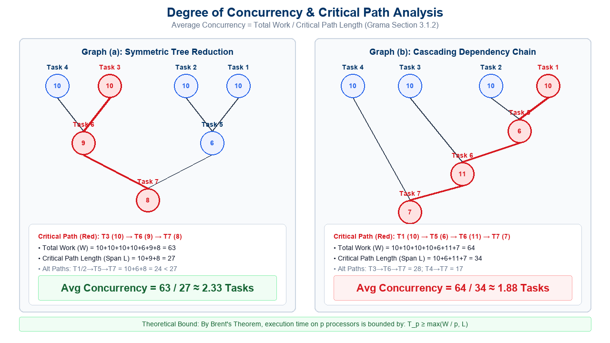
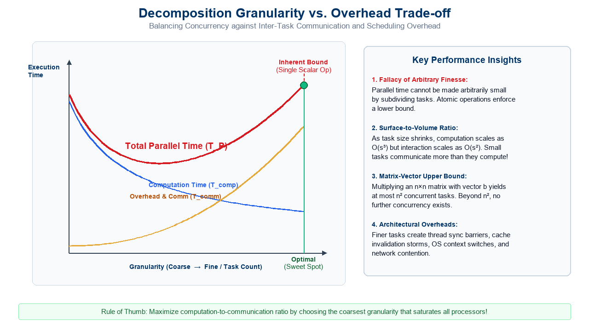
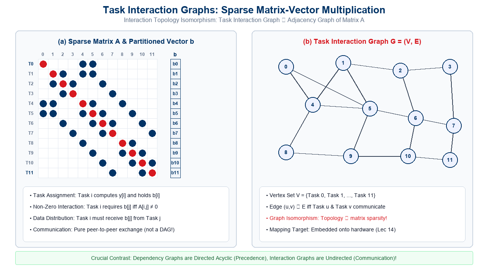
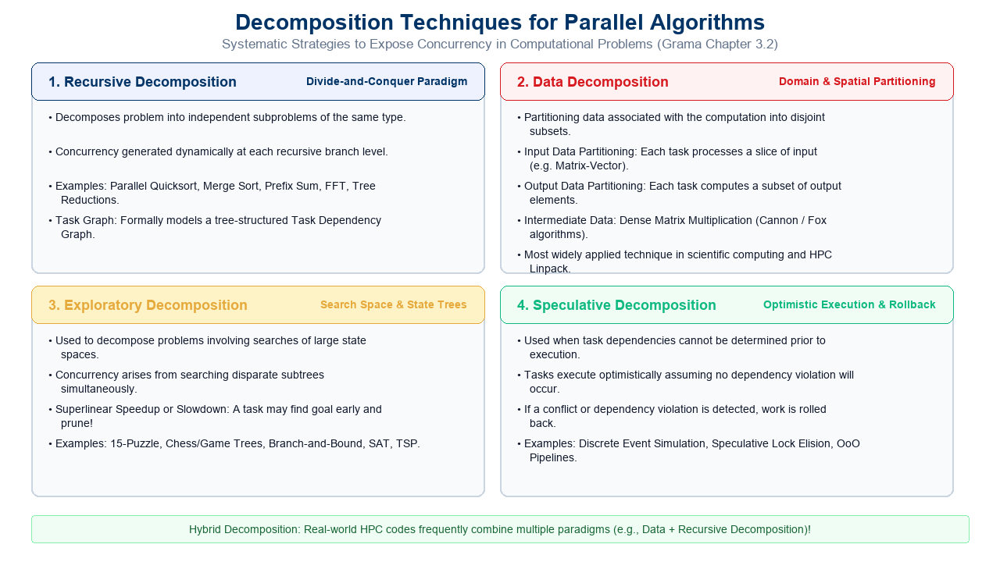

## Lecture Outline

:::: {.columns}

::: {.column width="50%"}
- **The Parallel Algorithm Paradigm**:
  - Sequential algorithms vs. The added dimension of concurrency.
  - The 5 Pillars of Parallel Algorithm Design.
- **Foundational Abstractions & Definitions**:
  - **Decomposition**: Dividing work into concurrent parts.
  - **Tasks**: Programmer-defined units of computation.
  - **Task Dependency Graph**: Directed Acyclic Graphs (DAGs) representing precedence constraints.
- **Decomposition Case Studies**:
  - **Matrix-Vector Multiplication**: Independent row tasks vs. scalar multiplication granularity.
  - **Database Query Processing**: Relational selection, join, and union pipelines.
  - **Alternative Query Trees**: Dependency Graph-1 vs. Graph-2 structural and concurrency trade-offs.
- **Granularity & Concurrency Metrics**:
  - Granularity spectrum: Fine-grained vs. Coarse-grained decomposition.
  - Maximum vs. Average Degree of Concurrency.
  - **Critical Path Length ($L$) / Span ($D$)** and Total Work ($W$).
:::

::: {.column width="50%"}
- **Quantitative DAG Analysis**:
  - Case study on weighted DAGs: Graph (a) vs. Graph (b).
  - Mathematical calculation of Work, Span, and Average Concurrency ($W/L$).
  - Brent's Scheduling Theorem bounds on execution time.
- **Limits on Parallel Performance**:
  - Inherent lower bounds on task granularity.
  - Upper bounds on concurrency ($n^2$ for matrix-vector).
  - The communication overhead penalty and the "Sweet Spot".
- **Task Interaction Graphs**:
  - Task Dependency Graphs (DAGs) vs. Task Interaction Graphs (Spatial).
  - Case Study: Sparse Matrix-Vector Multiplication.
  - **Graph Isomorphism**: Mapping matrix sparsity structure to interaction topology.
- **Decomposition Techniques & Task Characteristics**:
  - Recursive, Data, Exploratory, and Speculative Decomposition.
  - Task generation, granularity, context, and interaction profiles.
- **Interactive Review Quizzes** *(Standalone Pages)*:
  - **[Quiz 16-1](quiz-16-1.html){target="_blank"}** (Algorithms & Decomposition - Lec 16): 4 MCQs + Explanations.
  - **[Quiz 16-2](quiz-16-2.html){target="_blank"}** (Shared-Memory & OpenMP - Lec 15 Review): 4 MCQs + Explanations.
:::

::::

---

## Sequential vs. Parallel Algorithms: The Concurrency Dimension

In classical computer science, an algorithm is conceived as a **totally ordered sequence of instructions**:

$$I_1 \longrightarrow I_2 \longrightarrow I_3 \longrightarrow \cdots \longrightarrow I_n$$

:::: {.columns}

::: {.column width="50%"}
### Sequential Algorithm Paradigm
- **Linear Execution**:
  - A single program counter advances through instructions one after another.
  - Time complexity is modeled via RAM (Random Access Machine).
  - Deterministic state transitions: $S_{k+1} = \delta(S_k, I_{k+1})$.
- **No Concurrency Dimension**:
  - Programmer assumes exclusive access to all memory and CPU registers.
  - Total time equals the sum of step latencies: $T_1 = \sum_{i=1}^n t(I_i)$.
:::

::: {.column width="50%"}
### Parallel Algorithm Paradigm
- **Partial Order of Operations**:
  - Multiple instructions execute **simultaneously** on distinct hardware units.
  - Algorithm designer must explicitly define **sets of steps that can run concurrently**.
- **The Concurrency Dimension**:
  - Introducing concurrency requires solving:
    1. Who computes what? (**Decomposition & Assignment**)
    2. Where does data reside? (**Data Distribution**)
    3. How do units coordinate? (**Interaction & Synchronization**)
:::

::::

<div style="margin-top: 15px; padding: 10px 18px; background-color: #f1f5f9; border-left: 5px solid #003366; border-radius: 4px; font-size: 0.9em;">
  <strong>Fundamental Shift:</strong> Parallel algorithm design is fundamentally about discovering, exposing, and orchestrating independent computational steps while minimizing coordination overhead!
</div>

---

## The 5 Pillars of Parallel Algorithm Design

Designing a non-trivial parallel algorithm requires solving five interconnected challenges:

<div style="font-size: 0.88em; margin-top: 10px;">

| Pillar / Phase | Core Objective | Key Design Decision & Metric |
|:---|:---|:---|
| **1. Identifying Concurrency** | Decompose total computation into concurrent sub-tasks | Fine-grained vs. Coarse-grained task generation |
| **2. Process Mapping** | Assign concurrent pieces of work to executing processes | Load balancing & minimizing communication distance |
| **3. Data Distribution** | Partition input, intermediate, and output data | Uniform vs. Non-uniform partitioning across memory |
| **4. Shared Data Management** | Regulate read/write access to shared memory locations | Locks, critical sections, atomic ops, or reduction trees |
| **5. Processor Synchronization** | Coordinate execution stages across physical cores | Barriers, condition variables, and pipeline handoffs |

</div>

<div style="margin-top: 15px; padding: 10px 18px; background: #eff6ff; border-left: 5px solid #2563eb; border-radius: 4px; font-size: 0.88em; color: #1e40af;">
  <strong>Pedagogical Insight:</strong> These five pillars form an engineering pipeline. Flaws in Pillar 1 (insufficient concurrency) or Pillar 5 (excessive barrier synchronization) will bottleneck the entire application regardless of how powerful the hardware is!
</div>

---

## Foundational Definitions: Tasks & Decomposition

To analyze algorithms formally, we introduce three core abstractions:

:::: {.columns}

::: {.column width="50%"}
### 1. Decomposition
- **Definition**: The process of dividing a computational workload into smaller, discrete parts, some or all of which may be potentially executed in parallel.
- **Objective**: Expose the latent concurrency of the underlying mathematical problem.
- **Decomposition Granularity**: Can range from fine-grained (individual instructions) to coarse-grained (entire sub-algorithms).

### 2. Tasks
- **Definition**: Programmer-defined units of computation into which the main computation is subdivided by means of decomposition.
- **Atomic Unit**: Within the algorithmic model, a task is treated as an indivisible unit of work.
- **Execution**: Can be executed sequentially by a single process or thread.
:::

::: {.column width="50%"}
### 3. Task Dependency Graph (DAG)
- **Definition**: A **Directed Acyclic Graph** $G = (V, E)$ where:
  - Each vertex $v \in V$ represents a **task**.
  - A directed edge $(u, v) \in E$ indicates that task $v$ depends on data produced by task $u$.
- **Precedence Constraint**:
  - Task $v$ cannot begin execution until task $u$ has completely finished.
- **Source Tasks**: Nodes with in-degree 0 (can execute immediately at start).
- **Sink Tasks**: Nodes with out-degree 0 (produce final output of computation).
:::

::::

<div style="margin-top: 15px; padding: 10px 18px; background: #fff7ed; border-left: 5px solid #ea580c; border-radius: 4px; font-size: 0.88em; color: #7c2d12;">
  <strong>Property of Dependency Graphs:</strong> Dependency graphs are strictly <strong>acyclic</strong>! A cycle would represent a deadlocked dependency where task $A$ waits for task $B$, which in turn waits for task $A$.
</div>

---

## Case Study 1: Dense Matrix-Vector Multiplication

Consider computing the matrix-vector product $y = A \cdot b$, where $A \in \mathbb{R}^{n \times n}$ and $b \in \mathbb{R}^n$:

$$y_i = \sum_{j=0}^{n-1} A_{i, j} \cdot b_j \quad \text{for } i = 0, 1, \dots, n-1$$

:::: {.columns}

::: {.column width="50%"}
### Row-Wise Decomposition
- **Task Definition**:
  - Define Task $i$ as the computation of output element $y_i$.
  - Workload for Task $i$: Perform the dot product of row $A[i, :]$ with vector $b$.
- **Number of Tasks**:
  - Exactly $n$ independent tasks: $\{\text{Task } 0, \text{Task } 1, \dots, \text{Task } n-1\}$.
- **Workload Uniformity**:
  - Each task executes exactly $n$ scalar multiplications and $n-1$ additions:
    $$\text{Work}(\text{Task } i) = 2n - 1 = \Theta(n) \text{ FLOPs}$$
:::

::: {.column width="50%"}
### Algorithmic Properties
- **Zero Inter-Task Dependencies**:
  - To compute $y_i$, Task $i$ needs row $A[i, :]$ and vector $b$.
  - It does **not** need the output of any other Task $j$ ($j \ne i$).
  - The Task Dependency Graph consists of **$n$ disconnected nodes**!
- **Arbitrary Execution Order**:
  - All $n$ tasks can be scheduled simultaneously (fully concurrent), or in any arbitrary order.
- **Memory Footprint**:
  - Each task accesses a private row of $A$, but shares access to the common vector $b$.
:::

::::

---

## Visualizing Matrix-Vector Decomposition: Fine vs. Coarse

{width="100%" fig-align="center"}

---

## Case Study 2: Database Query Processing

Complex relational queries provide an excellent demonstration of non-trivial task dependency graphs:

<div style="background: #f1f5f9; border: 1px solid #cbd5e1; border-left: 5px solid #003366; border-radius: 6px; padding: 10px 16px; margin-bottom: 12px; font-size: 0.9em;">
  <strong>SQL Query:</strong><br>
  <code style="color: #003366; font-weight: 700;">SELECT * FROM Vehicles WHERE MODEL = 'Civic' AND YEAR = 2001 AND (COLOR = 'Green' OR COLOR = 'White');</code>
</div>

Consider the execution of this query on the following 10-record relational database table:

<div style="font-size: 0.8em; margin-top: 5px;">

| ID# | Model | Year | Color | Dealer | Price | Matched by Filter? |
|:---:|:---:|:---:|:---:|:---:|:---:|:---|
| **4523** | Civic | 2002 | Blue | MN | $18,000 | Model = Civic |
| **3476** | Corolla | 1999 | White | IL | $15,000 | Color = White |
| **7623** | Camry | 2001 | Green | NY | $21,000 | Year = 2001, Color = Green |
| **9834** | Prius | 2001 | Green | CA | $18,000 | Year = 2001, Color = Green |
| **6734** | **Civic** | **2001** | **White** | **OR** | **$17,000** | **ALL CONDITIONS SATISFIED! (Query Result)** |
| **5342** | Altima | 2001 | Green | FL | $19,000 | Year = 2001, Color = Green |
| **3845** | Maxima | 2001 | Blue | NY | $22,000 | Year = 2001 |
| **8354** | Accord | 2000 | Green | VT | $18,000 | Color = Green |
| **4395** | Civic | 2001 | Red | CA | $17,000 | Model = Civic, Year = 2001 (Color is Red &ne; White/Green) |
| **7352** | Civic | 2002 | Red | WA | $18,000 | Model = Civic |

</div>

---

## Database Query Processing: Dependency Graph-1

We can decompose the query into relational selection ($\sigma$), union ($\cup$), and intersection ($\cap$) tasks:

{width="100%" fig-align="center"}

---

## Detailed Mechanics of Dependency Graph-1

The execution pipeline of Dependency Graph-1 proceeds across three synchronous stages:

:::: {.columns}

::: {.column width="50%"}
### Stage 1: Parallel Relational Selections
- **Task 1 (`Model = Civic`)**:
  - Scans table for `Civic`. Returns 4 tuples:
    $$\{4523, 6734, 4395, 7352\}$$
- **Task 2 (`Year = 2001`)**:
  - Scans table for `2001`. Returns 5 tuples:
    $$\{7623, 6734, 5342, 3845, 4395\}$$
- **Task 3 (`Color = White`)**:
  - Returns 2 tuples: $\{3476, 6734\}$.
- **Task 4 (`Color = Green`)**:
  - Returns 4 tuples: $\{7623, 9834, 5342, 8354\}$.
- **Concurrency**: All 4 tasks execute simultaneously!
:::

::: {.column width="50%"}
### Stage 2 & 3: Combination & Join
- **Stage 2: Intermediate Operations**:
  - **Task 5 (`Civic AND 2001`)**:
    - Intersects outputs of Task 1 & Task 2:
      $$\{4523, 6734, 4395, 7352\} \cap \{7623, 6734, 5342, 3845, 4395\} = \{6734, 4395\}$$
  - **Task 6 (`White OR Green`)**:
    - Unions outputs of Task 3 & Task 4:
      $$\{3476, 6734\} \cup \{7623, 9834, 5342, 8354\} = \{3476, 7623, 9834, 6734, 5342, 8354\}$$
- **Stage 3: Final Intersection (Sink Task)**:
  - **Task 7**: Computes final intersection:
    $$\{6734, 4395\} \cap \{3476, 7623, 9834, 6734, 5342, 8354\} = \{6734\}$$
  - Output: Single unique record (ID# 6734).
:::

::::

---

## Database Query Processing: Dependency Graph-2

Does a unique dependency graph exist for a given problem? **No!** An alternative query execution plan yields a completely different DAG:

{width="100%" fig-align="center"}

---

## Architectural Comparison: DAG-1 vs. DAG-2

The choice of task decomposition radically impacts performance, concurrency, and memory consumption:

<div style="font-size: 0.88em; margin-top: 10px;">

| Evaluation Metric | Dependency Graph 1 (Balanced Plan) | Dependency Graph 2 (Cascading Plan) |
|:---|:---|:---|
| **Tree Topology** | Balanced binary reduction tree | Left-skewed sequential cascade |
| **Critical Path Length (Span)** | **3 Stages** (Shorter execution latency) | **4 Stages** (25% longer latency!) |
| **Maximum Concurrency** | **4 Tasks** (at Stage 1) | 4 Tasks initially, but drops to 1 task |
| **Average Concurrency** | **High**: Work is evenly distributed across levels | **Low**: Idle processors waiting on linear pipeline |
| **Task Synchronization** | Parallel barrier at each tree level | Staggered pipeline handoffs |
| **Intermediate Data Footprint** | Produces $2 + 6 = 8$ buffered tuples | Produces $6 + 3 = 9$ buffered tuples |
| **Resource Utilization** | Optimal for multi-core / symmetric SMPs | Better suited for streaming systolic arrays |

</div>

<div style="margin-top: 15px; padding: 10px 18px; background: #f0fdf4; border-left: 5px solid #16a34a; border-radius: 4px; font-size: 0.88em; color: #166534;">
  <strong>Database Query Optimizer Rule:</strong> Modern relational database query engines (PostgreSQL, Oracle, Spark SQL) use cost-based optimizers to mathematically enumerate alternative dependency DAGs, picking the one that minimizes estimated span and intermediate memory!
</div>

---

## Granularity of Task Decomposition

The ratio of computation to the number of tasks into which a problem is divided defines its **granularity**:

:::: {.columns}

::: {.column width="50%"}
### Fine-Grained Decomposition
- **Definition**: Subdividing the computation into a **large number of small tasks**.
- **Characteristics**:
  - Each task executes very few arithmetic operations (e.g., single scalar multiply-add, single matrix entry).
  - Maximizes the potential degree of concurrency.
- **Architectural Challenges**:
  - Massive overhead in task creation, scheduling, and dispatching.
  - Frequent inter-task communication and synchronization.
  - High cache thrashing and false sharing if data is not carefully aligned.
:::

::: {.column width="50%"}
### Coarse-Grained Decomposition
- **Definition**: Subdividing the computation into a **small number of large tasks**.
- **Characteristics**:
  - Each task executes substantial computation (e.g., multiplying blocks of matrix rows, processing sub-domains).
  - Maximizes spatial and temporal data locality in L1/L2 caches.
- **Architectural Challenges**:
  - Lower degree of concurrency (cannot fully exploit thousands of GPU cores or large clusters).
  - Susceptible to **load imbalance** if task workloads vary non-uniformly.
:::

::::

<div style="margin-top: 15px; padding: 10px 18px; background: #fff7ed; border-left: 5px solid #ea580c; border-radius: 4px; font-size: 0.88em; color: #7c2d12;">
  <strong>The Fundamental Granularity Trade-Off:</strong> Fine-grained decomposition exposes high concurrency but incurs excessive overhead. Coarse-grained decomposition minimizes overhead but risks processor starvation and idle cores!
</div>

---

## Degree of Concurrency: Core Metrics & Formalism

To quantify the parallelism exposed by a decomposition, we define three mathematical metrics:

:::: {.columns}

::: {.column width="50%"}
### 1. Maximum Degree of Concurrency
- The maximum number of tasks that can be executed simultaneously at any given instant during program execution.
- In a task dependency graph, it corresponds to the **maximum number of mutually independent tasks** at any stage (the graph width).
- In dense matrix-vector multiplication with row tasks, max concurrency is $n$.

### 2. Critical Path Length (Span $L$ or $D$)
- The directed path from a source task to a sink task with the **largest cumulative weight (execution time)**.
- Represents the absolute minimum time required to complete the program, even if an infinite number of processors are available ($T_\infty = L$).
:::

::: {.column width="50%"}
### 3. Total Amount of Work ($W$)
- The sum of the execution times of all tasks in the dependency graph:
  $$W = \sum_{v \in V} \text{Weight}(v)$$
- Corresponds to sequential execution time on a single processor ($T_1 = W$).

### 4. Average Degree of Concurrency
- The average number of tasks that can be processed concurrently over the total execution of the program:
  $$\text{Average Degree of Concurrency} = \frac{\text{Total Amount of Work } (W)}{\text{Critical Path Length } (L)}$$
:::

::::

<div style="margin-top: 15px; padding: 10px 18px; background: #eff6ff; border-left: 5px solid #2563eb; border-radius: 4px; font-size: 0.88em; color: #1e40af;">
  <strong>Connection to Work-Span Model:</strong> Average Concurrency is precisely the ratio $W / L$ (or $T_1 / T_\infty$), which defines the theoretical maximum speedup achievable on an ideal parallel machine!
</div>

---

## Quantitative Analysis: DAG Critical Path Examples

{width="100%" fig-align="center"}

---

## Step-by-Step Mathematical Walkthrough: Graph (a)

Let us calculate the metrics for **Graph (a)** (Slide 14):

:::: {.columns}

::: {.column width="50%"}
### Graph (a) Specification
- **Task Weights**:
  - $w(T_1) = 10, \; w(T_2) = 10, \; w(T_3) = 10, \; w(T_4) = 10$
  - $w(T_5) = 6$ (depends on $T_1, T_2$)
  - $w(T_6) = 9$ (depends on $T_3, T_4$)
  - $w(T_7) = 8$ (depends on $T_5, T_6$)
- **Total Work ($W$)**:
  $$W = 10 + 10 + 10 + 10 + 6 + 9 + 8 = 63$$
- **Candidate Paths to Sink ($T_7$)**:
  1. $\text{Path}_1: T_1 \to T_5 \to T_7 = 10 + 6 + 8 = 24$
  2. $\text{Path}_2: T_2 \to T_5 \to T_7 = 10 + 6 + 8 = 24$
  3. $\text{Path}_3: T_3 \to T_6 \to T_7 = 10 + 9 + 8 = 27$
  4. $\text{Path}_4: T_4 \to T_6 \to T_7 = 10 + 9 + 8 = 27$
:::

::: {.column width="50%"}
### Performance Metrics
- **Critical Path Length ($L$)**:
  $$L = \max(24, 24, 27, 27) = 27$$
  - Critical path consists of $T_3 \to T_6 \to T_7$ (or $T_4 \to T_6 \to T_7$).
- **Average Degree of Concurrency**:
  $$\text{Concurrency} = \frac{W}{L} = \frac{63}{27} \approx 2.333$$
- **Maximum Concurrency**:
  - At $t = 0$, all 4 root tasks ($T_1, T_2, T_3, T_4$) run concurrently:
    $$\text{Max Concurrency} = 4$$
- **Processor Efficiency**:
  - Providing more than $\lceil 2.33 \rceil = 3$ processors yields diminishing returns due to the critical path bottleneck!
:::

::::

---

## Step-by-Step Mathematical Walkthrough: Graph (b)

Now consider **Graph (b)** where dependencies are organized in an asymmetric cascade:

:::: {.columns}

::: {.column width="50%"}
### Graph (b) Specification
- **Task Weights**:
  - $w(T_1) = 10, \; w(T_2) = 10, \; w(T_3) = 10, \; w(T_4) = 10$
  - $w(T_5) = 6$ (depends on $T_1, T_2$)
  - $w(T_6) = 11$ (depends on $T_3$ and $T_5$)
  - $w(T_7) = 7$ (depends on $T_4$ and $T_6$)
- **Total Work ($W$)**:
  $$W = 10 + 10 + 10 + 10 + 6 + 11 + 7 = 64$$
- **Candidate Paths to Sink ($T_7$)**:
  1. $\text{Path}_1: T_1 \to T_5 \to T_6 \to T_7 = 10 + 6 + 11 + 7 = \mathbf{34}$
  2. $\text{Path}_2: T_2 \to T_5 \to T_6 \to T_7 = 10 + 6 + 11 + 7 = \mathbf{34}$
  3. $\text{Path}_3: T_3 \to T_6 \to T_7 = 10 + 11 + 7 = 28$
  4. $\text{Path}_4: T_4 \to T_7 = 10 + 7 = 17$
:::

::: {.column width="50%"}
### Performance Metrics
- **Critical Path Length ($L$)**:
  $$L = \max(34, 28, 17) = 34$$
  - Critical path consists of $T_1 \to T_5 \to T_6 \to T_7$.
- **Average Degree of Concurrency**:
  $$\text{Concurrency} = \frac{W}{L} = \frac{64}{34} \approx 1.882$$
- **Comparison with Graph (a)**:
  - Total work is nearly identical ($63$ vs. $64$).
  - But Graph (b)'s critical path is **26% longer** ($34$ vs. $27$).
  - As a result, Average Concurrency drops from **2.33** down to **1.88**!
:::

::::

<div style="margin-top: 15px; padding: 10px 18px; background: #fef2f2; border-left: 5px solid #dc2626; border-radius: 4px; font-size: 0.88em; color: #991b1b;">
  <strong>Architectural Lesson:</strong> Serializing dependencies between intermediate stages (as in Graph b) stretches the critical path, directly suppressing average concurrency!
</div>

---

## Limits on Parallel Performance: The Granularity Myth

A common misconception among beginner parallel programmers is:

> *"Parallel execution time can be made arbitrarily small by simply making the decomposition finer and finer."*

:::: {.columns}

::: {.column width="50%"}
### Why This Is False: Inherent Lower Bounds
1. **Inherent Granularity Limit**:
   - Computation cannot be subdivided beyond single atomic instructions (e.g., adding two numbers, reading a memory address).
2. **Algorithm-Specific Upper Bound**:
   - In multiplying an $n \times n$ dense matrix with an $n$-vector:
     - Total number of scalar multiplications is exactly $n^2$.
     - Therefore, **there can be at most $n^2$ concurrent tasks**!
     - No decomposition technique can extract more than $n^2$ tasks without restructuring the underlying algebra.
:::

::: {.column width="50%"}
### Communication & Overhead Limits
1. **Surface-to-Volume Ratio**:
   - Computational work of a task scales with its volume (e.g., $O(s^3)$ or $O(s^2)$).
   - Communication required by a task scales with its surface boundary (e.g., $O(s^2)$ or $O(s)$).
   - As task size $s \to 0$, communication dominates computation!
2. **Hardware Overhead Penalties**:
   - Operating system context switching.
   - Cache invalidations and false sharing.
   - Queue locking and thread synchronization latency.
:::

::::

---

## The Granularity vs. Overhead Trade-off Curve

{width="100%" fig-align="center"}

---

## Task Interaction Graphs: Spatial vs. Temporal Structures

It is crucial to distinguish between two fundamental graph representations used in parallel algorithm design:

:::: {.columns}

::: {.column width="50%"}
### Task Dependency Graph
- **Mathematical Nature**:
  - **Directed Acyclic Graph (DAG)**: Edges have strict direction.
- **What It Represents**:
  - **Temporal precedence constraints**: "Task $B$ cannot begin until Task $A$ finishes."
  - Data flow between distinct stages of an algorithm.
- **Key Analysis Metrics**:
  - Longest path = Critical Path Length ($L$).
  - Sum of node weights = Total Work ($W$).
  - Width = Maximum Degree of Concurrency.
:::

::: {.column width="50%"}
### Task Interaction Graph
- **Mathematical Nature**:
  - Typically an **Undirected or Bidirectional Graph** (can contain cycles!).
- **What It Represents**:
  - **Spatial communication patterns** between concurrently executing tasks.
  - An edge exists between Task $u$ and Task $v$ if they must exchange data or synchronize while running.
- **Key Analysis Metrics**:
  - Graph Degree, Diameter, Bisection Width.
  - Used for **Process-to-Processor Mapping** (Lecture 14 graph embeddings: Dilation, Congestion, Load).
:::

::::

<div style="margin-top: 15px; padding: 10px 18px; background: #f1f5f9; border-left: 5px solid #003366; border-radius: 4px; font-size: 0.9em;">
  <strong>Key Distinction:</strong> Dependency graphs answer <em>"In what order can tasks execute?"</em> Interaction graphs answer <em>"Which concurrent tasks need to communicate with each other?"</em>
</div>

---

## Case Study: Sparse Matrix-Vector Multiplication

In many scientific codes (finite elements, graph analytics), matrix $A$ is **sparse** (mostly zeros):

$$y_i = \sum_{j \in \text{NonZero}(A[i, :])} A_{i, j} \cdot b_j$$

:::: {.columns}

::: {.column width="50%"}
### Algorithmic Setup
- **Task Partitioning**:
  - Define Task $i$ as the computation of element $y_i$.
  - We also partition vector $b$ such that **Task $i$ initially holds element $b_i$**.
- **Computation**:
  - Only non-zero entries of matrix $A$ participate in arithmetic operations.
  - If $A_{i, j} = 0$, no computation or data from $b_j$ is needed by Task $i$.
- **Communication Requirement**:
  - If $A_{i, j} \ne 0$ and $i \ne j$, Task $i$ requires the value of $b_j$.
  - Therefore, Task $j$ must send $b_j$ to Task $i$!
:::

::: {.column width="50%"}
### The Graph Isomorphism Phenomenon
- **Interaction Condition**:
  - An edge exists between Task $i$ and Task $j$ in the Task Interaction Graph if and only if:
    $$A_{i, j} \ne 0 \quad \text{or} \quad A_{j, i} \ne 0$$
- **Profound Conclusion**:
  - If vector $b$ is partitioned across tasks, the **Task Interaction Graph of the computation is mathematically identical (isomorphic) to the adjacency graph of matrix $A$**!
- **Mapping Consequence**:
  - Optimizing parallel sparse matrix-vector multiplication requires graph partitioning algorithms (e.g., METIS, Scotch) to minimize edge cuts!
:::

::::

---

## Visualizing Sparse Matrix Interaction Graphs

**Graph Construction:** For the 12×12 sparse matrix $A$, create one node per row (Task $i$ computes $y_i$ and holds $b_i$). For each **off-diagonal** non-zero entry $A_{i,j} \ne 0$, draw an undirected edge $(i, j)$ — this edge represents that Task $i$ must fetch $b_j$ from Task $j$. Diagonal entries (self-loops) are omitted since Task $i$ already holds its own $b_i$. The resulting graph is **isomorphic** to the adjacency structure of matrix $A$.

{width="100%" fig-align="center"}

---

## Decomposition Techniques for Parallel Algorithms

How does a programmer systematically decompose an arbitrary problem? Four classical paradigms exist:

{width="100%" fig-align="center"}

---

## Detailed Overview of Decomposition Paradigms

<div style="font-size: 0.85em;">

### 1. Recursive Decomposition (Divide-and-Conquer)
- **Mechanism**: Subdivide a problem into independent sub-problems of the same type; solve each recursively; combine solutions.
- **Examples**: Merge Sort, Quicksort, Parallel Prefix Sum, Fast Fourier Transform (FFT).
- **Concurrency Profile**: Generated dynamically at each branch of the recursion tree.

### 2. Data Decomposition (Domain Partitioning)
- **Mechanism**: Partition the data associated with the computation (input, output, or intermediate state).
- **Sub-types**:
  - **Output Data Partitioning**: Each task computes a disjoint subset of output (e.g., matrix-vector, image rendering).
  - **Input Data Partitioning**: Each task processes a portion of input (e.g., finding min/max, frequency histogram).
  - **Intermediate Data Partitioning**: Partitioning internal state (e.g., block matrix multiplication).

### 3. Exploratory Decomposition (Search State Spaces)
- **Mechanism**: Decompose the search of large state spaces or game trees across concurrent processors.
- **Examples**: 15-Puzzle, Chess evaluation, Traveling Salesperson (TSP), Integer Linear Programming (Branch-and-Bound).
- **Anomalous Scaling**: Can achieve **superlinear speedup** ($S > p$) if one task quickly finds a goal and prunes other branches, or **speeddown** if tasks explore futile branches!

### 4. Speculative Decomposition (Optimistic Execution)
- **Mechanism**: When dependencies cannot be statically determined, execute tasks optimistically. If a dependency hazard is detected, abort and rollback.
- **Examples**: Parallel Discrete Event Simulation (Time Warp), Speculative Lock Elision.

</div>

---

## Characteristics of Tasks and Task Interactions

When modeling parallel algorithms, tasks and their interactions exhibit distinct behavioral traits:

:::: {.columns}

::: {.column width="50%"}
### Task Characteristics
1. **Task Generation**:
   - **Static**: All tasks are known prior to execution (e.g., matrix-vector multiplication).
   - **Dynamic**: Tasks are generated at runtime as execution proceeds (e.g., recursive quicksort, tree search).
2. **Task Granularity & Sizes**:
   - **Uniform**: All tasks take approximately equal execution time (e.g., dense matrix multiplication).
   - **Non-Uniform**: Execution time varies widely across tasks (e.g., adaptive mesh refinement).
3. **Task Context**:
   - Small context (few registers/cache lines) vs. Large context (megabytes of buffered memory).
:::

::: {.column width="50%"}
### Task Interaction Characteristics
1. **Static vs. Dynamic**:
   - **Static**: Interacting partners and message sizes are predetermined and predictable.
   - **Dynamic**: Interacting partners are determined at runtime based on data values.
2. **Regular vs. Irregular**:
   - **Regular**: Spatial structure follows symmetric topologies (ring, 2D mesh, hypercube).
   - **Irregular**: Graph-based, sparse, or unstructured communication patterns.
3. **Read-Only vs. Read-Write**:
   - **Read-Only**: Tasks only read shared data (no race conditions).
   - **Read-Write**: Tasks mutate shared variables (requires mutual exclusion or reduction).
:::

::::

---

## Processes, Processors, and the Two-Stage Mapping

A crucial distinction exists between the logical and physical execution entities:

```
┌──────────────────┐       Decomposition & Assignment       ┌──────────────────────┐
│ Algorithmic      │ ─────────────────────────────────────> │ Logical Processes    │
│ Tasks (T_1..T_k) │                                        │ / Threads (P_1..P_m) │
└──────────────────┘                                        └──────────────────────┘
                                                                       │
                                                                       │ Mapping & Scheduling
                                                                       │ (Topology Embedding)
                                                                       v
                                                            ┌──────────────────────┐
                                                            │ Physical Processors  │
                                                            │ / Cores (C_1..C_p)   │
                                                            └──────────────────────┘
```

:::: {.columns}

::: {.column width="50%"}
### Tasks vs. Processes
- **Tasks**: Logical units of work defined by the algorithm decomposition. The number of tasks can be massive ($k \gg p$, e.g., $k = n^2$).
- **Processes**: Operating system or runtime execution threads of control that execute tasks sequentially.
- **Assignment**: Mapping $k$ tasks onto $m$ processes.
:::

::: {.column width="50%"}
### Processes vs. Processors
- **Processors**: Physical CPU cores, GPU streaming multiprocessors, or cluster nodes ($p$).
- **Mapping (Lecture 14)**: Assigning $m$ processes to $p$ physical cores such that:
  - Processor workloads are balanced ($W_i \approx W / p$).
  - Physical communication dilation and link congestion are minimized!
:::

::::
---

## Key Takeaways: Lecture 16 Summary

:::: {.columns}

::: {.column width="50%"}
### 1. Decomposition & Dependency DAGs
- **The Concurrency Dimension**:
  - Parallel algorithms require discovering independent tasks and orchestrating their execution order.
- **Task Dependency Graph**:
  - Directed Acyclic Graph (DAG) modeling precedence.
  - Sinks, sources, and topological execution order.
- **Critical Path & Concurrency**:
  - Critical Path Length ($L$) is the longest weighted path.
  - Average Degree of Concurrency $= W / L$.
  - Bounds theoretical speedup via Brent's Theorem!
:::

::: {.column width="50%"}
### 2. Interactions & Granularity
- **The Granularity Trade-off**:
  - Fine-grained exposes concurrency but multiplies communication, cache thrashing, and scheduling overhead.
  - Coarse-grained amortizes latency; finding the "Sweet Spot" is vital.
- **Task Interaction Graph**:
  - Undirected/bidirectional spatial communication pattern.
  - Sparse matrix multiplication exhibits an exact isomorphism to the matrix non-zero adjacency structure.
- **Decomposition Paradigms**:
  - Recursive, Data, Exploratory, and Speculative decomposition.
:::

::::

<div style="margin-top: 20px; padding: 12px 20px; background: #eff6ff; border: 2px solid #2563eb; border-radius: 6px; text-align: center; font-size: 1.05em; color: #003366;">
  <strong>Next Lecture:</strong> Data Decomposition Techniques in Depth: 1D/2D Block, Cyclic, and Checkerboard Distributions, and Owner-Computes Rule in MPI!
</div>

---

## References & Further Reading

1. **Grama, A., Gupta, A., Karypis, G., & Kumar, V.** (2003). *Introduction to Parallel Computing* (2nd ed.). Addison-Wesley.
   - **Chapter 3**: "Principles of Parallel Algorithm Design" (Sections 3.1–3.4, pp. 85–136).
   - Core reference for Tasks, Decomposition, Dependency Graphs, Concurrency, and Interaction Graphs.
2. **Quinn, M. J.** (2004). *Parallel Programming in C with MPI and OpenMP*. McGraw-Hill Education.
   - **Chapter 3**: "Parallel Algorithm Design" (Foster's Design Methodology: Partitioning, Communication, Agglomeration, Mapping, pp. 63–92).
3. **Cormen, T. H., Leiserson, C. E., Rivest, R. L., & Stein, C.** (2022). *Introduction to Algorithms* (4th ed.). MIT Press.
   - **Chapter 26**: "Multithreaded Algorithms" (Work, Span, Parallelism, and Greedy Schedulers).
4. **Foster, I.** (1995). *Designing and Building Parallel Programs: Concepts and Tools for Parallel Software Engineering*. Addison-Wesley.
   - Foundational formulation of task decomposition, dependency analysis, and agglomeration strategies.
5. **Pacheco, P. S.** (2018). *An Introduction to Parallel Programming*. Morgan Kaufmann.
   - **Chapter 2**: "Parallel Hardware and Parallel Software" (Decomposition and Performance Modeling).
