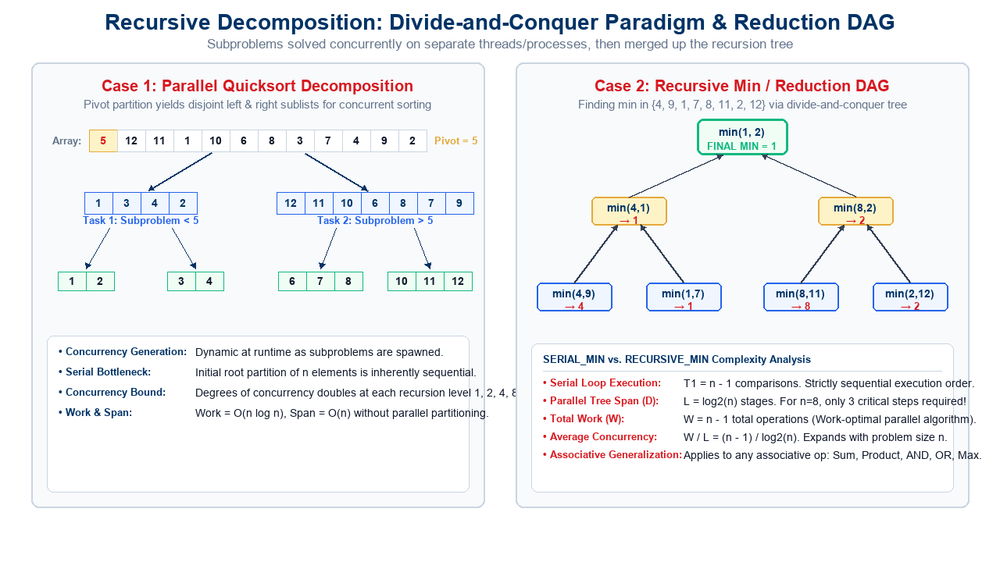
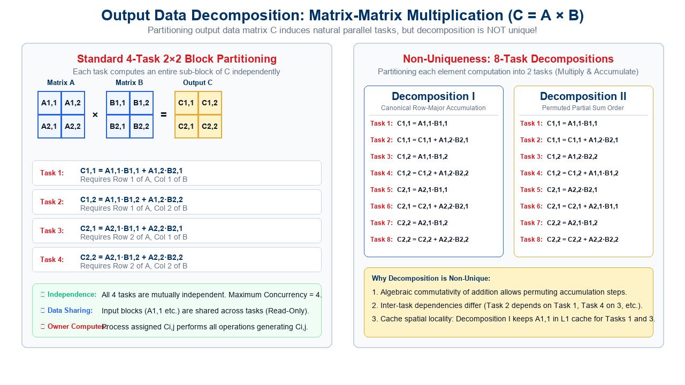
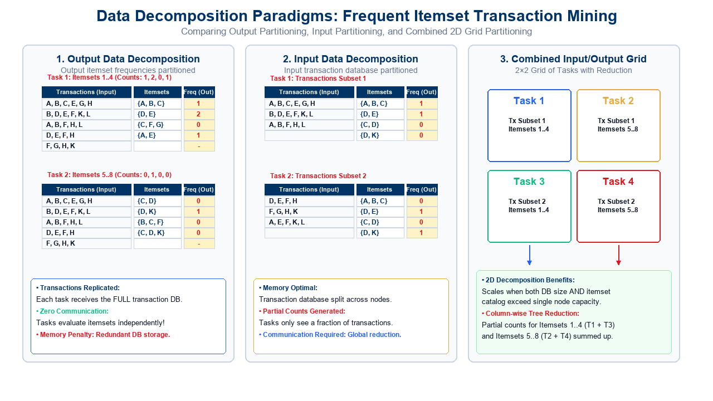
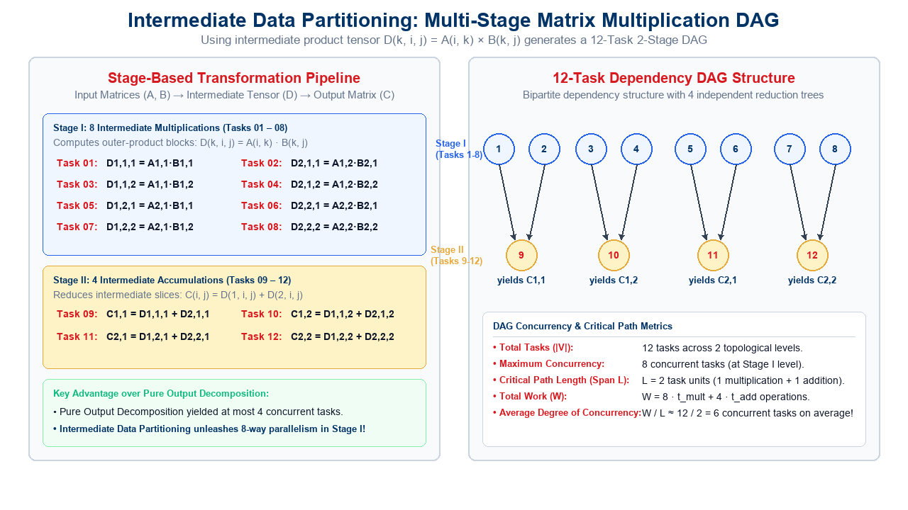
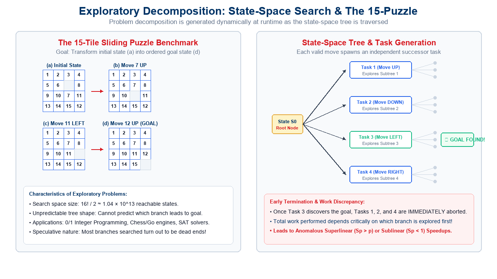
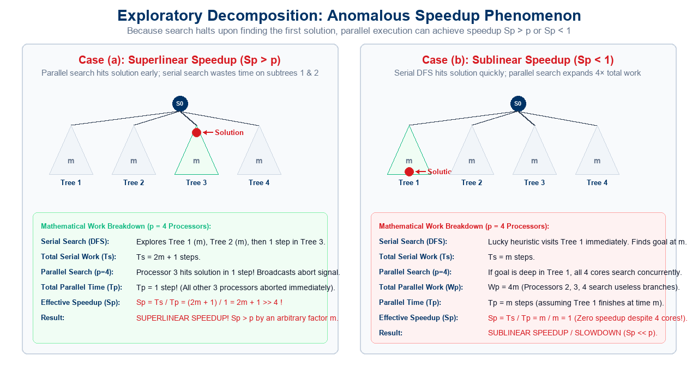
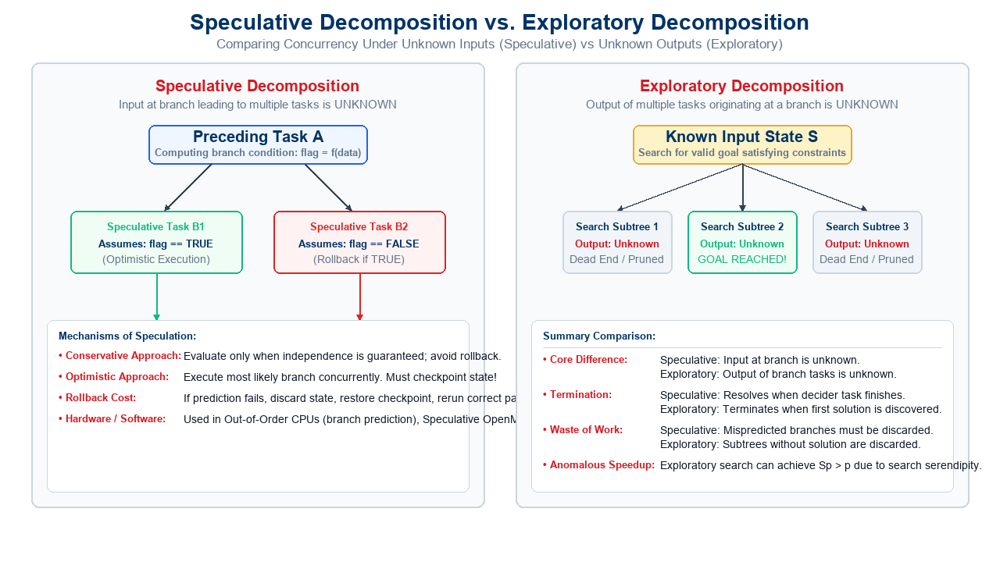
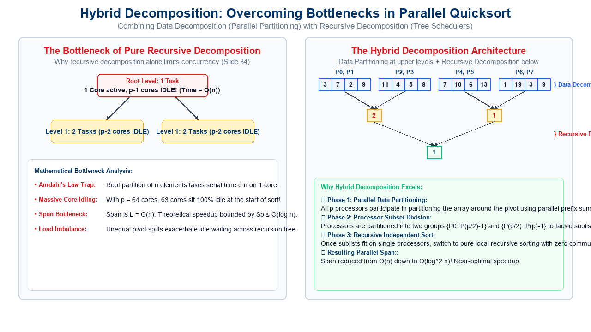

## Lecture Outline

:::: {.columns}

::: {.column width="50%"}
- **Foundations of Task Decomposition**:
  - Bridging logical concurrency and physical execution.
  - Tasks, dependency constraints, and concurrency bounds.
  - The 5 major decomposition paradigms overview.
- **Recursive Decomposition**:
  - Divide-and-Conquer strategy inducing natural concurrency.
  - Parallel Quicksort decomposition tree.
  - Case Study: Recursive Minimum finding (`SERIAL_MIN` vs `RECURSIVE_MIN`).
  - Task Dependency DAG analysis for $\{4, 9, 1, 7, 8, 11, 2, 12\}$.
- **Data Decomposition Paradigms**:
  - Output Data Decomposition ($C = A \times B$ block partitioning into 4 tasks).
  - The non-uniqueness of task decompositions (Decomposition I vs II).
  - Transaction Database Mining: Output partitioning.
  - Input Data Decomposition: Partitioning the transaction database.
  - Combined Input & Output Data Decomposition (2D grid partitioning).
  - Intermediate Data Partitioning: Multi-stage 12-task matrix multiplication DAG.
  - The **Owner Computes Rule** in shared and distributed memory.
:::

::: {.column width="50%"}
- **Exploratory Decomposition**:
  - Decomposition intertwined with execution in state-space search.
  - Case Study: The 15-Puzzle tile sliding benchmark.
  - State-space tree expansion and independent task generation.
  - **Anomalous Speedup Phenomenon**:
    - Mathematical formulation of early termination.
    - Superlinear speedup ($S_p > p$) and sublinear slowdown ($S_p < 1$).
- **Speculative Decomposition**:
  - Concurrency across computationally significant branch outcomes.
  - Conservative vs. Optimistic execution and rollback mechanics.
  - **Speculative vs. Exploratory Decomposition**: Unknown inputs vs. unknown outputs.
- **Hybrid Decomposition**:
  - The root bottleneck in recursive decomposition ($O(n)$ serial trap).
  - Synthesizing parallel data partitioning with recursive tree sorting.
- **Self-Assessment & Review**:
  - Interactive review quizzes on course portal (Quiz 17-1 & Quiz 17-2).
:::

::::

---

## The Decomposition Imperative: Exposing Concurrency

In parallel algorithm design, raw compute capacity is useless without **concurrency exposure**:

:::: {.columns}

::: {.column width="50%"}
### The Core Challenge
- **Sequential Mindset**:
  - Algorithms are structured as a linear sequence of instructions $I_1 \to I_2 \to \dots \to I_m$.
- **Parallel Imperative**:
  - We must shatter the problem into a collection of **tasks** that can be executed simultaneously on different processors.
- **The Central Question**:
  - *How does one systematically decompose a large problem into smaller subtasks such that concurrency is maximized while coordination overhead is minimized?*
:::

::: {.column width="50%"}
### The Five Canonical Paradigms
1. **Recursive Decomposition**:
   - Exploits divide-and-conquer subproblem independence.
2. **Data Decomposition**:
   - Partitions input, intermediate, or output data structures.
3. **Exploratory Decomposition**:
   - Dynamically explores discrete search spaces.
4. **Speculative Decomposition**:
   - Concurrently executes alternative control-flow branches.
5. **Hybrid Decomposition**:
   - Combines multiple techniques to eliminate serial bottlenecks.
:::

::::

<div style="margin-top: 15px; padding: 10px 18px; background-color: #f1f5f9; border-left: 5px solid #003366; border-radius: 4px; font-size: 0.9em;">
  <strong>Guiding Principle:</strong> Decomposition is the first and most critical step in Foster's design methodology (PCAM: Partitioning, Communication, Agglomeration, Mapping). An improper decomposition permanently caps the maximum speedup achievable!
</div>

---

## 1. Recursive Decomposition: Divide-and-Conquer

:::: {.columns}

::: {.column width="50%"}
### Algorithmic Strategy
- **Recursive Decomposition** induces concurrency in problems that naturally fit the **divide-and-conquer** paradigm:
  1. **Divide**: Partition the problem into a set of independent subproblems of smaller size.
  2. **Conquer**: Solve each subproblem recursively (concurrently on separate processing elements).
  3. **Combine**: Merge the results of the subproblems to form the complete solution.

- **Natural Concurrency**:
  - Subproblems at the same recursion depth operate on disjoint subdomains and can be evaluated **simultaneously**!
:::

::: {.column width="50%"}
### Concurrency Characteristics
- **Dynamic Task Generation**:
  - Tasks are spawned at runtime as the recursion unfolds.
- **Tree-Structured Dependency**:
  - Results bubble up the tree, creating logarithmic span reduction trees.
- **Major Examples**:
  - Parallel Merge Sort and Quicksort.
  - Fast Fourier Transform (Cooley-Tukey FFT).
  - Matrix multiplication (Strassen's algorithm).
  - Associative prefix reductions (Sum, Min, Max).
:::

::::

<div style="margin-top: 25px; padding: 12px 18px; background-color: #f1f5f9; border-left: 5px solid #003366; border-radius: 4px; font-size: 0.9em;">
  <strong>Key Insight:</strong> Tasks spawned across branches are strictly independent until the combine phase. Concurrency expands dynamically as recursion deepens.
</div>

---

## Recursive Decomposition: Illustrative Examples

<div style="text-align: center; margin-top: 10px;">
  
</div>

---

## Case Study: Parallel Quicksort Decomposition

Consider sorting an array of $n$ elements using Quicksort:

:::: {.columns}

::: {.column width="50%"}
### Recursive Partitioning Mechanics
1. **Pivot Selection & Partitioning**:
   - Select a pivot element (e.g., $x = 5$).
   - Rearrange elements such that all elements $\le x$ are placed in the left sublist, and all elements $> x$ are in the right sublist.
2. **Concurrent Recursive Calls**:
   - Once partitioned, the left sublist $\{1, 3, 4, 2\}$ and right sublist $\{12, 11, 10, 6, 8, 7, 9\}$ are **completely independent**.
   - Two concurrent tasks are spawned to sort each sublist recursively.
3. **Recursion Termination**:
   - Sublists of size $\le 1$ are trivial base cases.
:::

::: {.column width="50%"}
### Concurrency & Limitations
- **Concurrency Expansion**:
  - Level 0: $1$ task (the root partition).
  - Level 1: $2$ tasks.
  - Level 2: $4$ tasks.
  - Level $k$: $2^k$ concurrent tasks!
- **The Upper-Level Bottleneck**:
  - At the root (Level 0), only **1 processor** can perform the initial partition!
  - If array size is $n$, this step requires $\Theta(n)$ sequential work.
  - All other $p-1$ processors sit completely idle waiting for the root partition to finish!
:::

::::

<div style="margin-top: 10px; padding: 10px 18px; background-color: #fff3d6; border-left: 5px solid #e5a93c; border-radius: 4px; font-size: 0.88em;">
  <strong>Limitation of Pure Recursive Decomposition:</strong> While concurrency grows exponentially at lower levels, the root of the recursion tree acts as a severe sequential bottleneck. We will solve this via <em>Hybrid Decomposition</em>!
</div>

---

## Recursive Decomposition: Associative Reduction (`SERIAL_MIN`)

The problem of finding the minimum element in an array (or any associative operation such as Sum, Product, AND, OR) is traditionally written as a serial loop:

:::: {.columns}

::: {.column width="50%"}
### Sequential Formulation (`SERIAL_MIN`)
```c
// Serial Loop for Minimum Computation
procedure SERIAL_MIN (A, n)
begin
    min = A[0];
    for i := 1 to n - 1 do
        if (A[i] < min) then
            min := A[i];
    endfor;
    return min;
end SERIAL_MIN
```

- **Loop-Carried True Dependency**:
  - Variable `min` is read and written in every single iteration.
  - Prevents naive vectorization or trivial parallel loop distribution without synchronization.
:::

::: {.column width="50%"}
### Complexity & Concurrency Metrics
- **Total Work ($W$)**:
  $$W = T_1 = n - 1 \text{ comparisons}$$
- **Critical Path Length ($L$ or $D$)**:
  $$L = T_\infty = n - 1 \text{ steps}$$
- **Degree of Concurrency**:
  $$\text{Average Concurrency} = \frac{W}{L} = \frac{n - 1}{n - 1} = 1$$
- **Evaluation**:
  - Strictly sequential ($1$ operation per time step). Zero concurrency!
:::

::::

---

## Transforming to Divide-and-Conquer: `RECURSIVE_MIN`

We can rewrite the serial loop into a recursive divide-and-conquer formulation:

:::: {.columns}

::: {.column width="50%"}
### Recursive Formulation (`RECURSIVE_MIN`)
```c
procedure RECURSIVE_MIN (A, n)
begin
    if (n = 1) then
        min := A[0];
    else
        // Left subproblem: first n/2 elements
        lmin := RECURSIVE_MIN (A, n/2);
        
        // Right subproblem: remaining elements
        rmin := RECURSIVE_MIN (&(A[n/2]), n - n/2);
        
        // Combine step: single comparison
        if (lmin < rmin) then
            min := lmin;
        else
            min := rmin;
        endelse;
    endelse;
    return min;
end RECURSIVE_MIN
```
:::

::: {.column width="50%"}
### Mathematical Recurrence
- **Work Recurrence ($W(n)$)**:
  $$W(n) = 2\,W(n/2) + \Theta(1) \implies W(n) = n - 1$$
  *Total computational work is identical to `SERIAL_MIN`!*
- **Span / Critical Path Recurrence ($L(n)$)**:
  $$L(n) = L(n/2) + \Theta(1) \implies L(n) = \log_2 n$$
- **Average Degree of Concurrency**:
  $$\text{Concurrency} = \frac{W(n)}{L(n)} = \frac{n - 1}{\log_2 n}$$
  - For $n = 1024$: $W = 1023$, $L = 10$, Average Concurrency $\approx 102$!
:::

::::

<div style="margin-top: 15px; padding: 10px 18px; background-color: #f0fdf4; border-left: 5px solid #16a34a; border-radius: 4px; font-size: 0.9em;">
  <strong>Key Result:</strong> By reorganizing the order of associative operations from linear to tree-structured, the critical path drops exponentially from $\Theta(n)$ down to $\Theta(\log n)$ while preserving optimal $O(n)$ total work!
</div>

---

## `RECURSIVE_MIN`: Task Dependency Graph Analysis

Let us trace `RECURSIVE_MIN` on the input set $\{4, 9, 1, 7, 8, 11, 2, 12\}$ ($n = 8$ elements):

:::: {.columns}

::: {.column width="55%"}
<div style="text-align: center;">
  
</div>
:::

::: {.column width="45%"}
### Topological Execution Levels
- **Level 1 (Leaves - 4 Concurrent Tasks)**:
  - Task 1: $\min(4, 9) = 4$
  - Task 2: $\min(1, 7) = 1$
  - Task 3: $\min(8, 11) = 8$
  - Task 4: $\min(2, 12) = 2$
  - *All 4 tasks can execute in parallel!*
- **Level 2 (Intermediate - 2 Concurrent Tasks)**:
  - Task 5: $\min(4, 1) = 1$
  - Task 6: $\min(8, 2) = 2$
- **Level 3 (Root - 1 Final Reduction Task)**:
  - Task 7: $\min(1, 2) = 1$ (Global minimum)
- **DAG Properties**:
  - Total Tasks $|V| = 7 = n - 1$.
  - Span $= 3 = \log_2 8$ time steps.
:::

::::

---

## 2. Data Decomposition: Foundations

:::: {.columns}

::: {.column width="50%"}
### Core Philosophy
- In data-intensive computing, the computation is fundamentally structured around **large datasets** (arrays, matrices, tables, graphs).
- **The Data Decomposition Principle**:
  1. Identify the primary data structures on which computations are performed.
  2. Partition the data across multiple concurrent tasks.
  3. This partitioning **induces** a decomposition of the overall computational problem!
- *The choice of data partitioning critically impacts load balance, communication frequency, and memory bandwidth utilization.*
:::

::: {.column width="50%"}
### Forms of Data Decomposition
Data decomposition can be applied to different stages of the computation pipeline:

1. **Output Data Decomposition**:
   - Partition the output data structure; each task computes a disjoint subset of output elements.
2. **Input Data Decomposition**:
   - Partition the input data structure; each task processes a subset of the inputs.
3. **Intermediate Data Decomposition**:
   - Partition intermediate representations generated during multi-stage computations.
4. **Input + Output Combined Decomposition**:
   - Simultaneously partition both input and output domains.
:::

::::

<div style="margin-top: 15px; padding: 10px 18px; background-color: #f1f5f9; border-left: 5px solid #003366; border-radius: 4px; font-size: 0.9em;">
  <strong>The Driving Rule:</strong> How we partition data directly dictates what communication is necessary. If task $T_i$ needs input data owned by $T_j$, a communication or memory synchronization event must occur!
</div>

---

## Output Data Decomposition: Matrix-Matrix Multiplication

Consider multiplying two $n \times n$ dense matrices $A$ and $B$ to yield output matrix $C = A \cdot B$:

$$C_{i,j} = \sum_{k=1}^n A_{i,k} \cdot B_{k,j}$$

:::: {.columns}

::: {.column width="50%"}
### 4-Task Block Partitioning ($2 \times 2$)
We partition the output matrix $C$ into four equal $n/2 \times n/2$ sub-blocks:

$$\begin{pmatrix} A_{1,1} & A_{1,2} \\ A_{2,1} & A_{2,2} \end{pmatrix} \cdot \begin{pmatrix} B_{1,1} & B_{1,2} \\ B_{2,1} & B_{2,2} \end{pmatrix} = \begin{pmatrix} C_{1,1} & C_{1,2} \\ C_{2,1} & C_{2,2} \end{pmatrix}$$

Each block $C_{i,j}$ is assigned to an independent task:

- **Task 1**: $C_{1,1} = A_{1,1} B_{1,1} + A_{1,2} B_{2,1}$
- **Task 2**: $C_{1,2} = A_{1,1} B_{1,2} + A_{1,2} B_{2,2}$
- **Task 3**: $C_{2,1} = A_{2,1} B_{1,1} + A_{2,2} B_{2,1}$
- **Task 4**: $C_{2,2} = A_{2,1} B_{1,2} + A_{2,2} B_{2,2}$
:::

::: {.column width="50%"}
### Concurrency & Data Sharing
- **Complete Independence**:
  - The four output tasks have **zero write conflicts**; they write to disjoint memory buffers.
  - Maximum degree of concurrency $= 4$.
- **Read-Only Input Sharing**:
  - Block $A_{1,1}$ is read by both Task 1 and Task 2.
  - Block $B_{1,1}$ is read by both Task 1 and Task 3.
  - Since input data is read-only, it can be concurrently read or replicated across processors without locks.
:::

::::

<div style="margin-top: 15px; text-align: center;">
  
</div>

---

## Non-Uniqueness of Output Data Decomposition

A specific partitioning of the output data **does not result in a unique task decomposition**:

:::: {.columns}

::: {.column width="50%"}
### Decomposition I (8 Tasks)
Divide each block computation into two separate tasks (Multiply, then Accumulate):

- **Task 1**: $C_{1,1} = A_{1,1} B_{1,1}$
- **Task 2**: $C_{1,1} = C_{1,1} + A_{1,2} B_{2,1}$
- **Task 3**: $C_{1,2} = A_{1,1} B_{1,2}$
- **Task 4**: $C_{1,2} = C_{1,2} + A_{1,2} B_{2,2}$
- **Task 5**: $C_{2,1} = A_{2,1} B_{1,1}$
- **Task 6**: $C_{2,1} = C_{2,1} + A_{2,2} B_{2,1}$
- **Task 7**: $C_{2,2} = A_{2,1} B_{1,2}$
- **Task 8**: $C_{2,2} = C_{2,2} + A_{2,2} B_{2,2}$
:::

::: {.column width="50%"}
### Decomposition II (8 Tasks)
Alternative accumulation order exploiting commutativity of addition:

- **Task 1**: $C_{1,1} = A_{1,1} B_{1,1}$
- **Task 2**: $C_{1,1} = C_{1,1} + A_{1,2} B_{2,1}$
- **Task 3**: $C_{1,2} = A_{1,2} B_{2,2}$
- **Task 4**: $C_{1,2} = C_{1,2} + A_{1,1} B_{1,2}$
- **Task 5**: $C_{2,1} = A_{2,2} B_{2,1}$
- **Task 6**: $C_{2,1} = C_{2,1} + A_{2,1} B_{1,1}$
- **Task 7**: $C_{2,2} = A_{2,1} B_{1,2}$
- **Task 8**: $C_{2,2} = C_{2,2} + A_{2,2} B_{2,2}$
:::

::::

<div style="margin-top: 15px; padding: 10px 18px; background-color: #fff3d6; border-left: 5px solid #e5a93c; border-radius: 4px; font-size: 0.9em;">
  <strong>Architectural Implications:</strong> Although Decompositions I and II perform the exact same mathematical operations, Decomposition I exhibits superior spatial locality in L1 cache because Tasks 1 and 3 both read block $A_{1,1}$ consecutively!
</div>

---

## Data Decomposition in Databases: Frequent Itemsets

Consider the problem of counting the frequencies of candidate itemsets within a database of retail transactions:

:::: {.columns}

::: {.column width="50%"}
### The Problem Setting
- **Input Data**:
  - Transaction Database: A collection of transactions, each containing a set of purchased items (e.g., $\{A, B, C, E, G, H\}$).
- **Candidate Itemsets**:
  - A catalog of candidate patterns whose frequencies must be evaluated (e.g., $\{A, B, C\}$, $\{D, E\}$, $\{C, F, G\}$).
- **Output Data**:
  - A frequency table mapping each candidate itemset to its occurrence count in the database.
:::

::: {.column width="50%"}
### Partitioning Options
Depending on whether memory or communication is the primary constraint, we can partition:
1. **Output Frequencies**:
   - Partition candidate itemsets across tasks.
   - Transaction database is replicated on all nodes.
2. **Input Transactions**:
   - Partition transaction database across tasks.
   - Tasks compute partial counts.
3. **Both (2D Grid)**:
   - Simultaneously partition transactions and itemsets.
:::

::::

<div style="margin-top: 20px; padding: 12px 18px; background-color: #f1f5f9; border-left: 5px solid #003366; border-radius: 4px; font-size: 0.9em;">
  <strong>Fundamental Systems Dilemma:</strong> Replicating input transactions eliminates communication but duplicates memory footprint; partitioning transactions conserves RAM but requires an all-reduce synchronization to aggregate partial counts!
</div>

---

## Data Decomposition Paradigms: Database Transaction Mining

A visual comparison of the three fundamental partitioning paradigms in database transaction mining :

<div style="margin-top: 15px; text-align: center;">
  
</div>


---

## Input vs. Output Data Decomposition Comparison

Let us analyze the systems trade-offs of the two basic schemes:

<div style="font-size: 0.88em; margin-top: 15px;">

| Feature / Dimension | Output Data Decomposition | Input Data Decomposition |
|:---|:---|:---|
| **What is Partitioned?** | Candidate itemsets (Output frequencies) | Transaction database (Input transactions) |
| **What is Replicated?** | Full transaction database replicated on all nodes | Candidate itemset catalog replicated on all nodes |
| **Task Independence** | **100% Independent**: Each task computes exact global frequencies for its assigned itemsets. | **Partial Results**: Each task computes partial counts over its local transaction slice. |
| **Communication Needed** | **Zero Communication**: No message passing required during or after search! | **Global Reduction Required**: All partial counts must be summed via `MPI_Reduce` or tree reduction. |
| **Memory Bottleneck** | Node memory must be large enough to hold the **entire transaction database**. | Scales to massive databases; each node only stores a small shard of transactions. |
| **Best Used When** | Database fits comfortably in RAM; candidate itemset catalog is massive. | Database is too large for single-node RAM (Big Data / Out-of-Core). |

</div>

<div style="margin-top: 15px; padding: 10px 18px; background-color: #f1f5f9; border-left: 5px solid #003366; border-radius: 4px; font-size: 0.9em;">
  <strong>Synthesis Insight :</strong> If transactions are replicated, zero communication is needed. If transactions are partitioned, each task computes partial counts that are subsequently aggregated across processes.
</div>

---

## Combined Input & Output Partitioning (2D Grid)

When **both** the transaction database and the candidate itemset catalog exceed the memory capacity of individual compute nodes, we utilize a **2D Grid Decomposition**:

:::: {.columns}

::: {.column width="50%"}
### 2D Task Grid Assignment
- Partition transactions into 2 subsets ($T_{\text{sub1}}, T_{\text{sub2}}$).
- Partition itemsets into 2 subsets ($I_{\text{sub1}}, I_{\text{sub2}}$).
- **Creates 4 Concurrent Tasks**:
  - **Task 1**: Evaluates $I_{\text{sub1}}$ on $T_{\text{sub1}}$ $\implies$ Partial Counts $P_{1,1}$.
  - **Task 2**: Evaluates $I_{\text{sub2}}$ on $T_{\text{sub1}}$ $\implies$ Partial Counts $P_{1,2}$.
  - **Task 3**: Evaluates $I_{\text{sub1}}$ on $T_{\text{sub2}}$ $\implies$ Partial Counts $P_{2,1}$.
  - **Task 4**: Evaluates $I_{\text{sub2}}$ on $T_{\text{sub2}}$ $\implies$ Partial Counts $P_{2,2}$.
:::

::: {.column width="50%"}
### Aggregation Pipeline
- **Column-Wise Reduction**:
  - Global frequency for $I_{\text{sub1}}$ is computed by summing Task 1 and Task 3:
    $$\text{Freq}(I_{\text{sub1}}) = P_{1,1} + P_{2,1}$$
  - Global frequency for $I_{\text{sub2}}$ is computed by summing Task 2 and Task 4:
    $$\text{Freq}(I_{\text{sub2}}) = P_{1,2} + P_{2,2}$$
- **Key Advantage**:
  - Memory requirement per node is cut in half along both dimensions!
:::

::::

---

## 3. Intermediate Data Partitioning: Multi-Stage Pipelines

A complex computation is rarely a one-step mapping; it is often a **multi-stage sequence of transformations**:

$$\text{Input Data} \xrightarrow{\quad\text{Stage I}\quad} \text{Intermediate Data} \xrightarrow{\quad\text{Stage II}\quad} \text{Output Data}$$

:::: {.columns}

::: {.column width="50%"}
### Why Partition Intermediate Data?
- Sometimes, neither input nor output decomposition exposes sufficient concurrency.
- By partitioning an **intermediate data structure**, we can:
  - Expose a much higher degree of parallelism in the initial stages.
  - Decouple complex multi-operand interactions into pipelined, independent stages.
- **Pipelined Dataflow**:
  - Intermediate stages can overlap in time, creating continuous computational throughput across processors.
:::

::: {.column width="50%"}
### Strategic Value in HPC
- **Bypassing Output Concurrency Caps**:
  - In an $n \times n$ problem, output block partitioning produces at most $b^2$ tasks.
  - Intermediate partitioning can scale concurrency to $b^3$ tasks!
- **Foundation of 3D Parallel Algorithms**:
  - Forms the conceptual core of 3D Matrix Multiplication, 3D FFTs, and multi-pass parallel database joins.
:::

::::

<div style="margin-top: 20px; padding: 12px 18px; background-color: #f1f5f9; border-left: 5px solid #003366; border-radius: 4px; font-size: 0.9em;">
  <strong>Key Principle :</strong> Computation can often be viewed as a sequence of transformations from input to output. Using intermediate stages as a basis for decomposition exposes latent concurrency!
</div>

---

## Multi-Stage Matrix Multiplication: Intermediate Tensor Partitioning

Recall $C = A \cdot B$. The product can be formulated via an **intermediate 3D product tensor** $D_{k,i,j} = A_{i,k} \cdot B_{k,j}$:

<div style="margin-top: 15px; text-align: center;">
  
</div>


---

## Intermediate Decomposition: The 12-Task DAG

Intermediate data partitioning expands Matrix Multiplication into **12 distinct tasks** across 2 stages:

:::: {.columns}

::: {.column width="50%"}
### Stage I: 8 Multiplication Tasks
- Task 01: $D_{1,1,1} = A_{1,1} B_{1,1}$
- Task 02: $D_{2,1,1} = A_{1,2} B_{2,1}$
- Task 03: $D_{1,1,2} = A_{1,1} B_{1,2}$
- Task 04: $D_{2,1,2} = A_{1,2} B_{2,2}$
- Task 05: $D_{1,2,1} = A_{2,1} B_{1,1}$
- Task 06: $D_{2,2,1} = A_{2,2} B_{2,1}$
- Task 07: $D_{1,2,2} = A_{2,1} B_{1,2}$
- Task 08: $D_{2,2,2} = A_{2,2} B_{2,2}$
:::

::: {.column width="50%"}
### Stage II: 4 Summation Tasks
- Task 09: $C_{1,1} = D_{1,1,1} + D_{2,1,1}$
- Task 10: $C_{1,2} = D_{1,1,2} + D_{2,1,2}$
- Task 11: $C_{2,1} = D_{1,2,1} + D_{2,2,1}$
- Task 12: $C_{2,2} = D_{1,2,2} + D_{2,2,2}$

### Concurrency Metrics
- **Max Concurrency**: $8$ (Stage I).
- **Critical Path Length**: $L = 2$ task units ($1 \text{ mult} + 1 \text{ add}$).
- **Average Concurrency**: $W/L \approx 12 / 2 = 6$.
:::

::::

<div style="margin-top: 15px; padding: 10px 18px; background-color: #f0fdf4; border-left: 5px solid #16a34a; border-radius: 4px; font-size: 0.9em;">
  <strong>Key Result:</strong> Compared to standard output decomposition (which offered at most 4-way concurrency), intermediate data partitioning **doubles concurrency to 8-way**! This is the foundation of 3D Matrix Multiplication algorithms (e.g., Agarwal et al. / Cannon 3D).
</div>

---

## From Data Decomposition to Process Mapping: The Owner-Computes Rule

How do we systematically translate a data decomposition into executable process assignments?

:::: {.columns}

::: {.column width="50%"}
### Formal Definition
> **The Owner-Computes Rule** states that the process assigned a particular data item is responsible for executing all computations associated with producing (or consuming) that data item.

- **In Output Data Decomposition**:
  - The process that owns output data item $O_k$ performs all computations required to evaluate $O_k$.
  - Process fetches remote input data as needed.
- **In Input Data Decomposition**:
  - The process that owns input data item $I_k$ performs all computations that operate on $I_k$.
  - Process sends partial results to remote owners.
:::

::: {.column width="50%"}
### Systems Implementation
- **Distributed Memory (MPI)**:
  - Process owning an array block allocates local RAM.
  - Requires explicit `MPI_Send` / `MPI_Recv` or `MPI_Bcast` to bring non-local data into the local workspace prior to computation.
- **Shared Memory (OpenMP)**:
  - Expressed via `#pragma omp for schedule(static)`.
  - The thread assigned a loop index chunk writes exclusively to its private cache lines, minimizing cache invalidation traffic (false sharing).
:::

::::

---

## 4. Exploratory Decomposition: Search Space Concurrency

In many high-performance computing applications, the decomposition of a problem **goes hand-in-hand with its execution**:

:::: {.columns}

::: {.column width="50%"}
### Dynamic Search Spaces
- In **Exploratory Decomposition**, the algorithm searches an irregularly shaped solution space.
- The structure of the task dependency graph is **not known *a priori***; tasks are generated dynamically as candidate states are generated and evaluated.
- **Target Domains**:
  - Discrete optimization problems ($0/1$ integer programming, traveling salesperson).
  - Branch-and-bound graph search.
  - Automated theorem proving.
  - Game playing (Chess, Go, minimax tree search).
  - Combinatorial puzzles (15-puzzle, Rubik's cube).
:::

::: {.column width="50%"}
### Execution Characteristics
- **Dynamic Task Graph**:
  - Nodes represent states; edges represent valid state transitions.
- **Unpredictable Task Duration**:
  - One branch may terminate in 2 steps; another may search millions of nodes.
- **Early Termination**:
  - If the objective is to find *any* valid solution, all ongoing concurrent tasks can be aborted the moment the first solution is discovered!
- **Dynamic Load Balancing Essential**:
  - Static compile-time mapping is impossible due to unpredictable branch lengths.
:::

::::

<div style="margin-top: 20px; padding: 12px 18px; background-color: #f1f5f9; border-left: 5px solid #003366; border-radius: 4px; font-size: 0.9em;">
  <strong>Fundamental Property:</strong> Unlike data decomposition where total work $W$ is fixed regardless of processor count, total work in exploratory decomposition varies wildly depending on execution ordering!
</div>

---

## State-Space Search & The 15-Puzzle: Task Generation

Exploratory decomposition on the 15-Puzzle tile sliding benchmark and state-space tree generation :

<div style="margin-top: 15px; text-align: center;">
  
</div>


---

## Exploratory Decomposition Case Study: The 15-Puzzle

The 15-puzzle consists of 15 numbered tiles in a $4 \times 4$ grid with one blank position:

:::: {.columns}

::: {.column width="50%"}
### Problem Formulation
- **State Representation**:
  - A permutation of the numbers $\{1, 2, \dots, 15, \text{blank}\}$.
- **Move Generation**:
  - From any current state, between 2 and 4 valid moves exist (sliding an adjacent tile into the blank space).
- **Search Complexity**:
  - Total reachable states $= 16! / 2 \approx 1.04 \times 10^{13}$.
  - Shortest solution path may require up to 80 moves!
:::

::: {.column width="50%"}
### Exploratory Parallelization
- **Root State $S_0$**:
  - Initial configuration of tiles.
- **Branch Expansion**:
  - Generate successor states $S_1, S_2, S_3, S_4$.
  - Assign each successor subtree as an **independent concurrent task** to a distinct process!
- **State Pruning**:
  - Duplicate states or states exceeding current cost bounds are pruned dynamically.
:::

::::

<div style="margin-top: 15px; padding: 10px 18px; background-color: #f1f5f9; border-left: 5px solid #003366; border-radius: 4px; font-size: 0.9em;">
  <strong>Fundamental Property:</strong> Unlike data decomposition where the total work $W$ is fixed regardless of processor count, the total work performed in exploratory decomposition varies wildly depending on execution ordering!
</div>

---

## Exploratory Decomposition: The Anomalous Speedup Phenomenon

Because unfinished tasks can be immediately terminated when the first solution is found, exploratory parallel search exhibits **anomalous speedups** :

:::: {.columns}

::: {.column width="50%"}
### Superlinear Speedup ($S_p > p$)
- Occurs when parallel search explores the winning branch earlier than a serial search algorithm would.
- **Case (a)**:
  - 4 subtrees of size $m$. Solution is in Tree 3 at step 1.
  - Serial search (DFS left-to-right) explores Tree 1 ($m$), Tree 2 ($m$), then step 1 of Tree 3:
    $$T_s = 2m + 1$$
  - Parallel search on 4 processors: Processor 3 hits the solution in **1 time step**:
    $$T_p = 1 \implies S_p = \frac{T_s}{T_p} = 2m + 1 \gg 4!$$
:::

::: {.column width="50%"}
### Sublinear Speedup / Slowdown ($S_p < 1$)
- Occurs when serial search luckily hits the solution immediately, whereas parallel search wastes cores on fruitless subtrees.
- **Case (b)**:
  - Serial search explores Tree 1 and hits the solution at step $m$:
    $$T_s = m$$
  - Parallel search assigns 4 processors. All processors do work concurrently ($W_p = 4m$).
  - If parallel synchronization or tree overhead dominates:
    $$T_p = m \implies S_p = \frac{m}{m} = 1 \ll 4$$
:::

::::

<div style="margin-top: 20px; padding: 12px 18px; background-color: #f1f5f9; border-left: 5px solid #003366; border-radius: 4px; font-size: 0.9em;">
  <strong>Key Insight:</strong> The work performed by an exploratory parallel search algorithm is non-deterministic and can be strictly less than ($W_p \ll W_s$) or strictly greater than ($W_p \gg W_s$) the serial work!
</div>

---

## Anomalous Speedup: Search Tree Topologies

Visualizing early termination work discrepancies in parallel tree search:

<div style="margin-top: 15px; text-align: center;">
  
</div>


---

## 5. Speculative Decomposition

Speculative decomposition is utilized when a program encounters **computationally significant branches** whose outcome depends on prior incomplete computations:

:::: {.columns}

::: {.column width="50%"}
### Motivation & Execution Model
- Suppose task $A$ is computing a boolean condition `flag` that will take 1,000,000 cycles.
- Depending on `flag`, the program will either execute branch task $B_{\text{true}}$ or branch task $B_{\text{false}}$.
- **Speculative Strategy**:
  - Instead of letting idle cores sit idle waiting for $A$ to finish, launch $B_{\text{true}}$ (or both $B_{\text{true}}$ and $B_{\text{false}}$) **concurrently with $A$**!
- **Rollback Requirement**:
  - If speculation was correct: Huge speedup!
  - If speculation was incorrect: Discard computed state, restore checkpoint, and take the correct branch.
:::

::: {.column width="50%"}
### Two Execution Strategies
1. **Conservative Approach**:
   - Only execute tasks whose inputs are guaranteed to be independent and valid.
   - Zero rollback overhead, but misses opportunities for speculative concurrency.
2. **Optimistic Approach**:
   - Concurrently execute the most promising branch.
   - Requires checkpointing architecture and state rollback if prediction fails.
   - Ubiquitous in hardware branch prediction, Software Transactional Memory (STM), and optimistic discrete-event simulation (Time Warp).
:::

::::

---

## Speculative vs. Exploratory Decomposition: The Deep Architectural Contrast

Students frequently confuse Speculative and Exploratory decomposition.

:::: {.columns}

::: {.column width="50%"}
### Speculative Decomposition
> **In Speculative Decomposition, the INPUT at a branch leading to multiple parallel tasks is UNKNOWN.**

- The tasks themselves are deterministic functions, but we do not yet know which branch will be selected by the decider task.
- Computational work is speculative and may be discarded entirely upon branch resolution.
- Common in branch prediction, Software Transactional Memory (STM), and optimistic discrete-event simulation.
:::

::: {.column width="50%"}
### Exploratory Decomposition
> **In Exploratory Decomposition, the OUTPUT of multiple tasks originating at a branch is UNKNOWN.**

- The input state is known and valid.
- We launch tasks into multiple subtrees because we do not know which subtree contains a valid solution.
- Unfinished tasks are terminated as soon as the first valid solution is found.
:::

::::

<div style="margin-top: 20px; padding: 12px 18px; background-color: #f1f5f9; border-left: 5px solid #003366; border-radius: 4px; font-size: 0.9em;">
  <strong>Key Distinction:</strong> Speculative tasks gamble on which control path will be taken (requiring rollback on misprediction); exploratory tasks gamble on where a solution resides (pruning unpromising subtrees upon discovery).
</div>

---

## Structural Comparison: Speculative vs. Exploratory Workflows

Visualizing control-flow branch speculation with rollback vs. search-space tree expansion with early cancellation:

<div style="margin-top: 15px; text-align: center;">
  
</div>


---

## 6. Hybrid Decomposition: Overcoming Single-Paradigm Bottlenecks

In many complex parallel algorithms, **relying on a single decomposition technique results in poor scalability**:

:::: {.columns}

::: {.column width="50%"}
### The Quicksort Dilemma
- **Recursive Decomposition Alone**:
  - Level 0 (root): $1$ task ($p-1$ processors idle).
  - Serial partitioning of $n$ elements takes $O(n)$ time.
  - By Amdahl's Law, this initial serial partition caps speedup severely:
    $$S_p \le \frac{T_1}{T_1 / p + c \cdot n}$$
  - Theoretical span remains $O(n)$, despite infinite processors!
:::

::: {.column width="50%"}
### The Hybrid Solution 
Synthesize **Data Decomposition** with **Recursive Decomposition**:

1. **Upper Levels (Data Decomposition)**:
   - All $p$ processors cooperatively partition the $n$-element array around the pivot using parallel prefix sums (Span $= O(\log n)$).
2. **Lower Levels (Recursive Decomposition)**:
   - Sublists are partitioned among disjoint processor subsets: $\{P_0..P_{p/2-1}\}$ and $\{P_{p/2}..P_{p-1}\}$.
3. **Leaf Level (Independent Local Sort)**:
   - When sublists fit within private caches, switch to pure sequential sort without communication!
:::

::::

<div style="margin-top: 25px; padding: 12px 18px; background-color: #f1f5f9; border-left: 5px solid #003366; border-radius: 4px; font-size: 0.9em;">
  <strong>Key Insight:</strong> Combining data decomposition at the top of the recursion tree with recursive task spawning at the bottom eliminates the serial root bottleneck while preserving independent divide-and-conquer concurrency.
</div>

---

## Case Study: Hybrid Quicksort Architecture

<div style="text-align: center; margin-top: 10px;">
  
</div>

---

## Key Takeaways: Lecture 17 Summary

:::: {.columns}

::: {.column width="50%"}
### 1. The Core Decomposition Taxonomy
- **Recursive Decomposition**:
  - Divide-and-conquer turns linear loop dependencies into logarithmic span trees ($L = O(\log n)$).
- **Data Decomposition**:
  - Partitioning output data produces independent tasks; partitioning input data produces partial counts needing reduction; intermediate partitioning exposes multi-stage concurrency.
- **The Owner-Computes Rule**:
  - Formalizes process responsibility in shared and distributed memory architectures.
:::

::: {.column width="50%"}
### 2. Search & Speculative Concurrency
- **Exploratory Decomposition**:
  - Problem decomposition unfolds dynamically during state-space traversal.
  - Early termination upon finding a goal induces **anomalous superlinear or sublinear speedups**.
- **Speculative Decomposition**:
  - Evaluates alternative branch paths before decider completes (unknown input vs. unknown output).
- **Hybrid Decomposition**:
  - Eliminates serial root bottlenecks in recursive algorithms (e.g., parallel partitioning in Quicksort).
:::

::::

<div style="margin-top: 15px; padding: 10px 18px; background: #f0fdf4; border: 1px solid #16a34a; border-radius: 6px; text-align: center; font-size: 0.9em; color: #166534;">
  <strong>Interactive Review Quizzes:</strong> Test your understanding with <a href="quiz-17-1.html" target="_blank" style="color: #003366; font-weight: 700; text-decoration: underline;">Quiz 17-1 (Decomposition Paradigms)</a> and <a href="quiz-17-2.html" target="_blank" style="color: #d71920; font-weight: 700; text-decoration: underline;">Quiz 17-2 (Data Decomposition &amp; Anomalous Speedup)</a> on the course portal!
</div>

<div style="margin-top: 10px; padding: 10px 20px; background: #eff6ff; border: 2px solid #2563eb; border-radius: 6px; text-align: center; font-size: 0.95em; color: #003366;">
  <strong>Next Lecture:</strong> Process Mapping Techniques & Load Balancing: Static 1D/2D Distributions, Sparse Graph Partitioning, and Dynamic Work Stealing!
</div>

---

## References & Further Reading

1. **Grama, A., Gupta, A., Karypis, G., & Kumar, V.** (2003). *Introduction to Parallel Computing* (2nd ed.). Addison-Wesley.
   - **Chapter 3**: "Principles of Parallel Algorithm Design" (Sections 3.2–3.4, pp. 91–125).
   - Authoritative source for Recursive, Data, Exploratory, and Speculative decomposition, and Anomalous speedup proofs.
2. **Quinn, M. J.** (2004). *Parallel Programming in C with MPI and OpenMP*. McGraw-Hill Education.
   - **Chapter 3**: "Parallel Algorithm Design" (Foster's PCAM Methodology and Owner-Computes Rule).
3. **Cormen, T. H., Leiserson, C. E., Rivest, R. L., & Stein, C.** (2022). *Introduction to Algorithms* (4th ed.). MIT Press.
   - **Chapter 26**: "Multithreaded Algorithms" (Divide-and-Conquer Recurrences, Work, Span, and Parallel Quicksort).
4. **Blumofe, R. D., & Leiserson, C. E.** (1999). *Scheduling multithreaded computations by work stealing*. Journal of the ACM (JACM), 46(5), 720-748.
5. **Foster, I.** (1995). *Designing and Building Parallel Programs: Concepts and Tools for Parallel Software Engineering*. Addison-Wesley.
