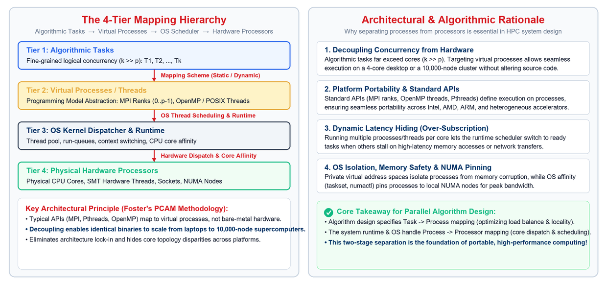
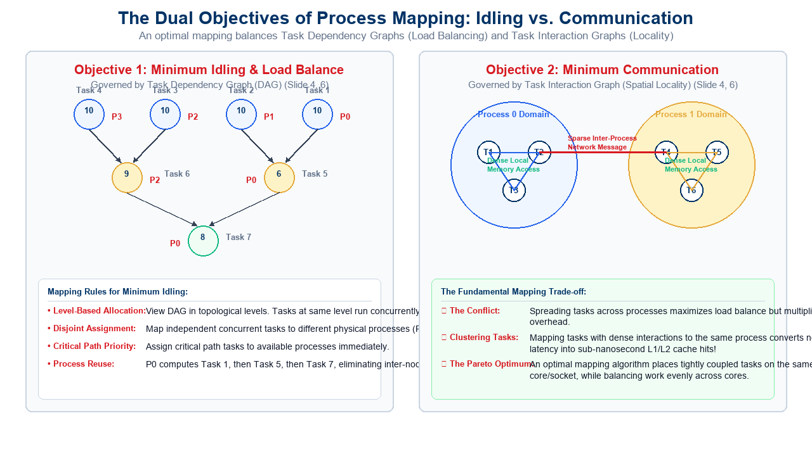
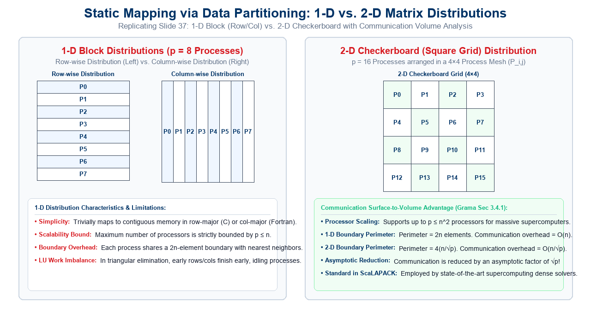
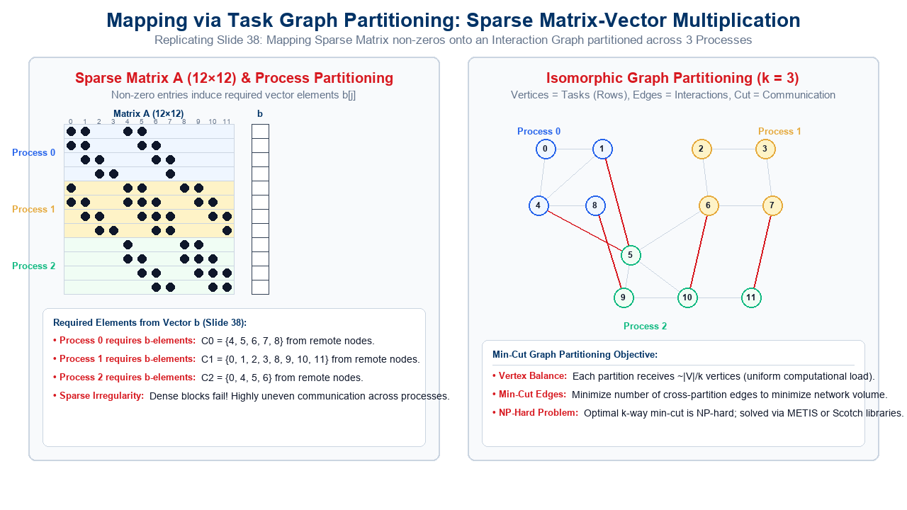
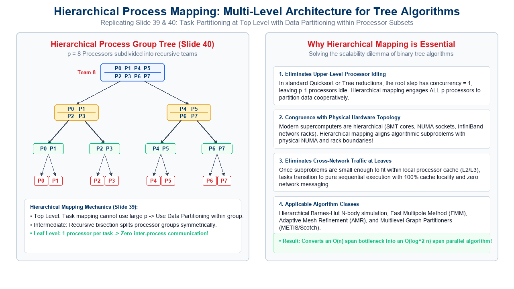
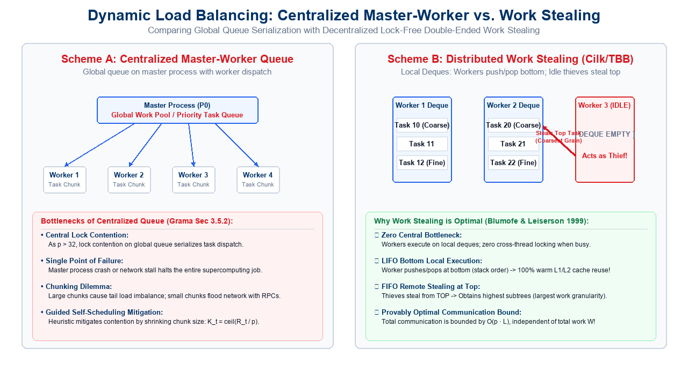
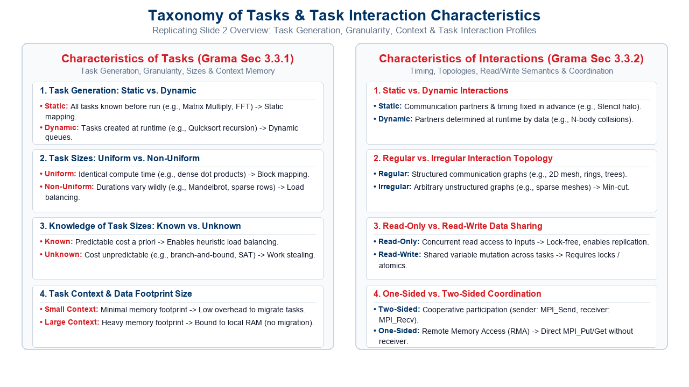

## Lecture Outline

:::: {.columns}

::: {.column width="50%"}
- **The Process Mapping Problem**:
  - Bridging logical task decompositions and physical hardware execution.
  - **Processes vs. Processors**: The 4-tier virtualization hierarchy.
  - Why programming APIs (MPI, OpenMP) map to virtual processes.
- **The Dual Objectives of Process Mapping**:
  - **Objective 1 (Minimize Idling)**: Equal work distribution via Task Dependency Graphs (DAGs).
  - Level-by-level mapping: Database query case study ($P_0..P_3$).
  - **Objective 2 (Minimize Communication)**: Locality via Task Interaction Graphs.
  - The fundamental tension and Pareto optimal trade-off.
- **Taxonomy of Mapping Techniques**:
  - Static Mapping (*a priori*) vs. Dynamic Mapping (*runtime*).
  - Characteristics determining mapping choice.
- **Static Mapping via Data Partitioning**:
  - 1-D Block Distributions (Row-wise and Column-wise).
  - 1-D Cyclic & Block-Cyclic: Solving the LU decomposition imbalance.
  - 2-D Block (Checkerboard) Distribution: Square process meshes.
  - **Surface-to-Volume Analysis**: $\sqrt{p}$ asymptotic communication reduction.
:::

::: {.column width="50%"}
- **Static Mapping via Task Graph Partitioning**:
  - Irregular sparse problems: Sparse Matrix-Vector Multiplication ($y = A \cdot x$).
  - Graph Isomorphism: Matrix non-zero structure as interaction graph.
  - $k$-Way Min-Cut Graph Partitioning formulation (METIS/Scotch).
- **Hierarchical Mapping Architecture**:
  - The scalability limits of pure task mapping in binary trees.
  - Multi-level process groups: Top-level data partitioning + lower-level recursion.
  - Quicksort hierarchical processor allocation tree.
- **Dynamic Mapping & Load Balancing**:
  - Centralized Master-Worker schemes and Guided Self-Scheduling.
  - Distributed **Work Stealing** (Blumofe & Leiserson, Cilk/TBB).
  - Deque mechanics: LIFO local execution vs. FIFO remote stealing.
- **Taxonomy of Tasks & Interactions**:
  - Generation, Granularity, Context, and Interaction profiles.
- **References & Further Reading**:
  - Foundational textbooks and seminal research papers.
:::

::::

---

## From Decomposition to Execution: The Process Mapping Problem

In Lecture 17, we decomposed computational problems into collections of concurrent tasks:

:::: {.columns}

::: {.column width="50%"}
### The Execution Dilemma
- In any non-trivial parallel algorithm, **the number of concurrent tasks vastly exceeds the number of available physical processors**:
  $$|\mathcal{T}| \gg p$$
- For example, a $1024 \times 1024$ matrix-vector multiplication yields:
  - $1,048,576$ scalar multiplication tasks.
  - But the system may have only $p = 16$ or $64$ physical CPU cores!
- **The Mapping Problem**:
  - We must determine a function $M: \mathcal{T} \to \mathcal{P}$ that assigns tasks $\mathcal{T}$ to executing processes $\mathcal{P}$ such that overall parallel completion time is minimized.
:::

::: {.column width="50%"}
### Fundamental Mapping Goals
An appropriate mapping must minimize parallel execution time by satisfying three critical imperatives (Slide 6):
1. **Concurrency**:
   - Map mutually independent tasks to different processes.
2. **Critical Path Prioritization**:
   - Assign tasks located on the critical path to available processes the moment their dependencies are satisfied.
3. **Locality & Overhead Minimization**:
   - Map tasks that exhibit dense interaction to the **same process** to eliminate network messaging.
:::

::::

  <strong>Key Observation (Slide 3):</strong> A parallel algorithm specifies a mapping of tasks to <em>processes</em>, rather than to physical processors, because standard parallel programming APIs decouple logical threads from hardware cores!

---

## Processes vs. Processors: The Architectural Virtualization Layer

  Why do parallel algorithms target <em>processes</em> instead of physical <em>processors</em>? (Slide 3):

  

---

## The Dual Objectives of Process Mapping

Process mapping must satisfy two inherently competing performance objectives (Slide 4, 6):

:::: {.columns}

::: {.column width="50%"}
### Objective 1: Minimizing Idling (Optimal Load Balance)
- **Goal**: Ensure that all processing elements are kept uniformly busy throughout the execution timeline.
- **Driven by**: **Task Dependency Graph (DAG)**.
- **Strategy**:
  - Independent tasks at the same topological level must be distributed across all available processes.
  - Critical path tasks must never wait for an available core.
- **Consequence of Failure**:
  - Severe load imbalance; some processes finish early and sit idle, wasting hardware cycles.
:::

::: {.column width="50%"}
### Objective 2: Minimizing Communication (Maximum Locality)
- **Goal**: Minimize the total volume and frequency of data transfers between physical cores.
- **Driven by**: **Task Interaction Graph**.
- **Strategy**:
  - Tasks that share substantial amounts of data or communicate frequently must be mapped to the **same process** (or neighboring cores on the same NUMA socket).
- **Consequence of Failure**:
  - Interconnect saturation, network buffer contention, and latency bottlenecks.
:::

::::

  <strong>The Fundamental Conflict:</strong> Minimizing idling pushes us to spread tasks widely across all processors; minimizing communication pulls us to cluster tasks onto as few processors as possible! Parallel mapping is the art of finding the optimal balance.

---

## Minimizing Idling: Level-by-Level DAG Mapping (Slide 7)

Let us examine the relational database query decomposition from Lecture 16 and map its tasks to processes:

  

:::: {.columns}

::: {.column width="50%"}
### Level-Based Allocation Mechanics
- **Level 1 (4 Independent Selection Tasks)**:
  - Tasks 1, 2, 3, 4 each have weight 10.
  - Map across 4 processes: $T_1 \to P_0$, $T_2 \to P_1$, $T_3 \to P_2$, $T_4 \to P_3$.
  - Time elapsed: $10$ units. All 4 cores 100% utilized!
- **Level 2 (2 Intermediate Join Tasks)**:
  - Task 5 (weight 6) combines $T_1$ and $T_2$; assigned to $P_0$.
  - Task 6 (weight 9) combines $T_3$ and $T_4$; assigned to $P_2$.
:::

::: {.column width="50%"}
### Process Reuse & Locality Optimization
- Notice that Task 5 is mapped to $P_0$ (which already computed $T_1$).
- Thus, the output of $T_1$ requires **zero inter-process transfer**; it remains resident in $P_0$'s private cache!
- Similarly, Task 6 is assigned to $P_2$ (which computed $T_3$), avoiding remote transfer of $T_3$'s output.
- **Level 3**: Task 7 (weight 8) is mapped to $P_0$.
:::

::::

---

## Taxonomy of Process Mapping Techniques

Mapping algorithms are classified into two broad categories based on when mapping decisions are made (Slide 35):

| Category | Definition & Execution Model | Prerequisites & Requirements | Typical Applications |
|:---|:---|:---|:---|
| **Static Mapping** | Tasks are mapped to processes **a priori** (before execution begins). Task-to-process assignments remain fixed throughout runtime. | Must have a reliable compile-time estimate of the size, duration, and dependencies of each task. | Dense linear algebra, regular grid PDEs, image convolution, FFT. |
| **Dynamic Mapping** | Tasks are assigned to processes **at runtime** by a scheduler as cores become idle. | Used when tasks are generated dynamically, task sizes are unpredictable, or system is heterogeneous. | Exploratory search (15-puzzle), adaptive mesh refinement (AMR), discrete optimization. |

:::: {.columns}

::: {.column width="50%"}
### Other Deciding Factors
- **Data Footprint**:
  - If a task operates on huge arrays, migrating it at runtime is prohibitively expensive $\implies$ Favor **Static Mapping**.
:::

::: {.column width="50%"}
### Three Major Static Schemes (Slide 36)
1. **Mapping based on Data Partitioning**.
2. **Mapping based on Task Graph Partitioning**.
3. **Hierarchical Mapping**.
:::

::::

---

## Static Mapping via Data Partitioning: 1-D Block Distributions

When computation is tightly coupled to regular dense matrices, we combine data partitioning with the **Owner-Computes Rule** (Slide 37):

:::: {.columns}

::: {.column width="50%"}
### Row-Wise Block Distribution
- For an $n \times n$ matrix distributed across $p$ processes:
  - Process $P_i$ is assigned contiguous rows from index $i \cdot (n/p)$ to $(i+1) \cdot (n/p) - 1$.
- **Advantages**:
  - Matches row-major memory layouts (C/C++).
  - Excellent spatial locality for algorithms that sweep along rows (e.g., matrix-vector multiplication $y_i = A_{i,:} \cdot x$).
:::

::: {.column width="50%"}
### Column-Wise Block Distribution
- Process $P_j$ is assigned contiguous columns from index $j \cdot (n/p)$ to $(j+1) \cdot (n/p) - 1$.
- **Advantages**:
  - Matches column-major memory layouts (Fortran, MATLAB).
  - Ideal for algorithms requiring full column broadcasts.
- **Severe Scalability Limit**:
  - With 1-D partitioning, the maximum number of processes is strictly bounded by $p \le n$!
:::

::::

  <strong>The Owner-Computes Rule:</strong> Each process is assigned the computation associated with the data elements it owns, eliminating write conflicts on shared memory and minimizing inter-process messaging on distributed architectures!

---

## Visualizing 1-D vs. 2-D Matrix Distributions

  

---

## 1-D Cyclic and Block-Cyclic Distributions

What happens when computational load across rows or columns is **inherently non-uniform**?

:::: {.columns}

::: {.column width="50%"}
### The Triangular Matrix Bottleneck
- In Gaussian Elimination and LU Factorization, the active submatrix shrinks as computation progresses:
  - Step 1 operates on rows $0 \dots n-1$.
  - Step $k$ operates on rows $k \dots n-1$.
- **Failure of 1-D Block Distribution**:
  - As soon as the upper block of rows is eliminated, Process $P_0$ has zero work remaining!
  - Processes $P_0, P_1, \dots$ sit idle while the final process $P_{p-1}$ finishes the matrix.
  - Overall efficiency drops to $< 50\%$!
:::

::: {.column width="50%"}
### The 1-D Cyclic Solution
- In a **cyclic distribution**, row $i$ is assigned to process $P_{i \bmod p}$:
  - $P_0$ owns rows $0, p, 2p, \dots$
  - $P_1$ owns rows $1, p+1, 2p+1, \dots$
- **Benefit**:
  - Every process owns rows distributed evenly across the entire matrix.
  - As rows are eliminated from top to bottom, the remaining workload remains **perfectly balanced** across all $p$ processes!
- **Block-Cyclic**: Assigns chunks of size $b$ cyclically to maintain SIMD vectorization and cache line reuse.
:::

::::

---

## 2-D Block (Checkerboard) Distribution

To scale beyond $p = n$ processors and minimize communication overhead, we arrange $p$ processes as a **2-D process mesh** of size $\sqrt{p} \times \sqrt{p}$:

:::: {.columns}

::: {.column width="50%"}
### Mathematical Formulation
- Process $P_{r, c}$ (where $0 \le r, c < \sqrt{p}$) owns an $(n/\sqrt{p}) \times (n/\sqrt{p})$ sub-block of matrix $A$:
  $$A_{\text{sub}} = A\left[r \frac{n}{\sqrt{p}} : (r+1) \frac{n}{\sqrt{p}} - 1, \; c \frac{n}{\sqrt{p}} : (c+1) \frac{n}{\sqrt{p}} - 1\right]$$
- **Scalability**:
  - Supports up to $p \le n^2$ concurrent processors!
  - Essential for massively parallel supercomputers with tens of thousands of cores.
:::

::: {.column width="50%"}
### Surface-to-Volume Ratio Comparison
Consider an $n \times n$ stencil computation:
- **1-D Block Distribution**:
  - Data volume owned per process $= n^2 / p$.
  - Perimeter / Communication boundary $= 2n$.
  - Communication-to-Computation ratio $\propto \frac{2n}{n^2/p} = \frac{2p}{n}$.
- **2-D Checkerboard Distribution**:
  - Data volume owned per process $= n^2 / p$.
  - Perimeter / Communication boundary $= 4(n / \sqrt{p})$.
  - Communication-to-Computation ratio $\propto \frac{4(n/\sqrt{p})}{n^2/p} = \frac{4\sqrt{p}}{n}$.
:::

::::

  <strong>Asymptotic Breakthrough:</strong> 2-D checkerboard partitioning reduces inter-process communication volume by an asymptotic factor of $\sqrt{p}$ compared to 1-D block partitioning! This is why ScaLAPACK uses 2-D block-cyclic distributions.

---

## Static Mapping via Task Graph Partitioning (Slide 38)

When problems are **sparse and irregular**, regular 1-D or 2-D block distributions fail catastrophically:

:::: {.columns}

::: {.column width="50%"}
### The Sparse Matrix Challenge
- Consider multiplying a sparse matrix $A$ ($n \times n$) by a dense vector $b$:
  $$y_i = \sum_{j \in \text{NonZeros}(A[i,:])} A_{i,j} \cdot b_j$$
- Most entries in $A$ are zero; non-zeros are distributed irregularly.
- A regular block partition assigns some processes thousands of non-zeros, while other processes receive almost none $\implies$ **severe load imbalance**!
- Furthermore, the required elements of vector $b$ vary arbitrarily across rows.
:::

::: {.column width="50%"}
### The Graph Partitioning Approach
- Transform the sparse computation into an **isomorphic Task Interaction Graph** $G = (V, E)$:
  - **Vertices $V$**: Each vertex $i$ represents the computation of row $y_i$. Vertex weight $w(i) = \text{number of non-zeros in row } i$.
  - **Edges $E$**: An edge $(i, j)$ exists if computing row $i$ requires data produced or owned by row $j$. Edge weight = communication cost.
- **The $k$-Way Min-Cut Problem**:
  - Partition $V$ into $k = p$ disjoint subsets $V_0, V_1, \dots, V_{p-1}$.
:::

::::

  <strong>Core Idea:</strong> Graph partitioning models irregular computational workload as vertex weights and inter-task dependencies as edge costs, turning process mapping into a graph min-cut problem!

---

## Visualizing Sparse Matrix Task Graph Partitioning (Slide 38)

  

---

## Sparse Matrix Graph Partitioning: Formal Objectives

The $k$-way graph partitioning problem optimizes two simultaneous criteria:

:::: {.columns}

::: {.column width="50%"}
### 1. Load Balance Constraint
$$\sum_{v \in V_i} w(v) \approx \frac{1}{p} \sum_{v \in V} w(v) \quad \forall \; i \in \{0, 1, \dots, p-1\}$$

- The total computational weight (floating point operations) assigned to each process must be virtually identical.
- Guarantees minimum idling during parallel execution!
:::

::: {.column width="50%"}
### 2. Minimum Edge-Cut Objective
$$\text{Minimize } \text{Cut}(V_0, \dots, V_{p-1}) = \sum_{(u, v) \in E, \; u \in V_i, \; v \in V_j, \; i \ne j} \text{cost}(u, v)$$

- Cut edges (red lines spanning partitions) represent inter-process network messages.
- Minimizing the cut directly minimizes total network communication volume!
:::

::::

  <strong>Computational Complexity:</strong> Optimal $k$-way min-cut graph partitioning is NP-complete. In practice, high-performance computing utilizes state-of-the-art multilevel heuristic libraries such as <strong>METIS</strong> (Karypis & Kumar) and <strong>Scotch</strong> (Pellegrini).

---

## Hierarchical Mapping Architecture (Slide 39, 40)

Sometimes a single mapping technique is completely inadequate for the entire computation:

:::: {.columns}

::: {.column width="50%"}
### The Binary Tree Scalability Dilemma
- Consider algorithms whose task dependency graphs form a binary tree (Parallel Quicksort, Tree Reductions, Divide-and-Conquer).
- At the top level (root), only **1 task** exists.
- If we map tasks directly to processes, only 1 process can be active at the root, leaving $p-1$ processors idle!
- Pure task mapping **cannot use a large number of processors** at upper levels.
:::

::: {.column width="50%"}
### The Hierarchical Solution
- **Multi-Level Hybrid Mapping**:
  - Use **Data Partitioning** within processor groups at the upper levels.
  - Use **Task Mapping** to divide processor groups at each recursive step.
- **Hierarchical Process Groups**:
  - Start with all $p$ processors working as a single team.
  - Recursively bisect the processor team along with the data subproblems!
:::

::::

  <strong>Key Architectural Insight:</strong> Hierarchical mapping bridges the gap between tree-structured algorithms and physical hardware by dynamically transitioning from collective data partitioning at the root to isolated task parallelism at the leaves!

---

## Visualizing Hierarchical Process Mapping (Slide 39, 40)

  

---

## Hierarchical Quicksort Process Allocation Tree (Slide 40)

Let us trace how $p = 8$ processors are mapped across the Quicksort recursion tree:

:::: {.columns}

::: {.column width="50%"}
### Stage-by-Stage Group Allocation
- **Level 0 (Root Level)**:
  - Processor Team: $\{P_0, P_1, P_4, P_5, P_2, P_3, P_6, P_7\}$.
  - All 8 processors cooperatively partition the initial array around the pivot using **parallel data partitioning**.
- **Level 1 (First Bisection)**:
  - Left subproblem assigned to Team A: $\{P_0, P_1, P_2, P_3\}$.
  - Right subproblem assigned to Team B: $\{P_4, P_5, P_6, P_7\}$.
  - The two teams execute completely independently!
:::

::: {.column width="50%"}
### Transition to Pure Sequential Sorting
- **Level 2 (Second Bisection)**:
  - Four 2-processor teams: $\{P_0, P_1\}$, $\{P_2, P_3\}$, $\{P_4, P_5\}$, $\{P_6, P_7\}$.
- **Level 3 (Leaf Level - Single Processors)**:
  - Each individual processor ($P_0, P_1, \dots, P_7$) owns its private sublist.
  - Switches to local serial quicksort in private L1/L2 cache with **zero inter-process communication**!
- **Result**:
  - Overcomes the Amdahl's Law serial root bottleneck; delivers polylogarithmic span $O(\log^2 n)$.
:::

::::

---

## Dynamic Mapping: Centralized Schemes

When tasks are generated dynamically or have unpredictable execution times, **static mapping leads to catastrophic load imbalance**:

:::: {.columns}

::: {.column width="50%"}
### Master-Worker (Task Pool) Architecture
- A designated **Master Process** manages a global pool/queue of ready tasks.
- **Worker Processes** execute tasks:
  1. Worker finishes its current task.
  2. Worker sends a request message to the master asking for new work.
  3. Master pulls task(s) from the queue and sends them to the worker.
  4. Worker executes and returns results.
- **Automatic Load Balancing**:
  - Fast processors or workers with light tasks request work more frequently; slow workers request less frequently.
:::

::: {.column width="50%"}
### The Central Contention Bottleneck
- **Master Serialization**:
  - As processor count grows ($p > 32$), the master becomes a communication bottleneck.
  - Workers spend more time waiting in line for the master to respond than doing actual work!
- **Chunking Strategies**:
  - Instead of dispatching 1 task at a time, master dispatches chunks of size $K$.
  - **Guided Self-Scheduling (GSS)**:
    - Early in the computation, dispatch large chunks: $K_t = \lceil R_t / p \rceil$ (where $R_t$ is remaining tasks).
    - As remaining work shrinks, chunk size decreases geometrically down to 1.
:::

::::

---

## Distributed Dynamic Mapping: Work Stealing

  To eliminate the centralized master bottleneck entirely, modern runtimes (Cilk, Intel TBB, OpenMP, Fork-Join) utilize <strong>Decentralized Work Stealing</strong> (Blumofe &amp; Leiserson 1999):

  

---

## Work Stealing Mechanics: Local Deques & Steal Discipline

Modern decentralized work schedulers decouple local computation from remote load balancing:

:::: {.columns}

::: {.column width="50%"}
### Local Double-Ended Queues (Deques)
- Every worker process maintains its own private **deque** (double-ended queue) of tasks.
- **Local Push/Pop at Bottom (LIFO)**:
  - The local worker treats the deque as a **stack** (LIFO: Last-In, First-Out).
  - Newly spawned subtasks are pushed onto the bottom.
  - Exploits temporal and spatial cache locality — child task data is already warm in L1/L2 cache!
:::

::: {.column width="50%"}
### Remote Work Stealing at Top (FIFO)
- **Thief Execution**:
  - When a worker's deque becomes completely empty, it becomes a **thief**.
  - It chooses a victim worker uniformly at random.
  - It attempts to **steal a task from the TOP** of the victim's deque (FIFO: First-In, First-Out).
- **Why Steal from the Top?**
  - Tasks near the top are the highest ancestors in the recursion tree $\implies$ largest granularity of work!
  - Minimizes future steal attempts and amortizes network overhead.
:::

::::

  <strong>Locality vs. Granularity:</strong> LIFO push/pop at the bottom optimizes fine-grained cache reuse for busy cores, while FIFO stealing at the top transfers coarse-grained work to idle cores!

---

## Provable Optimality of Work Stealing

The work stealing paradigm is backed by one of the most celebrated theoretical results in parallel computing:

:::: {.columns}

::: {.column width="50%"}
### Blumofe-Leiserson Scheduling Theorem
> **Theorem (Blumofe & Leiserson 1999)**: For any multithreaded computation with total work $W$ and critical path length (span) $L$, a randomized work-stealing scheduler on $p$ processors executes the computation in expected time:
> $$T_p \le \frac{W}{p} + O(L)$$

- **Significance**:
  - As long as average concurrency $W/L \gg p$, the execution time is strictly dominated by $W/p$ $\implies$ **near-perfect linear speedup**!
:::

::: {.column width="50%"}
### Total Communication Bound
- In work stealing, communication occurs **only when a steal attempt is made**.
- When processors are busy, there is **zero inter-process communication or locking**.
- The total number of steal attempts across the entire execution is bounded by:
  $$\text{Total Steals} = O(p \cdot L)$$
- **Crucial Consequence**:
  - Communication overhead depends *only on the depth of the algorithm $L$*, completely independent of the total problem size or work $W$!
:::

::::

---

## Taxonomy of Task Characteristics (Slide 2 Overview)

  Understanding the inherent characteristics of tasks and their interactions is essential for selecting optimal process mapping:

  

---

## Detailed Task Characteristics: Generation, Granularity & Context

Algorithmic properties determine whether static assignment is feasible or dynamic load balancing is mandatory:

:::: {.columns}

::: {.column width="50%"}
### Task Generation & Sizes
- **Task Generation**:
  - **Static**: All tasks known before execution starts (e.g., matrix multiply). Enables compile-time mapping.
  - **Dynamic**: Tasks spawned at runtime (e.g., quicksort recursion). Requires runtime task queues.
- **Task Sizes**:
  - **Uniform**: Identical compute duration across tasks. Simplifies block partitioning.
  - **Non-Uniform**: Variable compute duration. Requires cyclic or dynamic load balancing.
:::

::: {.column width="50%"}
### Task Knowledge & Context
- **Knowledge of Task Sizes**:
  - **Known *a priori***: Enables heuristic load balancing (e.g., non-zero count per row in sparse matrices).
  - **Unknown / Stochastic**: Requires runtime work-stealing schedulers.
- **Task Context (Memory Footprint)**:
  - **Small Context**: Easily migrated between processor cores with low communication overhead.
  - **Large Context**: Bound to local RAM; task migration incurs severe bandwidth penalties.
:::

::::

  <strong>Design Takeaway:</strong> Static generation + uniform sizes + known costs + large context $\implies$ <em>Ideal for Static Mapping</em>. Dynamic generation + non-uniform sizes + unknown costs + small context $\implies$ <em>Ideal for Work Stealing</em>.

---

## Taxonomy of Task Interaction Characteristics (Slide 2 Overview)

The physical nature of inter-task communication dictates synchronization requirements:

| Characteristic | Options & Manifestations | System Impact & Optimal Mapping |
|:---|:---|:---|
| **Timing of Interactions** | **Static** vs. **Dynamic** | Static interactions allow pre-scheduled communication patterns; dynamic interactions require polling or reactive message handlers. |
| **Topology of Interactions** | **Regular** vs. **Irregular** | Regular topologies (rings, 2-D grids, trees) map directly to structured hardware; irregular graphs require min-cut graph partitioning. |
| **Read/Write Semantics** | **Read-Only** vs. **Read-Write** | Read-only allows concurrent, lock-free access and data replication; read-write mandates mutual exclusion (locks, critical sections, atomics). |
| **Coordination Model** | **Two-Sided** vs. **One-Sided** | Two-Sided requires cooperative participation (`MPI_Send`/`MPI_Recv`); One-Sided utilizes Remote Memory Access (RMA: `MPI_Put`/`MPI_Get`). |

  <strong>Architectural Synthesis:</strong> Static + Regular + Read-Only interactions yield the highest parallel scalability. Dynamic + Irregular + Read-Write interactions represent the most challenging class of HPC workloads.

---

## Key Takeaways: Lecture 18 Summary

:::: {.columns}

::: {.column width="50%"}
### 1. Process Mapping Principles
- **Processes vs. Processors**:
  - Virtualization enables hardware abstraction, portability, and latency hiding.
- **Dual Optimization Goals**:
  - Minimize Idling (via Task Dependency DAGs) vs. Minimize Communication (via Task Interaction Graphs).
- **Static vs. Dynamic Mapping**:
  - Static mapping leverages compile-time data partitioning; dynamic mapping adapts to runtime irregularity.
:::

::: {.column width="50%"}
### 2. High-Performance Mapping Schemes
- **2-D Checkerboard Distribution**:
  - Achieves an asymptotic $\sqrt{p}$ reduction in boundary communication volume over 1-D block partitioning.
- **Sparse Graph Partitioning**:
  - $k$-way min-cut balances non-zero compute load while minimizing communication edge cuts.
- **Hierarchical & Work-Stealing Systems**:
  - Hierarchical mapping eliminates binary tree root bottlenecks; work stealing provably achieves optimal $T_p \le W/p + O(L)$ time with $O(p \cdot L)$ communication.
:::

::::

---

## References & Further Reading

1. **Grama, A., Gupta, A., Karypis, G., & Kumar, V.** (2003). *Introduction to Parallel Computing* (2nd ed.). Addison-Wesley.
   - **Chapter 3**: "Principles of Parallel Algorithm Design" (Sections 3.4–3.5, pp. 110–136).
   - Authoritative source for 1D/2D block distributions, sparse matrix graph partitioning, and hierarchical mapping.
2. **Blumofe, R. D., & Leiserson, C. E.** (1999). *Scheduling multithreaded computations by work stealing*. Journal of the ACM (JACM), 46(5), 720-748.
   - Foundational paper proving the optimality of work stealing and the $O(p \cdot L)$ communication bound.
3. **Karypis, G., & Kumar, V.** (1998). *A fast and high quality multilevel scheme for partitioning irregular graphs*. SIAM Journal on Scientific Computing, 20(1), 359-392.
   - Core paper describing the METIS multilevel min-cut graph partitioning algorithm.
4. **Quinn, M. J.** (2004). *Parallel Programming in C with MPI and OpenMP*. McGraw-Hill Education.
   - **Chapter 3 & 4**: Mapping strategies and communication minimization in MPI.
5. **Cormen, T. H., Leiserson, C. E., Rivest, R. L., & Stein, C.** (2022). *Introduction to Algorithms* (4th ed.). MIT Press.
   - **Chapter 26**: Multithreaded greedy schedulers and work stealing.
