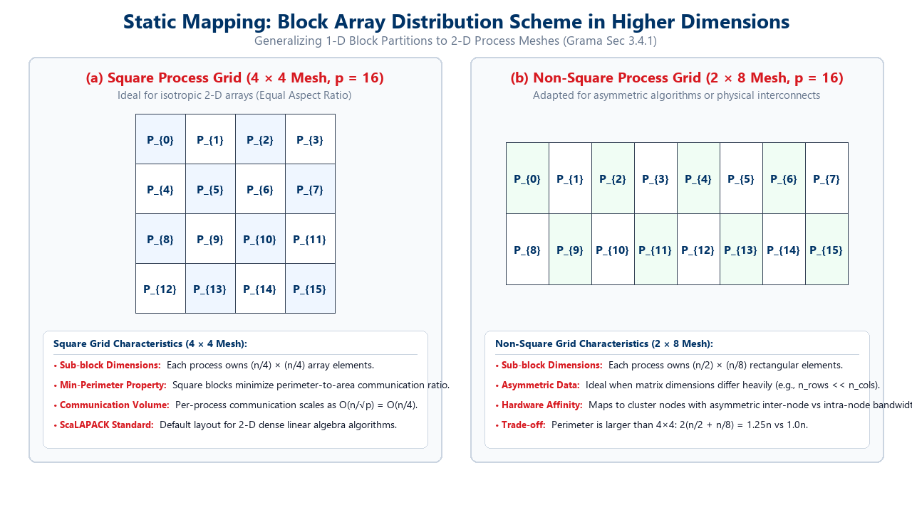
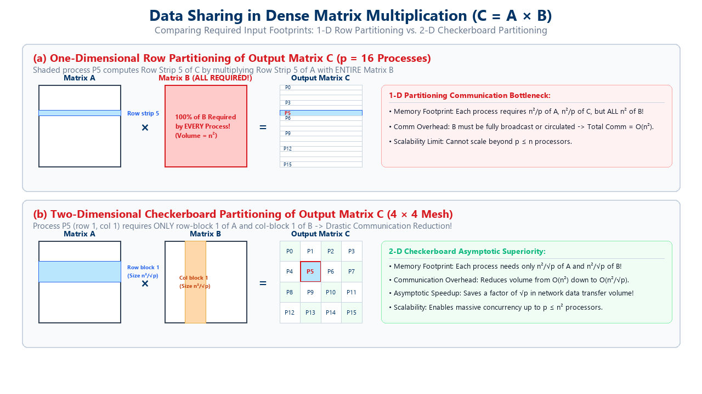
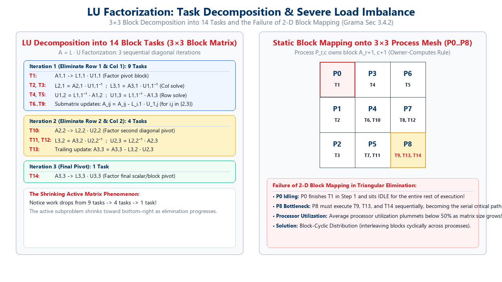
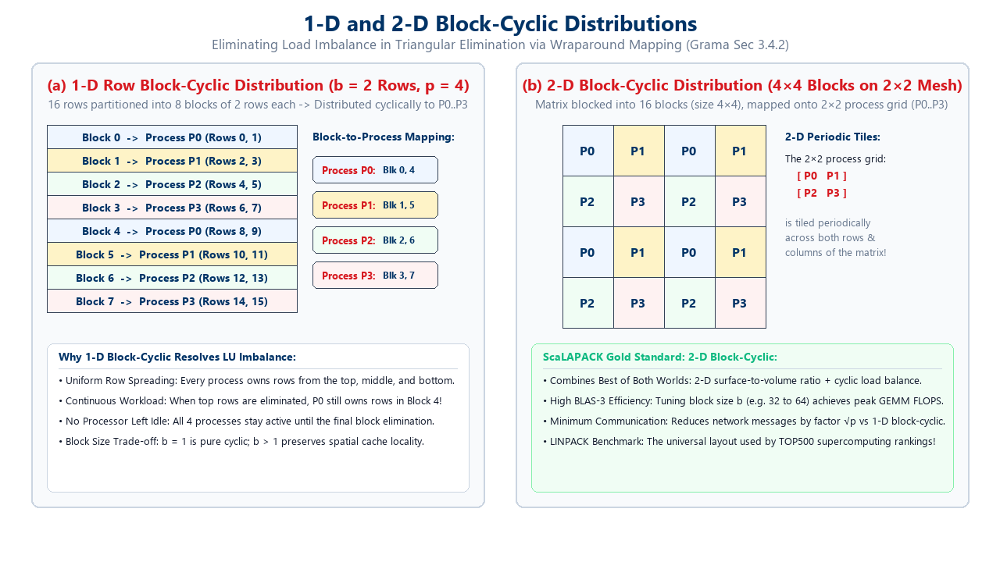
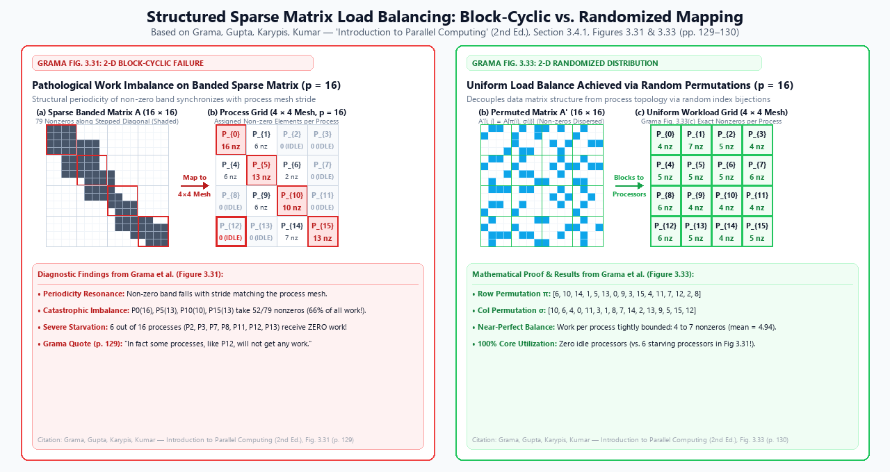
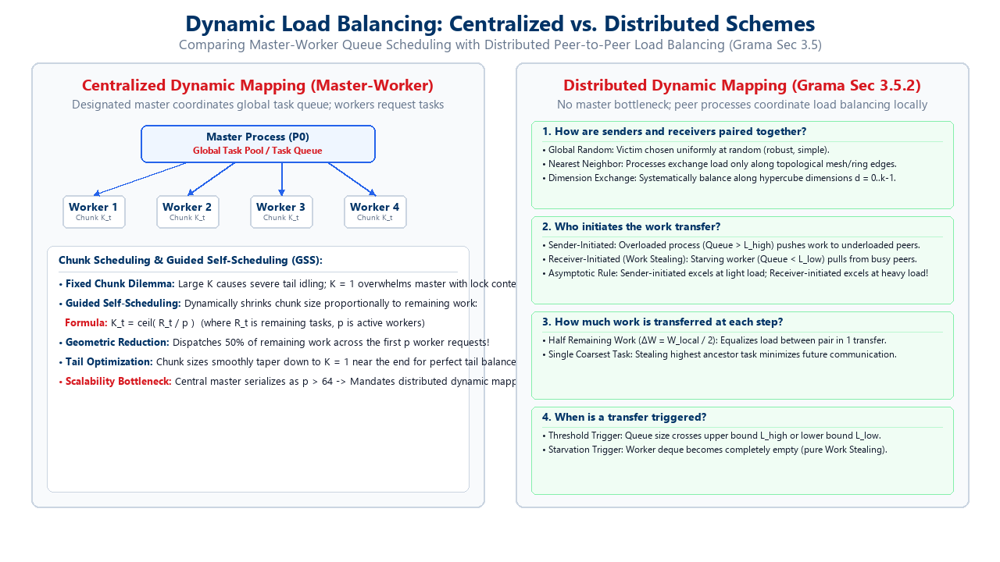

## Lecture Outline

:::: {.columns}

::: {.column width="50%"}
- **Higher-Dimensional Block Distributions**:
  - Extending 1-D block arrays to 2-D matrices and 3-D grids.
  - Square ($p_r = p_c$) vs. Rectangular ($p_r \ne p_c$) process meshes.
  - Scalability limit relaxation ($p \le n$ vs. $p \le n^2$).
- **Data Sharing in Dense Matrix Multiplication**:
  - Partitioning output matrix $C = A \times B$ via block mapping.
  - 1-D row decomposition: $O(n^2)$ communication & memory bottleneck.
  - 2-D checkerboard decomposition: $O(n^2/\sqrt{p})$ surface-to-volume ratio.
- **Dense LU Factorization & Load Imbalance**:
  - Gaussian elimination without pivoting on a $3 \times 3$ block matrix.
  - The 14 canonical sub-tasks (factorizations, solves, updates).
  - The fatal flaw of 2-D block distribution: Active submatrix shrinkage.
  - Processor idling timeline: $P_0$ starvation vs. $P_8$ bottleneck.
:::

::: {.column width="50%"}
- **Block-Cyclic Distributions**:
  - Over-decomposition into micro-blocks of size $b \times b$.
  - 1-D and 2-D round-robin tile assignment.
  - ScaLAPACK tuning: BLAS-3 cache locality + cyclic load balance.
- **Structured Sparse Matrices & Randomization**:
  - Periodicity pathology: Banded diagonals aligning with process grid.
  - Randomized row and column permutations ($\pi, \sigma$).
  - Restoring statistical uniformity without destroying indexing.
- **Dynamic Mapping & Dynamic Load Balancing**:
  - Centralized Master-Worker model & scheduling overhead.
  - Chunk Scheduling & Guided Self-Scheduling (GSS: $K_t = \lceil R_t / p \rceil$).
  - Distributed dynamic schemes: The 4 Critical Questions.
  - Work Stealing deques: LIFO local execution vs. FIFO remote stealing.
- **Academic References**:
  - Foundational textbooks and seminal research papers.
:::

::::

---

## Static Mapping: Higher-Dimensional Block Distributions

In Lecture 18, we partitioned arrays along a single dimension (1-D row or column striping). We can generalize block distribution to higher dimensions:

:::: {.columns}

::: {.column width="50%"}
### Generalizing to 2-D and 3-D
- Instead of mapping to a 1-D array of processes, we arrange the $p$ virtual processes into a multi-dimensional logical mesh:
  $$p = p_r \times p_c \quad \text{(for 2-D)}$$
- An $n \times n$ dense matrix is partitioned into $p_r \times p_c$ rectangular sub-blocks:
  $$\text{Block Dimensions: } \left(\frac{n}{p_r}\right) \times \left(\frac{n}{p_c}\right)$$
- Each process $P_{i,j}$ owns a dedicated sub-block of the matrix:
  $$A_{i,j} \iff P_{i,j} = P_{i \cdot p_c + j}$$
:::

::: {.column width="50%"}
### Why Higher Dimensions Matter
1. **Dramatic Scalability Expansion**:
   - 1-D partitioning limits parallel concurrency to $p \le n$.
   - 2-D block partitioning allows scaling up to $p \le n^2$ processes!
2. **Aspect Ratio Flexibility**:
   - **Square Grids** ($\sqrt{p} \times \sqrt{p}$): Ideal when communication must be symmetric along rows and columns.
   - **Rectangular Grids** ($p_r \times p_c$): Preferred when row operations differ fundamentally in cost or frequency from column operations.
:::

::::

  <strong>Reference Principle (Grama Sec 3.4.1):</strong> Higher-dimensional data decomposition allows the use of significantly larger process counts while maintaining balanced sub-blocks and minimizing per-process memory footprints.

---

## Visualizing Higher-Dimensional Block Mapping

Comparing a Square Process Grid ($4 \times 4$) with a Rectangular Process Grid ($2 \times 8$) for $p = 16$:

  

---

## Coordinate Mapping in Multi-Dimensional Process Grids

Converting between 2-D array coordinates and 1-D linearized process ranks:

:::: {.columns}

::: {.column width="50%"}
### 2-D Index Mapping Formula
- For an $n \times n$ matrix distributed on a $p_r \times p_c$ process grid:
  $$\text{Row Process: } \quad i = \left\lfloor \frac{r}{n / p_r} \right\rfloor$$
  $$\text{Col Process: } \quad j = \left\lfloor \frac{c}{n / p_c} \right\rfloor$$
- **Linearized Process Rank** (Row-Major):
  $$\text{Rank}(P_{i,j}) = i \cdot p_c + j$$
- Local array offsets inside process $P_{i,j}$:
  $$r_{\text{local}} = r \pmod{n / p_r}, \quad c_{\text{local}} = c \pmod{n / p_c}$$
:::

::: {.column width="50%"}
### Grid Geometry & Communication Perimeter
- The perimeter of a sub-block governs its message exchange surface area:
  $$\text{Perimeter} = 2 \cdot \left( \frac{n}{p_r} + \frac{n}{p_c} \right)$$
- **Square Grid Minimization**:
  - When $p_r = p_c = \sqrt{p}$, the sub-block is square:
    $$\text{Perimeter}_{\min} = 4 \cdot \frac{n}{\sqrt{p}}$$
  - A square geometry strictly minimizes the surface-to-volume ratio, cutting communication overhead to its theoretical minimum!
:::

::::

  <strong>Design Rule:</strong> Use a square process mesh ($\sqrt{p} \times \sqrt{p}$) whenever algorithms require symmetric horizontal and vertical communication (e.g., Cannon's or Fox's matrix multiplication).

---

## Data Sharing in Dense Matrix Multiplication ($C = A \times B$)

Consider computing $C = A \times B$ for two dense $n \times n$ matrices using block decomposition:

:::: {.columns}

::: {.column width="50%"}
### Task Granularity & Output Partitioning
- Each element $C_{i,j}$ requires evaluating an inner product of length $n$:
  $$C_{i,j} = \sum_{k=0}^{n-1} A_{i,k} \cdot B_{k,j}$$
- Total computational work: $2n^3$ floating-point operations.
- By assigning equal numbers of elements of $C$ to each process (the **Owner-Computes Rule**), computational workload is perfectly balanced.
- **The Core Dilemma**: Which decomposition of $C$ (1-D or 2-D) minimizes communication overhead?
:::

::: {.column width="50%"}
### Input Data Sharing Requirements
- To compute a specific block of $C$, a process requires:
  - The corresponding **horizontal rows of $A$**.
  - The corresponding **vertical columns of $B$**.
- Because multiple processes compute blocks sharing rows or columns:
  - Elements of $A$ and $B$ must be shared or replicated across processes.
  - The choice of 1-D vs. 2-D partitioning fundamentally dictates how much data must be transferred across the network!
:::

::::

  <strong>Key Takeaway:</strong> The choice of precise decomposition (1-D vs. 2-D) is dictated entirely by the associated communication overhead and memory footprint, not by computational load balance!

---

## Visualizing Data Footprints: 1-D vs. 2-D Partitioning

Shaded portions of input matrices $A$ and $B$ required by the process computing the shaded block of $C$:

  

---

## Mathematical Analysis: Why 2-D Partitioning Wins

Comparing memory requirements and communication volumes for computing $C = A \times B$ across $p$ processes:

:::: {.columns}

::: {.column width="50%"}
### 1-D Row-Striped Partitioning
- Process $P_i$ owns a horizontal strip of $C$ of size $(n/p) \times n$.
- **Required Data Footprint**:
  - From $A$: Strip $(n/p) \times n \implies \frac{n^2}{p}$ elements.
  - From $B$: **The entire matrix $B$ ($n \times n$)** $\implies n^2$ elements!
- **Catastrophic Bottlenecks**:
  - **Memory Explosion**: Every process must store all $n^2$ entries of $B$.
  - **Communication Overhead**: Matrix $B$ must be completely broadcast across all cores ($O(n^2)$ network traffic).
  - **Concurrency Ceiling**: $p \le n$.
:::

::: {.column width="50%"}
### 2-D Checkerboard Partitioning
- Process $P_{i,j}$ owns a sub-block of $C$ of size $(n/\sqrt{p}) \times (n/\sqrt{p})$.
- **Required Data Footprint**:
  - From $A$: Row-block of size $(n/\sqrt{p}) \times n \implies \frac{n^2}{\sqrt{p}}$ elements.
  - From $B$: Column-block of size $n \times (n/\sqrt{p}) \implies \frac{n^2}{\sqrt{p}}$ elements.
- **Architectural Advantages**:
  - **Memory Reduction**: Footprint drops from $n^2$ to $\frac{n^2}{\sqrt{p}}$, a reduction by factor $\sqrt{p}$!
  - **Communication Efficiency**: Sub-blocks circulate only among processes in the same row or column.
  - **Massive Scalability**: Concurrency scales up to $p \le n^2$.
:::

::::

  <strong>Surface-to-Volume Theorem:</strong> 2-D checkerboard partitioning reduces the data communication footprint per process by a factor of $\sqrt{p}$, enabling linear scaling on supercomputers with thousands of cores!

---

## When Block Decompositions Fail: Non-Uniform Computations

Block decomposition works exceptionally well when every data item requires identical computation:

:::: {.columns}

::: {.column width="50%"}
### The Uniformity Assumption
- Matrix multiplication, Jacobi stencils, and image convolutions exhibit **uniform work distribution**:
  - Every element $C_{i,j}$ requires exactly $n$ multiply-add operations.
  - Assigning equal block areas yields identical computational workloads.
:::

::: {.column width="50%"}
### Non-Uniform Workloads
- In many critical scientific algorithms, the amount of computation associated with data items **varies drastically**:
  - Sub-blocks at different coordinates require different amounts of work.
  - As computation progresses, the active problem domain shrinks!
- **Consequence**: Under standard block mapping, some processes run out of work almost immediately and sit idle, while others choke on heavy workloads!
:::

::::

  <strong>Canonical Case Study:</strong> Dense Gaussian elimination and <strong>LU Factorization</strong> of dense matrices exhibit severe, progressive computational shrinkage that completely breaks standard 2-D block distributions!

---

## LU Factorization: Block Formulation & Step 1 Tasks ($T_1..T_5$)

Consider factoring an $n \times n$ matrix $A$ into triangular factors $A = L \cdot U$ partitioned into a $3 \times 3$ grid of submatrices:

$$\begin{bmatrix} A_{1,1} & A_{1,2} & A_{1,3} \\ A_{2,1} & A_{2,2} & A_{2,3} \\ A_{3,1} & A_{3,2} & A_{3,3} \end{bmatrix} = \begin{bmatrix} L_{1,1} & 0 & 0 \\ L_{2,1} & L_{2,2} & 0 \\ L_{3,1} & L_{3,2} & L_{3,3} \end{bmatrix} \begin{bmatrix} U_{1,1} & U_{1,2} & U_{1,3} \\ 0 & U_{2,2} & U_{2,3} \\ 0 & 0 & U_{3,3} \end{bmatrix}$$

:::: {.columns}

::: {.column width="50%"}
### Task 1: Diagonal Pivot Factorization
- **Task $T_1$**: Perform LU factorization on the top-left submatrix:
  $$A_{1,1} = L_{1,1} \cdot U_{1,1}$$
- Yields the foundational diagonal factors $L_{1,1}$ and $U_{1,1}$.
- Must complete first before any other task can proceed (**Critical Path root**).
:::

::: {.column width="50%"}
### Tasks 2..5: Triangular System Solves
- **Column Solves** (Solve with $U_{1,1}^{-1}$):
  - **Task $T_2$**: $L_{2,1} = A_{2,1} \cdot U_{1,1}^{-1}$
  - **Task $T_3$**: $L_{3,1} = A_{3,1} \cdot U_{1,1}^{-1}$
- **Row Solves** (Solve with $L_{1,1}^{-1}$):
  - **Task $T_4$**: $U_{1,2} = L_{1,1}^{-1} \cdot A_{1,2}$
  - **Task $T_5$**: $U_{1,3} = L_{1,1}^{-1} \cdot A_{1,3}$
:::

::::

  <strong>Observation:</strong> Tasks $T_2, T_3, T_4, T_5$ are mutually independent and can execute concurrently the instant Task $T_1$ completes!

---

## LU Factorization: Trailing Submatrix Updates ($T_6..T_{14}$)

Once Step 1 completes, the trailing $2 \times 2$ submatrix is updated (Schur complement) and recursively factored:

:::: {.columns}

::: {.column width="50%"}
### Step 2: Schur Complement Updates
- Four independent rank-1 matrix updates:
  - **Task $T_6$**: $A_{2,2} \leftarrow A_{2,2} - L_{2,1} \cdot U_{1,2}$
  - **Task $T_7$**: $A_{3,2} \leftarrow A_{3,2} - L_{3,1} \cdot U_{1,2}$
  - **Task $T_8$**: $A_{2,3} \leftarrow A_{2,3} - L_{2,1} \cdot U_{1,3}$
  - **Task $T_9$**: $A_{3,3} \leftarrow A_{3,3} - L_{3,1} \cdot U_{1,3}$
- Notice that all 4 updates require outputs from Step 1!
:::

::: {.column width="50%"}
### Step 3: Trailing Factorization & Completion
- **Task $T_{10}$**: Factor 2nd pivot $A_{2,2} = L_{2,2} \cdot U_{2,2}$
- **Tasks $T_{11}, T_{12}$**: Triangular solves:
  - $T_{11}: L_{3,2} = A_{3,2} \cdot U_{2,2}^{-1}$
  - $T_{12}: U_{2,3} = L_{2,2}^{-1} \cdot A_{2,3}$
- **Task $T_{13}$**: Trailing update:
  - $A_{3,3} \leftarrow A_{3,3} - L_{3,2} \cdot U_{2,3}$
- **Task $T_{14}$**: Factor final pivot $A_{3,3} = L_{3,3} \cdot U_{3,3}$
:::

::::

  <strong>14 Tasks Total:</strong> Notice the progressive shrinkage of active tasks: Step 1 generates 9 tasks ($T_1..T_9$), Step 2 generates 4 tasks ($T_{10}..T_{13}$), and Step 3 leaves only 1 task ($T_{14}$)!

---

## Visualizing LU Factorization & Process Idling

A $3 \times 3$ block LU decomposition mapped to a $3 \times 3$ process mesh ($P_0..P_8$):

  

---

## Pathology of Pure Block Mapping in LU Factorization

Why mapping $A_{i,j} \to P_{i,j}$ leads to massive processor starvation:

:::: {.columns}

::: {.column width="50%"}
### Process Assignment Table
- **Process $P_0$**: Executes **ONLY Task 1** ($A_{1,1} = L_{1,1} U_{1,1}$).
  - As soon as Step 1 finishes, $P_0$ has zero tasks for the remainder of the algorithm!
  - **Idling Duration**: Sits idle for Steps 2 and 3!
- **Processes $P_1, P_2, P_3, P_6$**:
  - Execute only Step 1 column/row solves.
  - Sits completely idle during Steps 2 and 3!
- **Process $P_8$**:
  - Must execute $T_9$ (Step 1), $T_{13}$ (Step 2), and $T_{14}$ (Step 3).
  - Runs continuously while almost all other cores are dead!
:::

::: {.column width="50%"}
### Asymptotic Efficiency Collapse
- As matrix dimension $n \to \infty$ with $p$ processes under block distribution:
  - After step $k$, an active submatrix of dimension $(n - k) \times (n - k)$ remains.
  - Top-left processes become permanently idle.
  - When $k = n/2$, **75% of the processors are completely idle**!
- **Parallel Efficiency**:
  $$\text{Efficiency } E \le \frac{1}{3} \approx 33\%$$
  - Two-thirds of all available processor cycles are utterly wasted!
:::

::::

  <strong>The Root Cause:</strong> In pure block distribution, each process owns only one contiguous geographic region. When the active computational frontier sweeps past that region, the process starves!

---

## Block-Cyclic Distribution: The Universal Solution

To eliminate the idling and workload shrinkage problem, we introduce **Block-Cyclic Distribution**:

:::: {.columns}

::: {.column width="50%"}
### The Core Philosophy
1. **Over-Decomposition**:
   - Partition the array into far more blocks than the number of available processes:
     $$\text{Number of Blocks } M \gg p$$
2. **Round-Robin Interleaving**:
   - Assign blocks to processes in cyclic (round-robin) order.
   - Each process receives a collection of **non-adjacent, interleaved blocks** spread across the entire matrix!
3. **Continuous Participation**:
   - Because every process owns blocks in all parts of the matrix, all processes remain actively engaged until the final step!
:::

::: {.column width="50%"}
### Tuning Block Size $b$
- The block size $b$ is a tunable parameter that controls the trade-off:
  - **$b = 1$ (Pure Cyclic Distribution)**:
    - Maximum load balancing: Each process gets individual rows or columns.
    - Poor data locality: Destroys cache reuse and increases message count.
  - **$b = n/p$ (Pure Block Distribution)**:
    - High spatial locality, but catastrophic load imbalance.
  - **Optimal $b \in [16, 64]$ (Block-Cyclic)**:
    - Balances high cache BLAS-3 performance with near-perfect load balance!
:::

::::

  <strong>ScaLAPACK Definition:</strong> Block-cyclic distribution partitions an array into contiguous blocks of size $b$, and maps block $(I, J)$ to process $(I \pmod{p_r}, J \pmod{p_c})$ on a $p_r \times p_c$ mesh.

---

## Visualizing 1-D & 2-D Block-Cyclic Layouts

Comparing 1-D Block-Cyclic ($b=2$ rows on 4 processes) with 2-D Block-Cyclic ($4 \times 4$ blocks on $2 \times 2$ mesh):

  

---

## Why 2-D Block-Cyclic is the Supercomputing Standard

Modern high-performance linear algebra libraries (ScaLAPACK, SLATE, cuSOLVER) universally adopt **2-D Block-Cyclic Distribution**:

:::: {.columns}

::: {.column width="50%"}
### Synergy of Three Principles
1. **2-D Checkerboard Communication**:
   - Reduces inter-process communication surface area by a factor of $\sqrt{p}$ compared to 1-D partitioning.
2. **Cyclic Load Balancing**:
   - Distributes trailing submatrix shrinkage uniformly across all processes during LU, Cholesky, and QR factorizations.
3. **BLAS-3 Cache Blocking**:
   - By choosing block size $b \approx 32\text{ to }64$, each local block fits in L1/L2 cache, maximizing GEMM (Matrix Multiplication) FLOPS!
:::

::: {.column width="50%"}
### Real-World Impact: The TOP500 Benchmark
- The **High-Performance LINPACK (HPL)** benchmark, which ranks the world's fastest supercomputers (Frontier, Aurora, Fugaku):
  - Solves an enormous dense system $A x = b$ using LU factorization with partial pivoting.
  - Runs exclusively on top of a **2-D block-cyclic layout**.
  - Without 2-D block-cyclic mapping, scaling to hundreds of thousands of cores would be mathematically impossible!
:::

::::

  <strong>ScaLAPACK Rule of Thumb:</strong> Choose square or near-square process grids ($p_r \approx p_c$), with block sizes $b \in [32, 64]$ to saturate CPU vector registers while preserving load balance.

---

## Disadvantage of Block-Cyclic: Structured Sparse Matrices

Despite its universal success in dense linear algebra, block-cyclic distribution can fail catastrophically on **structured sparse matrices**:

:::: {.columns}

::: {.column width="50%"}
### Where Sparse Banded Matrices Arise
- Numerical solutions of PDEs using Finite Differences, Finite Elements, or Stencil methods:
  - 1-D wave equations, 2-D Poisson solvers, spline interpolations.
- Yield **banded matrices** or **stepped diagonal matrices**:
  - Non-zero coefficients are concentrated exclusively along the main diagonal and a few adjacent sub-diagonals.
  - Vast majority of off-diagonal regions are completely zero!
:::

::: {.column width="50%"}
### The Periodicity Trap
- Consider a banded sparse matrix mapped onto a $4 \times 4$ process grid ($p = 16$) using block-cyclic distribution:
  - Because non-zeros follow the diagonal, they fall with periodic regularity onto the **same process indices**!
  - Processes on the process mesh diagonal ($P_0, P_5, P_{10}, P_{15}$) receive **66% of all non-zero entries** (52 out of 79)!
  - Seven off-diagonal processes ($P_2, P_3, P_7, P_8, P_{11}, P_{12}, P_{13}$) receive **zero work**!
:::

::::

  <strong>Pathological Failure (Grama Fig. 3.31):</strong> The spatial periodicity of the block-cyclic mapping synchronizes with the structural periodicity of the sparse matrix, resulting in massive load imbalance (processes like $P_{12}$ receive zero work)!

---

## Visualizing Sparse Matrix Periodicity & Randomization

Comparison of Grama Figure 3.31 (Block-Cyclic Failure) vs. Grama Figure 3.33 (2-D Randomized Block Distribution):

  

---

## Randomized Block-Cyclic Distribution: Mechanics

To break the pathological coupling between matrix structure and process grid periodicity:

:::: {.columns}

::: {.column width="50%"}
### The Random Permutation Algorithm
1. **Generate Pseudo-Random Permutations**:
   - Generate two independent, uniformly random permutations of indices $\{0, 1, \dots, n-1\}$:
     $$\pi: \text{Row permutation}, \quad \sigma: \text{Column permutation}$$
2. **Virtual Coordinate Translation**:
   - Instead of storing element $A(i, j)$ at $(i, j)$, store it at permuted coordinates:
     $$A'( \pi(i), \sigma(j) ) \leftarrow A(i, j)$$
3. **Standard Block-Cyclic Mapping**:
   - Now distribute the randomized matrix $A'$ using standard 2-D block-cyclic mapping!
:::

::: {.column width="50%"}
### Why It Works & Key Guarantees
- **Index Integrity Preserved**:
  - Entries retain their original logical indices $(i, j)$ in metadata; no algebraic equations are altered.
- **Statistical Workload Homogenization**:
  - The clustering of non-zeros along diagonals is shattered and scattered uniformly across all $p$ sub-blocks!
  - By the Law of Large Numbers, each process gets an almost identical count of non-zero entries:
    $$\mathbb{E}[\text{Non-zeros in } P_k] \approx \frac{\text{Total Non-zeros}}{p}$$
:::

::::

  <strong>Grama Section 3.4.1 (p. 129–130):</strong> Randomized mapping decouples structural data characteristics from geometric process topologies, delivering optimal load balancing without complex dynamic load balancers!

---

## Dynamic Mapping: When Static Mapping Fails

Static mapping requires predictable task generation and execution times before runtime. When does it break down?

:::: {.columns}

::: {.column width="50%"}
### Limitations of Static Mapping
- Static schemes cannot adapt when:
  1. **Task Execution Times Vary Unpredictably**:
     - Mandelbrot set rendering (number of iterations varies wildly per pixel).
     - Ray tracing (rays bounce unpredictable numbers of times).
  2. **Tasks are Generated Dynamically at Runtime**:
     - Game-tree search ($\alpha\text{-}\beta$ pruning in chess, 15-puzzle).
     - Branch-and-bound optimization.
  3. **Hardware is Heterogeneous**:
     - Clusters with mixed CPU frequencies or shared cloud nodes.
:::

::: {.column width="50%"}
### The Dynamic Mapping Paradigm
- **Dynamic Mapping** is universally referred to as **Dynamic Load Balancing**.
- Tasks are allocated to processes **at runtime** as processors become available.
- Two fundamental architectural classifications:
  1. **Centralized Dynamic Mapping**: A master process manages the task pool and assigns work to slave workers.
  2. **Distributed Dynamic Mapping**: Work is distributed across all processes; processes exchange work peer-to-peer.
:::

::::

  <strong>Core Trade-off:</strong> Dynamic mapping achieves superior load balance for irregular workloads, but incurs runtime communication overhead for scheduling and task migration.

---

## Centralized Dynamic Mapping: Master-Worker Architectures

In a centralized scheme, one designated process acts as the **Master** and the remaining $p-1$ act as **Workers (Slaves)**:

:::: {.columns}

::: {.column width="50%"}
### The Master-Worker Protocol
- The Master maintains a centralized **Task Queue**:
  1. Worker finishes its current task.
  2. Worker sends a `REQUEST_WORK` message to Master.
  3. Master removes a task from queue and sends `TASK_DISPATCH`.
  4. Worker executes task and returns result.
- **The Scalability Bottleneck**:
  - As process count $p$ grows to hundreds of cores, the Master becomes overwhelmed handling requests!
  - Workers spend increasing time blocked waiting for responses $\implies$ Catastrophic queuing delay!
:::

::: {.column width="50%"}
### Chunk Scheduling Mitigation
- **Chunk Scheduling**:
  - Instead of dispatching 1 task at a time, the Master dispatches a **chunk of $k$ tasks** per request:
    $$\text{Chunk Size } = k > 1$$
  - Reduces master messaging frequency by a factor of $k$!
- **The Chunk Size Trade-off**:
  - **Large $k$**: Minimal master bottleneck, but near the end of computation, idle workers cannot take tasks locked inside another worker's chunk $\implies$ **Load Imbalance!**
  - **Small $k$**: Excellent load balance, but **Master Bottleneck!**
:::

::::

  <strong>Design Insight:</strong> To solve this dilemma, algorithms use self-adaptive schemes that gradually decrease chunk size as computation progresses!

---

## Guided Self-Scheduling (GSS): Adaptive Chunk Sizing

Polychronopoulos & Kuck (1987) introduced **Guided Self-Scheduling (GSS)** to mathematically resolve the chunk size conflict:

:::: {.columns}

::: {.column width="50%"}
### The GSS Mathematical Formulation
- At step $t$, if $R_t$ remaining tasks are in the master queue and $p$ worker processes are active:
  $$K_t = \left\lceil \frac{R_t}{p} \right\rceil$$
- The requesting worker receives exactly $K_t$ tasks.
- The remaining tasks are updated:
  $$R_{t+1} = R_t - K_t = R_t - \left\lceil \frac{R_t}{p} \right\rceil$$
- **Dynamic Chunk Trajectory**:
  - Early phase: Chunks are huge $\implies$ Minimal communication overhead.
  - Late phase: Chunks taper exponentially to 1 $\implies$ Fine-grained smoothing of stragglers!
:::

::: {.column width="50%"}
### Concrete Execution Walkthrough
- Consider $N = 1000$ tasks on $p = 10$ worker processes:
  - Request 1: Worker gets $\lceil 1000 / 10 \rceil = 100$ tasks. ($R = 900$)
  - Request 2: Worker gets $\lceil 900 / 10 \rceil = 90$ tasks. ($R = 810$)
  - Request 3: Worker gets $\lceil 810 / 10 \rceil = 81$ tasks. ($R = 729$)
  - ...
  - Final requests: Chunks shrink smoothly to $4, 3, 2, 1, 1$.
- **Result**: Near-zero master contention at the start, and zero idle worker waiting at the finish!
:::

::::

  <strong>Industrial Adoption:</strong> Guided Self-Scheduling is implemented directly in standard OpenMP runtimes as `#pragma omp for schedule(guided)`!

---

## Visualizing Centralized vs. Distributed Dynamic Schemes

Comparing Master-Worker with GSS against the 4 Critical Questions of Distributed Dynamic Mapping:

  

---

## Distributed Dynamic Mapping: The 4 Critical Questions

To completely eliminate the single point of failure and bottleneck of centralized masters, we use **Distributed Dynamic Mapping**:

:::: {.columns}

::: {.column width="50%"}
### Eliminating the Central Master
- Every process maintains its own local work pool.
- Any process can send or receive work directly to/from any peer.
- Completely avoids the central coordinator bottleneck.
- **The Design Challenge**:
  - Because state is decentralized, every distributed dynamic scheme must answer **four fundamental questions**:
:::

::: {.column width="50%"}
### The 4 Critical Questions
1. **Partner Pairing**:
   - How are sending and receiving processes paired together?
2. **Transfer Initiator**:
   - Who initiates the work transfer? (Sender vs. Receiver)
3. **Work Volume**:
   - How much work is transferred in each transaction?
4. **Trigger Condition**:
   - When is a transfer triggered?
:::

::::

  <strong>Design Principle:</strong> Answers to these four questions are application-specific and govern the stability, message complexity, and scalability of the parallel system.

---

## Distributed Dynamic Mapping: Pairing & Initiator (Q1 & Q2)

Addressing the first two fundamental architectural questions for decentralized load balancing:

:::: {.columns}

::: {.column width="50%"}
### Question 1: Partner Pairing
*How are sending and receiving processes paired together?*
- **Random Selection**:
  - Pick a target process $P_{\text{target}} \in [0, p-1]$ uniformly at random.
  - Prevents network hotspots and avoids centralized bottlenecks.
- **Neighborhood / Mesh Topology**:
  - Exchange work only with direct network neighbors (e.g., in a 2-D mesh or hypercube).
  - Strictly preserves communication locality and minimizes router hops.
- **Hierarchical Reduction Tree**:
  - Exchange summary load metrics along an aggregation tree to match donor-receiver domains.
:::

::: {.column width="50%"}
### Question 2: Transfer Initiator
*Who initiates the work transfer?*
- **Sender-Initiated (Work Pushing)**:
  - Overloaded processes search for underloaded peers to offload work.
  - Works best when the entire system is lightly loaded.
  - Floods the network with requests under heavy system loads!
- **Receiver-Initiated (Work Stealing)**:
  - Idle/starving processes search for overloaded peers to steal work.
  - Provably stable: Under heavy load, zero steal requests are generated!
  - Universally preferred in modern runtimes (Cilk, Intel TBB, Go, Rust Tokio).
:::

::::

  <strong>Key Insight:</strong> Receiver-initiated work stealing is mathematically stable because messaging frequency scales with <em>idle time</em>, not total computation time!

---

## Distributed Dynamic Mapping: Work Volume & Triggers (Q3 & Q4)

Addressing work transfer quantity and triggering conditions for decentralized load balancing:

:::: {.columns}

::: {.column width="50%"}
### Question 3: Work Volume
*How much work is transferred in each transaction?*
- **The Half-Work Rule ($\lfloor W / 2 \rfloor$)**:
  - Transfer exactly half of the available work items:
    $$W_{\text{transferred}} = \left\lfloor \frac{W_{\text{local}}}{2} \right\rfloor$$
  - Maximizes the expected time before either process starves again!
- **Fixed Chunk Size ($k$)**:
  - Transfer a constant number of $k$ tasks per transaction.
  - Minimizes memory buffer allocation overhead.
- **Subtree Splitting (Tree Search)**:
  - In branch-and-bound, transfer nodes near the **root** of the search tree (representing massive, coarse-grained subproblems).
:::

::: {.column width="50%"}
### Question 4: Trigger Condition
*When is a work transfer triggered?*
- **Threshold-Based Triggering**:
  - **Upper Threshold ($T_{\text{high}}$)**: Sender initiates push when queue size $W_{\text{local}} > T_{\text{high}}$.
  - **Lower Threshold ($T_{\text{low}}$)**: Receiver initiates pull when queue size $W_{\text{local}} < T_{\text{low}}$.
  - Prevents ping-pong oscillations (hysteresis).
- **Absolute Starvation Triggering**:
  - Trigger work request **strictly when local queue becomes completely empty** ($W = 0$).
  - Eliminates all speculative or redundant task transfers.
:::

::::

  <strong>Engineering Trade-off:</strong> The Half-Work Rule combined with Starvation Triggering forms the universal foundation of modern high-performance work stealing libraries!

---

## Work Stealing & Deque Mechanics (Blumofe & Leiserson)

Among all distributed dynamic mapping schemes, **Work Stealing** (Receiver-Initiated) is the gold standard:

:::: {.columns}

::: {.column width="50%"}
### Why Receiver-Initiated Outperforms Sender-Initiated
- **Behavior Under Heavy Load**:
  - Most processors are busy with plenty of work.
  - Senders would flood the network with useless push requests!
  - Under Work Stealing: Zero stealing messages occur because nobody is idle!
- **Provable Stability**:
  - Stealing communication occurs **only in proportion to processor idle time**, never in proportion to computation time!
:::

::: {.column width="50%"}
### Double-Ended Queue (Deque) Architecture
- Each worker owns a concurrent **Deque**:
  - **Local Thread (Owner)**:
    - Pushes and pops tasks from the **BOTTOM** in LIFO order (stack semantics).
    - Maximizes CPU cache locality and matches recursive call semantics.
  - **Remote Thieves**:
    - Steal tasks from the **TOP** in FIFO order.
    - Top tasks correspond to the root of the search tree $\implies$ Coarsest granularity and largest subtrees!
  - **Zero Lock Contention**:
    - Owner and thieves operate on opposite ends of the deque!
:::

::::

  <strong>ACM Turing-Award Proven (Blumofe & Leiserson 1999):</strong> Randomized work stealing achieves execution time $T_p \le T_1 / p + O(T_\infty)$ with probability $1 - \epsilon$, guaranteeing optimal asymptotic speedup!

---

## Comprehensive Lecture Summary

:::: {.columns}

::: {.column width="50%"}
### Static Mapping Innovations
- **Higher-Dimensional Grids**:
  - Relaxes scalability bound from $p \le n$ to $p \le n^2$.
  - 2-D surface-to-volume ratio reduces memory footprint and communication by factor $\sqrt{p}$.
- **Dense LU Decomposition**:
  - Exposes fatal flaw of pure block distribution: Progressive workload shrinkage leaves processors idle.
- **2-D Block-Cyclic Distribution**:
  - The universal gold standard (ScaLAPACK/HPL): Interleaves $b \times b$ blocks in round-robin fashion, combining BLAS-3 cache locality with continuous load balance.
- **Randomized Block-Cyclic**:
  - Breaks spatial periodicity traps in structured sparse banded matrices via pseudo-random row/col permutations.
:::

::: {.column width="50%"}
### Dynamic Mapping Innovations
- **Centralized Schemes**:
  - Master-Worker model suffers bottleneck at scale.
  - Chunk scheduling amortizes overhead.
  - Guided Self-Scheduling ($K_t = \lceil R_t / p \rceil$) provides exponential chunk decay for optimal balance.
- **Distributed Schemes & The 4 Questions**:
  - 1. Partner Pairing (Random vs. Topology).
  - 2. Transfer Initiator (Sender-push vs. Receiver-pull).
  - 3. Work Volume (Half-work rule).
  - 4. Trigger Condition (Starvation / Threshold).
- **Work Stealing (Receiver-Initiated Deques)**:
  - Steal traffic scales with idle time, not work time.
  - Deque separation (Owner at bottom, thieves at top) minimizes synchronization and steals coarse-grained trees.
:::

::::

---

## Academic References: Foundational Textbooks

1. **Grama, A., Gupta, A., Karypis, G., & Kumar, V. (2003)**.  
   *Introduction to Parallel Computing* (2nd Edition). Addison-Wesley.
   - **Chapter 3: Principles of Parallel Algorithm Design**:
     - *Section 3.4.1: Mapping Techniques for Load Balancing* (Block, Cyclic, Block-Cyclic, and Randomized distributions).
     - *Section 3.4.2: Methods for Containing Interaction Overheads* (2-D Surface-to-Volume Ratio analysis for matrix computations).
     - *Section 3.4.3: Dynamic Mapping Schemes* (Centralized and Distributed load balancing algorithms).

2. **Golub, G. H., & Van Loan, C. F. (2013)**.  
   *Matrix Computations* (4th Edition). Johns Hopkins University Press.
   - *Chapter 3: General Linear Systems and LU Factorization*.
   - Rigorous mathematical error bounds and algorithmic structures for block Gaussian elimination and Schur complement updates.

  <strong>Primary Textbook Mapping:</strong> Today's lecture formalizes Sections 3.4.1 through 3.4.3 of Grama et al., establishing the algorithmic foundation for parallel dense linear algebra.

---

## Academic References: Seminal Research Papers

1. **Blackford, L. S., Choi, J., Cleary, A., D'Azevedo, E., Demmel, J., Dhillon, I., Dongarra, J., et al. (1997)**.  
   *ScaLAPACK Users' Guide*. Society for Industrial and Applied Mathematics (SIAM).
   - Foundational formulation of 2-D block-cyclic data distribution and optimal tile tuning ($b \in [32, 64]$) for distributed memory supercomputing.

2. **Polychronopoulos, C. D., & Kuck, D. J. (1987)**.  
   Guided self-scheduling: A practical scheduling scheme for parallel supercomputers.  
   *IEEE Transactions on Computers*, C-36(12), 1425–1439. DOI: `10.1109/TC.1987.1676885`.
   - Derivation of the adaptive formula $K_t = \lceil R_t / p \rceil$ and proof of load balance convergence.

3. **Blumofe, R. D., & Leiserson, C. E. (1999)**.  
   Scheduling multithreaded computations by work stealing.  
   *Journal of the ACM (JACM)*, 46(5), 720–748. DOI: `10.1145/324133.324234`.
   - Mathematical proof of asymptotic speedup optimality ($T_p \le T_1/p + O(T_\infty)$) for randomized work stealing deques.

